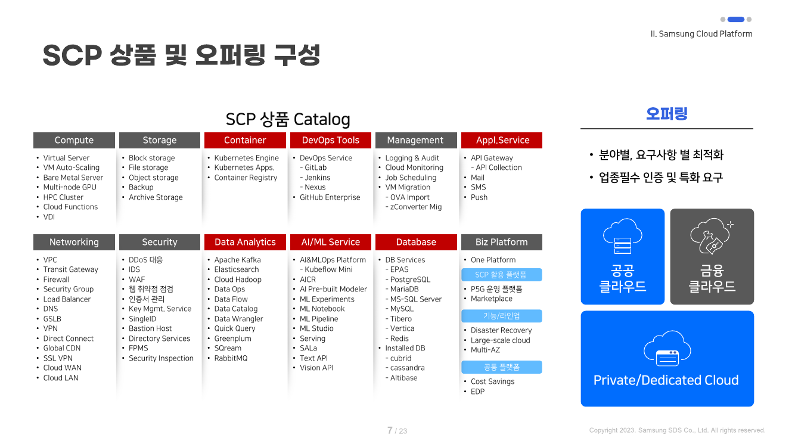
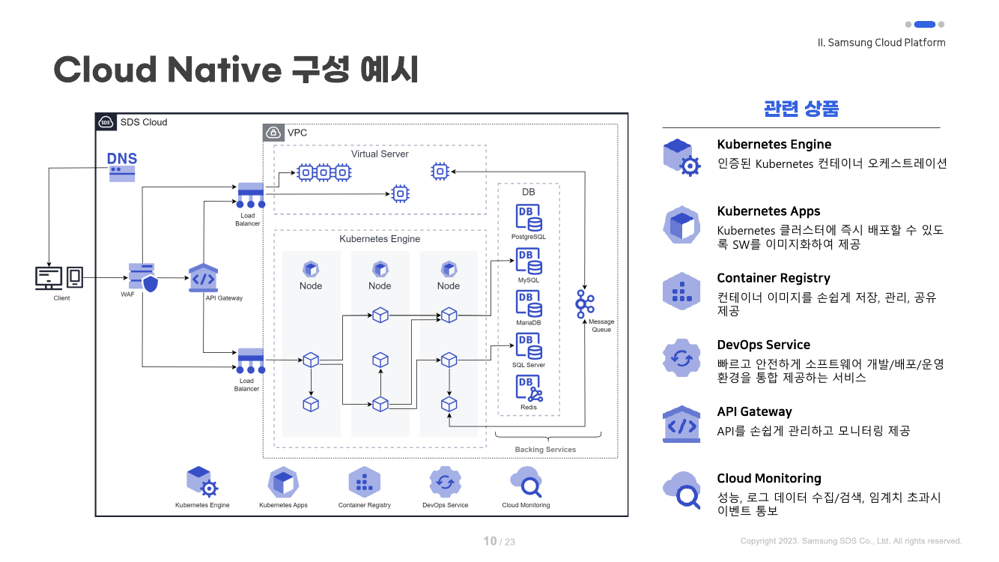
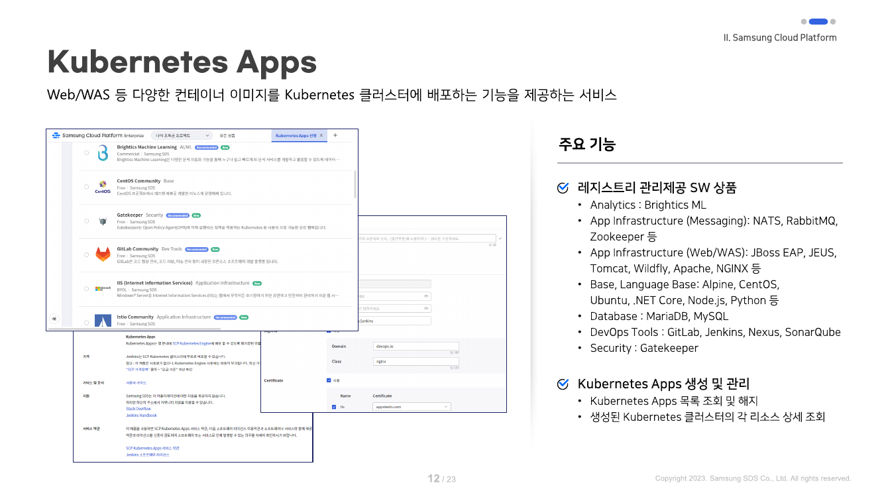
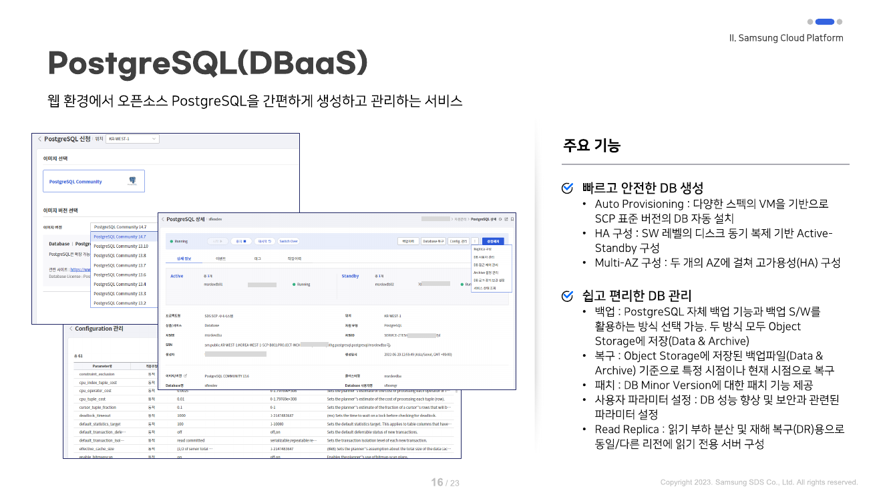
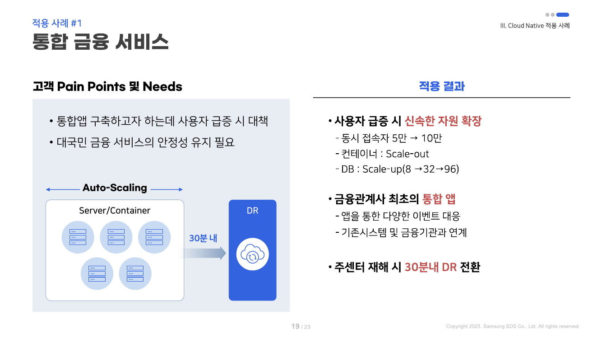
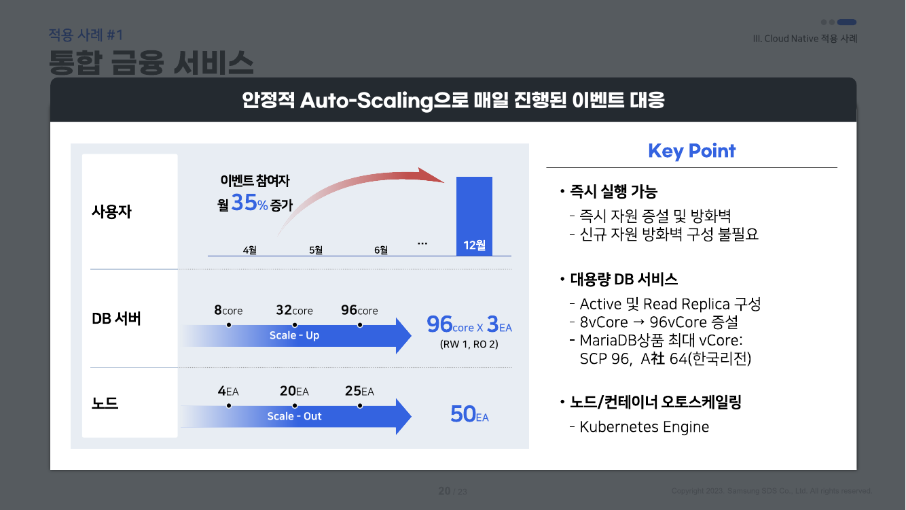
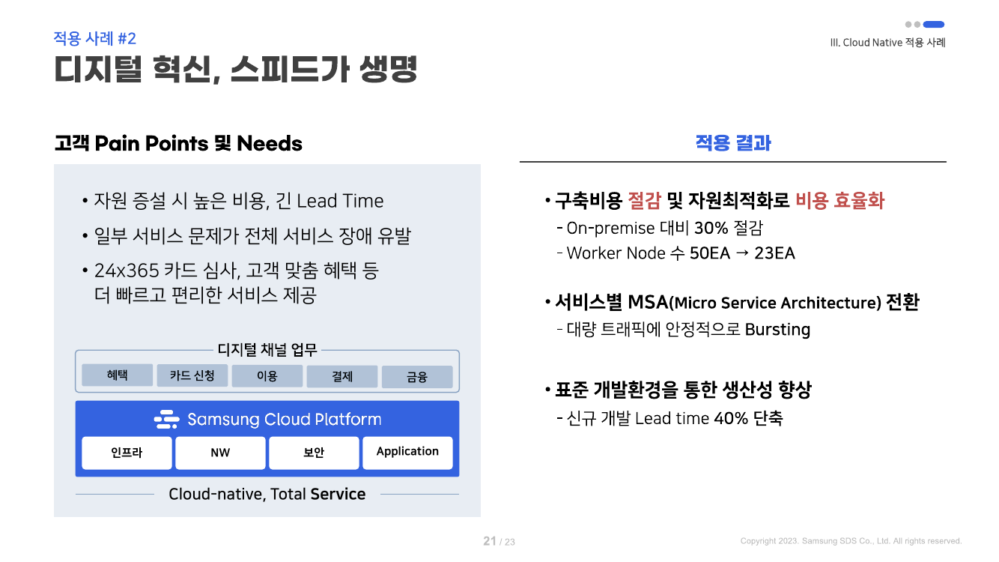
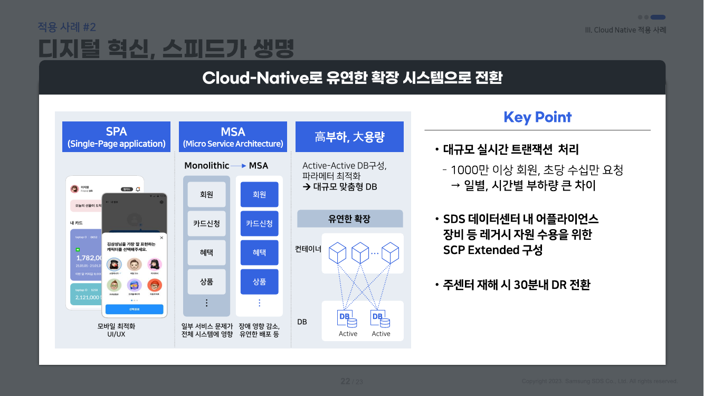
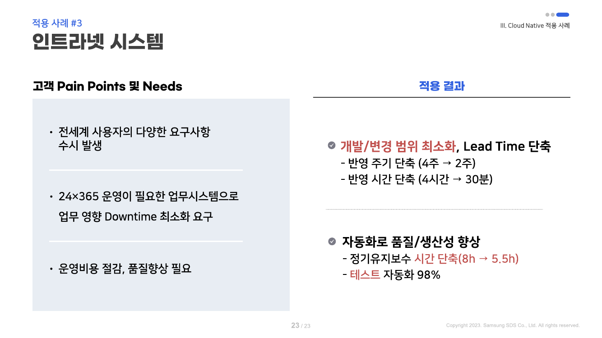

# Cloud Native와 Samsung Cloud Platform

김정민 / 기술혁신팀 PaaS그룹

Open Cloud Platform Summit 2023 2023.07.12 (수)

---
class: toc
---

  <h2>목차</h2>

  

    

      Ⅰ.
      Cloud Native 여정
    

    

      Ⅱ.
      Samsung Cloud Platform
    

    

      Ⅲ.
      Cloud Native 적용 사례
    

  

---
class: section
---

  Ⅰ
  Cloud Native 여정

---
---

# SDS의 Cloud Native 여정 <small>선제적 기술 도입 및 단계적 확장</small>

  2010년 가상화 도입부터 2023년 엔터프라이즈 AI/ML 클라우드까지 13년의 축적된 역사

| 연도 | 주요 이정표 | 핵심 기술 및 의의 |
|:---:|---|---|
| **2010** | **클라우드 / 가상화 기술 도입** | 클라우드 컴퓨팅 서비스 시작, 삼성 관계사 인프라 전환 기반 마련 |
| **2014** | **컨테이너화 아키텍처 도입** | 모놀리식에서 마이크로서비스 및 컨테이너 기반으로 구조 전환 시작 |
| **2016** | **CNCF 멤버 활동 시작** | 글로벌 클라우드 네이티브 생태계 참여 및 오픈소스 표준 연계 |
| **2017** | **국내 최초 KCSP 획득** | CNCF 공인 쿠버네티스 서비스 제공자(Kubernetes Certified Service Provider) |
| **2018** | **컨테이너 엔진 CNCF 인증** | 플랫폼(Platform) 부문 쿠버네티스 공식 적합성 인증 획득 |
| **2020** | **Gartner Magic Quadrant 등재** | 컨테이너 6,000+ 운영 역량 인정 (DCO & HIMS 부문) |
| **2021** | **Samsung Cloud Platform (SCP) 출시** | Kubernetes Engine 등 기업 전용 고보안·고성능 PaaS 본격 서비스 |
| **2022** | **Data Ops · Data Flow 출시** | 클라우드 네이티브 대용량 데이터 분석 및 스트리밍 플랫폼 확장 |
| **2023** | **Analytics · AI/ML MLOps 라인업 완비** | 엔터프라이즈 AI&MLOps 플랫폼 상품 추가로 풀스택 PaaS 완성 |

---
---

# SDS의 Cloud Native 역량 <small>기술력과 대규모 운영 경험</small>

### 📊 대규모 엔터프라이즈 운영 실적

- **K8s 클러스터 300+ 개** 자체 운영
- **컨테이너 6,000+ 개** 무중단 관리
- **공공·금융·제조 등 업무 시스템 200+ 개** 클라우드 전환
- 삼성 관계사 핵심 업무의 90% 이상 클라우드 수용

  <b>축적된 노하우:</b> 대규모 트래픽 분산, 엔터프라이즈 보안, 무중단 DR 전환 역량을 바탕으로 최고 수준의 PaaS 상품 제공

### 🧩 체계적인 Cloud Native 자산

- **Cloud Native 방법론**: 분석·설계·구축·운영 표준 가이드
- **컨테이너 아키텍처**: 표준 MSA 설계 패턴 및 템플릿
- **핵심 PaaS 오퍼링**:
  - `Kubernetes Engine` & `Kubernetes Apps`
  - `Container Registry` (보안 취약점 자동 점검)
  - `DevOps Service` (GitLab · Jenkins · Nexus 통합)
  - `DBaaS` & `Data Ops` / `Data Flow`
  - `AI&MLOps Platform` (Kubeflow 기반 머신러닝 라이프사이클)

---
class: section
---

  Ⅱ
  Samsung Cloud Platform

---
---

# Samsung Cloud Platform <small>3대 핵심 가치</small>

  지자체 · 공공 · 금융 · 기업의 디지털 경쟁력 확보를 위한 최적의 엔터프라이즈 클라우드

| 구분 | **Simple** (간편함) | **Smart** (스마트) | **Secure** (강력한 보안) |
|:---:|---|---|---|
| **핵심 가치** | **쉽고 빠르게 구성하는 클라우드** | **최신 기술 기반의 다양한 PaaS/SaaS** | **보안 기능 내재화로 안전한 환경** |
| **인프라 역량** | • 확장성 (Scalability) • 탄력성 (Elasticity) • 고성능 & 고가용성 (HA) | • Analytics & Data Ops • AI & MLOps 플랫폼 • Data Science 지원 | • 최고 수준의 보안 인증 • 공공·금융 전용 존 분리 • 24x365 관제 및 신뢰성 |
| **제공 효과** | 복잡한 인프라 관리 부담을 없애고 비즈니스 로직 개발에 집중 | 데이터 분석과 AI 모델 서빙까지 클라우드 네이티브로 원스톱 구축 | KISA 보안 인증 및 국가 규제 요건을 완벽하게 만족하는 안정성 |

  👉 인프라(IaaS)를 넘어 플랫폼(PaaS) 중심의 클라우드 전환을 가속화!

---
class: visual
---

# SCP 상품 및 오퍼링 Catalog <small>풀스택 클라우드 라인업</small>

---
---

# Samsung Cloud Platform 특장점 <small>엔터프라이즈 및 공공 최적화</small>

### 1. 글로벌 및 국내 최고 수준 인증

- **보안 및 규제 검증**:
  - CSAP (IaaS / SaaS) 공공 클라우드 보안인증
  - ISO 27001, 27017, 27018, 27701 국제 표준 인증
  - ISMS-P 정보보호 및 개인정보보호 관리체계
- **쿠버네티스 공식 인증**:
  - 국내 최초 CNCF KCSP 획득
  - K-PaaS(구 파스-타) 적합성 호환성 확인

### 2. 높은 가용성과 엔터프라이즈 안정성

- **검증된 인프라**:
  - 사내 및 삼성 관계사 200+ 시스템이 상시 운영 중
  - 최고 수준의 데이터센터 설비 및 Multi-AZ 네트워크
- **3. 강력한 보안 관제 체계**:
  - KISA 지정 보안관제 전문 인력 24x365 전담
  - 침해사고 대응, 취약점 점검 및 DDoS 방어 내재화
- **하이브리드 확장**: 기존 온프레미스 레거시 시스템과 SCP 간 전용망 연동

---
---

# SCP PaaS 핵심 라인업 <small>개발 생산성을 높이는 플랫폼 서비스</small>

| 카테고리 | 대표 상품 | 주요 역할 및 특징 |
|:---:|---|---|
| **컨테이너** | **Kubernetes Engine** | CNCF 인증 표준 K8s 클러스터 자동 생성, 관리, 오토스케일링 |
| | **Kubernetes Apps** | 검증된 오픈소스 소프트웨어를 클릭 한 번으로 K8s 위에 배포 |
| | **Container Registry** | 보안 취약점 점검이 내재화된 안전한 프라이빗 컨테이너 이미지 저장소 |
| **데브옵스** | **DevOps Service** | GitLab(형상관리) + Jenkins(CI/CD) + Nexus(아티팩트)를 통합 제공 |
| **데이터베이스** | **DB Services** | PostgreSQL, MariaDB, MySQL, Redis, Tibero 등 완전 관리형 HA DB |
| **빅데이터** | **Data Ops / Flow** | Apache Kafka, Spark, Hadoop 기반 대용량 데이터 수집·가공·분석 파이프라인 |
| **AI / ML** | **AI&MLOps Platform** | Kubeflow 기반 Notebook 개발부터 Job 훈련, 모델 서빙까지 전주기 관리 |

---
class: visual
---

# Kubernetes Engine <small>엔터프라이즈 K8s 관리 플랫폼</small>

---
---

# Kubernetes Engine <small>핵심 아키텍처 및 관리 기능</small>

### 🚀 자동화와 고가용성

- **표준 쿠버네티스 완벽 준수**: CNCF 적합성 인증 기반의 최신 Kubernetes 엔진 제공
- **Multi-AZ 마스터 고가용성**: 무중단 컨트롤 플레인 자동 구성
- **유연한 워커 노드 풀**: 일반 VM, BareMetal, Multi-node GPU 노드 풀 지원
- **스마트 오토스케일링**: HPA(Pod 확장)와 Cluster Autoscaler(노드 확장) 연동

### 🛡️ 엔터프라이즈 운영 편의성

- **통합 로깅 및 모니터링**: 클러스터 메트릭(Prometheus) 및 로그 수집 기본 제공
- **RBAC 및 멀티테넌시**: 프로젝트/네임스페이스 단위 접근 제어
- **스토리지 연동**: CSI 기반 Block/File Storage 동적 프로비저닝
- **네트워크 최적화**: VPC CNI 플러그인을 통한 고속 가상 네트워크 연동

---
class: visual
---

# Kubernetes Apps <small>원클릭 애플리케이션 카탈로그</small>

---
---

# Container Registry & DevOps Service <small>안전한 소프트웨어 공급망</small>

### 📦 Container Registry

- **초고속 프라이빗 레지스트리**: 컨테이너 이미지 안전 보관
- **보안 취약점 자동 점검**: 이미지 푸시 시 CVE 취약점 스캔
- **접근 통제**: 프로젝트별 세분화된 읽기/쓰기 권한 분리
- **수명주기 관리**: 오래된 태그 자동 정리 및 저장 공간 최적화

### 🔄 DevOps Service

- **통합 올인원 CI/CD 도구 체계**:
  - **GitLab**: 엔터프라이즈 소스코드 버전 관리
  - **Jenkins**: 유연한 빌드·테스트 자동화 파이프라인
  - **Nexus**: 라이브러리 및 패키지 아티팩트 저장소
- **K8s 배포 연동**: 빌드 완료된 이미지를 Kubernetes Engine으로 즉시 무중단 배포

---
---

# Database Services <small>완전 관리형 클라우드 DB</small>

  고가용성 아키텍처와 자동 백업으로 엔터프라이즈 데이터의 무결성과 비즈니스 연속성 보장

| 구분 | 핵심 내용 |
|:---:|---|
| **지원 엔진** | **PostgreSQL**, **MariaDB**, **MySQL**, **Redis**, **MS-SQL**, **EPAS**, **Tibero** 등 |
| **고가용성 (HA)** | Active-Standby 이중화 및 장애 발생 시 수초 이내 자동 Failover 수행 |
| **읽기 부하 분산** | 대규모 트래픽 처리를 위한 다중 Read Replica 구성 지원 (동일/원격 리전) |
| **백업 & 복원** | 일일 자동 백업 및 특정 시점 복원(PITR, Point-In-Time Recovery) 완벽 지원 |
| **자동 패치** | 보안 취약점 및 DB 마이너 버전에 대한 무중단 유지보수 패치 제공 |

---
class: visual
---

# AI & MLOps Platform <small>Kubeflow 기반 머신러닝 라이프사이클</small>

---
class: section
---

  Ⅲ
  Cloud Native 적용 사례

---
class: visual
---

# 사례 1: 통합 금융 서비스 <small>대규모 이벤트 및 트래픽 폭증 대응</small>

---
class: visual
---

# 사례 1: 통합 금융 서비스 <small>안정적 Auto-Scaling 아키텍처</small>

---
class: visual
---

# 사례 2: 디지털 혁신, 스피드가 생명 <small>카드사 MSA 전면 전환</small>

---
class: visual
---

# 사례 2: 디지털 혁신, 스피드가 생명 <small>Monolithic에서 MSA로</small>

---
class: visual
---

# 사례 3: 글로벌 인트라넷 시스템 <small>배포 리드타임 단축 및 무중단 운영</small>

---
---

# Wrap-up <small>Cloud Native 성공을 위한 3대 핵심</small>

### 📌 엔터프라이즈 전환 3대 축

1. **플랫폼 중심 표준화 (Platform-first)** 
   개별 인프라 구축 대신 검증된 K8s PaaS를 통해 운영 복잡도 대폭 제거
2. **아키텍처 현대화 (Microservices)** 
   컨테이너화와 MSA 분리를 통해 대규모 트래픽 탄력 대응 및 배포 주기 혁신
3. **선제적 신뢰성 확보 (Resilience & Security)** 
   Multi-AZ, 자동 Failover, 30분 이내 DR 전환 체계 내재화

### 💡 Samsung Cloud Platform

- **검증된 파트너**: 수백 개 핵심 관계사 시스템 운영을 통해 입증된 안정성
- **풀스택 라인업**: 컨테이너, 데브옵스, DB, 빅데이터부터 MLOps까지 원스톱 제공
- **지속 가능한 혁신**: 고객사의 디지털 비즈니스 혁신을 가장 빠르고 안전하게 가속화

  감사합니다! 👏

