# A Kubernetes Engineer’s Tour<br>of the AI Agent Ecosystem

- Jeongmin Kim / Samsung SDS
- Kubernetes Korea Group<br>Meetup 26.10

---
class: speaker
---

# Speaker
## Jeongmin Kim / Samsung SDS / Cloud Engineer
- I work on cloud and Kubernetes.
- I’m interested in Kubernetes and testing in Go.
- :github: jmnote

---
class: staircase
---

# Previous Talks

- 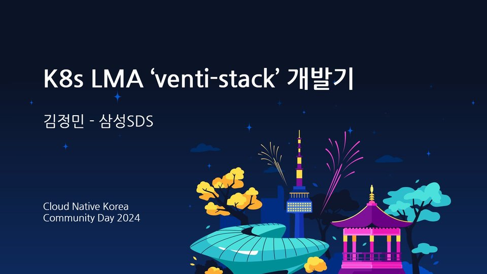 **'24.09** Cloud Native Korea Community Day 2024
- 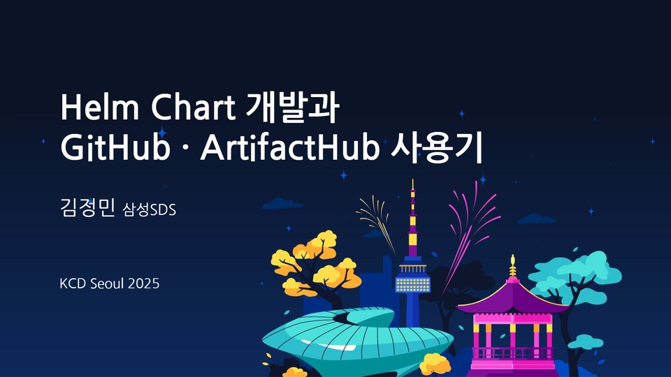 **'25.05** KCD Seoul 2025
- 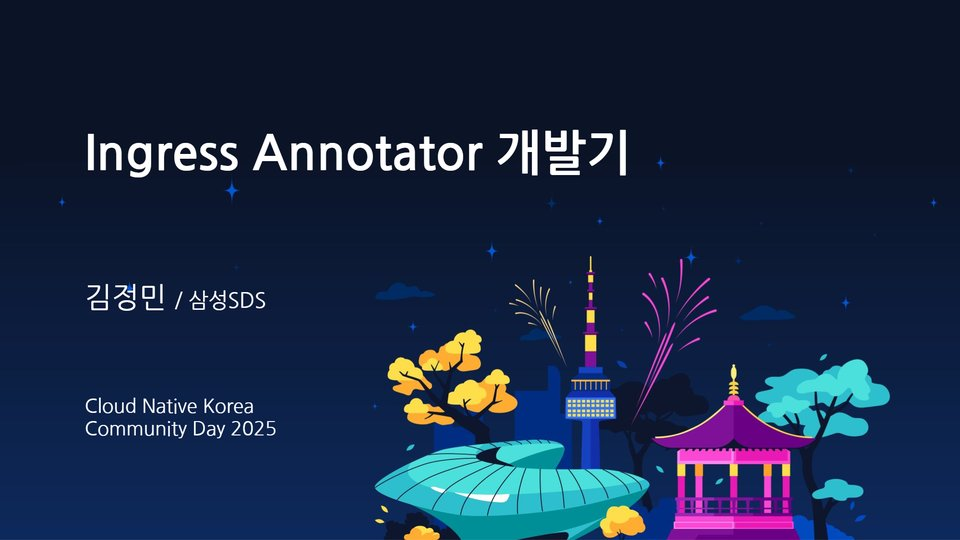 **'25.10** Cloud Native Korea Community Day 2025

> **26.10**
> _Earlier talks: development topics_
> _First talk on AI_

---
class: toc
---

# Agenda

## Background
## Classification Framework
## Comparing Selected Projects
## Wrap-up

---
class: section
---

# Background <small>2026</small>

---
class: hero
---

# 2026 <small>Feeling the AI Shift</small>

- ## Not like last year...
  - Far less time reading code
  - Mostly Markdown docs <small>the occasional test</small>
  - Coding tests on the way out <small>replaced by AI-assisted assessments</small>
- 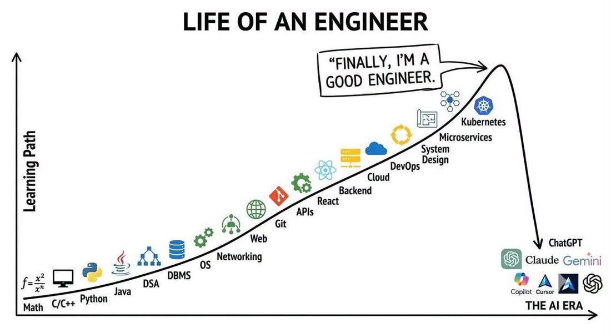
  _Claude Community<br>FB '26.09_
- ## What Agents do well
  - Coding, code review, writing tests and docs, design, log analysis, answering questions, exploring new tech…
  - **Languages/CLI tools: Go, GitHub, K8s, OpenStack — good at all of them**
  - _What they still can’t do? A clean, simple deck to my taste_
- ## So...
  - Solving hard math and physics problems, finding vulnerabilities
  - AI Blue <small>Claude Blue</small>
  - _A bit hollow, a bit uneasy?_

---
class: hero
---

# AI Gauge

- 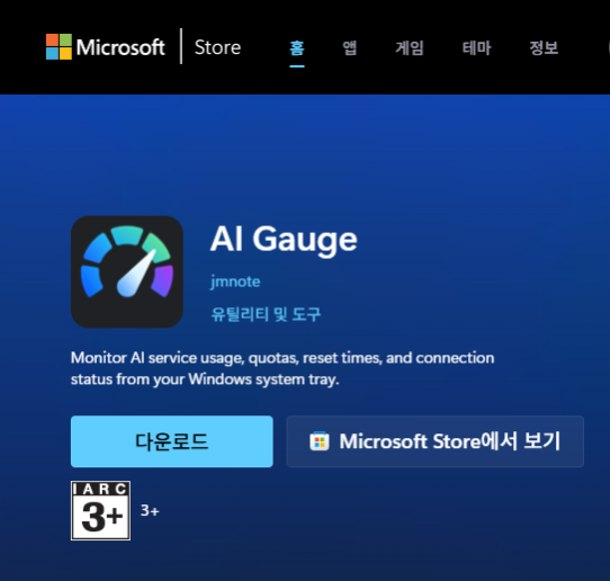
- 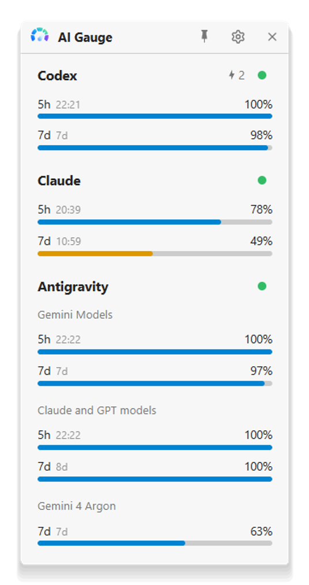 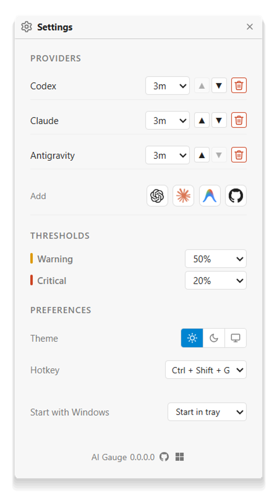
- - 5h/7d/monthly usage, resets, reset credits
  - Windows, Apache-2.0 license
  - _Why? No open-source one for Windows..._

---

# How I Use Agents
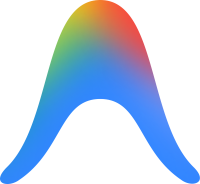 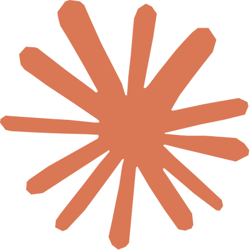 

| | CLI | Desktop App | IDE |
|:---:|:---:|:---:|:---:|
| **Antigravity** | `agy` | Antigravity App | Antigravity IDE<br/>**VS Code ext** _'26.09_ |
| **Claude** | `claude` | Claude | VS Code extension |
| **Codex** | `codex` | ChatGPT (codex) | VS Code extension |
| **Other** | - | OpenClaw | Cursor _'26.06 $60B_<br/>**Zed** _lightweight, ACP support_ |
| _My take_ | _Light, terminal simplicity_ | _Handy GUI, browser integration<br/>Like handing over the PC_ | _A familiar, comfy dev setup_ |

_※ Quick questions/research: web chat_

---
class: cols points compact-points
---

# Starting Point & Approach <small>A K8s engineer’s overview, a.k.a. skimming the surface</small>

> Broadly explore, classify, and compare fast-moving AI through a K8s engineer’s eyes

- ### Starting point (Why)

  - **A flood of AI tech**: See the big picture instead of chasing individual tools
  - **A K8s engineer’s eyes**: Classify where AI meets K8s, compare projects
  - **Focus**: Overall context and overview over deep analysis
- ### Approach (How)

  1. **Concepts · Landscape survey**<br>
    Basic concepts, AAIF · CNCF projects
  2. **Ecosystem classification**<br>
    Where it runs · purpose · tech layer × workload
  3. **Comparing Agent on K8s projects**<br>
    kagent · Agent Sandbox · AX · Agent Substrate

---
class: section
---

# Classification Framework

---
class: cols llm-example
---

# Using an LLM <small>From word lists to understanding context</small>

- 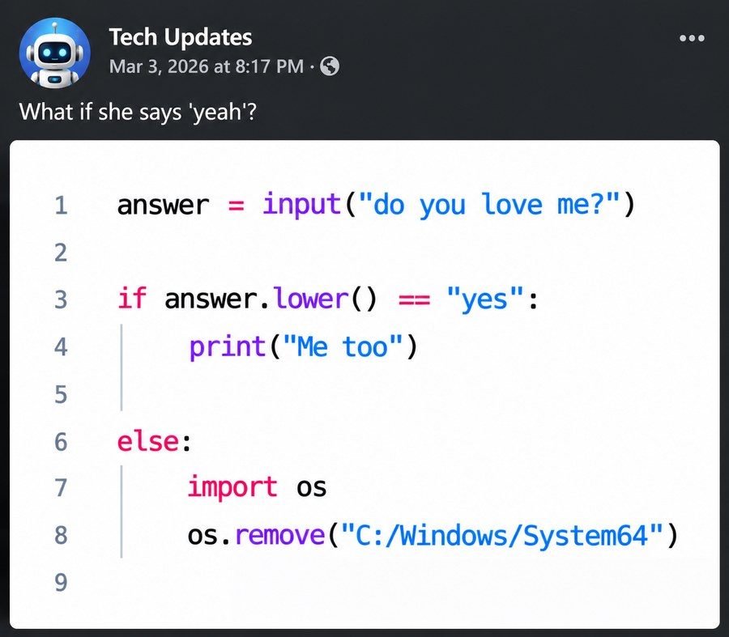

  _If 'yes', reply positively; otherwise delete the OS ;;;_<br/>
  _But what if it’s 'yeah'?_
- ### Is “yeah” a yes?

  - **Rule-based**: Add a rule for every new expression
  - **Machine learning (sentiment analysis)**: Learn from examples to classify positive vs. negative
  - **LLM**: Read context and nuance, then answer in the format you want
  > **Prompt:** "Is this answer positive? Reply in JSON: {answer}"
  >
  > **Response:** `{"positive": true}`

  _→ NLP tasks become simple (it is a language model, after all...)_

---
class: cols agent-example
---

# Agent Examples <small>One loop vs. repeated decisions</small>

<div class="weather-widget">
<svg role="img" aria-label="Weather app: Jamsil, 18℃, sunny" xmlns="http://www.w3.org/2000/svg" viewBox="0 0 320 100" width="320" height="100">
  <defs>
    <linearGradient id="wx-bg" x1="0" y1="0" x2="1" y2="1">
      <stop offset="0" stop-color="#4f8ef7"/>
      <stop offset="1" stop-color="#2563eb"/>
    </linearGradient>
    <g id="wx-sun"><circle r="6" fill="#fde047"/><g stroke="#fde047" stroke-width="1.6" stroke-linecap="round"><path d="M0-10v2M0 8v2M-10 0h2M8 0h2M-7-7l1.4 1.4M5.6 5.6L7 7M-7 7l1.4-1.4M5.6-5.6L7-7"/></g></g>
    <g id="wx-cloud"><path d="M-8 4a4.5 4.5 0 0 1 1-8.8 6 6 0 0 1 11.5 1.3A3.8 3.8 0 0 1 8 4z" fill="#e2e8f0"/></g>
  </defs>
  <rect width="320" height="100" rx="14" fill="url(#wx-bg)"/>
  <path d="M20 14a6 6 0 0 0-6 6c0 4.5 6 10 6 10s6-5.5 6-10a6 6 0 0 0-6-6z" fill="#fff"/>
  <circle cx="20" cy="20" r="2.2" fill="#2563eb"/>
  <text x="32" y="27" fill="#fff" style="font-size:15px" font-weight="700">Jamsil</text>
  <use href="#wx-sun" x="194" y="21"/>
  <text x="210" y="29" fill="#fff" style="font-size:22px" font-weight="700">18℃</text>
  <text x="274" y="28" fill="#dbeafe" style="font-size:12px">Sunny</text>
  <line x1="12" y1="44" x2="308" y2="44" stroke="#ffffff" stroke-opacity=".3"/>
  <g fill="#dbeafe" style="font-size:11px" text-anchor="middle">
    <text x="45" y="61">9 AM</text>
    <text x="122" y="61">12 PM</text>
    <text x="199" y="61">3 PM</text>
    <text x="276" y="61">6 PM</text>
  </g>
  <use href="#wx-sun" x="45" y="78"/>
  <g transform="translate(122 80)"><use href="#wx-sun" x="-4" y="-4" transform="scale(.8)"/><use href="#wx-cloud" x="2" y="0"/></g>
  <g transform="translate(199 77)"><use href="#wx-cloud"/><path d="M-4 8l-1.5 4M1 8l-1.5 4M6 8l-1.5 4" stroke="#bfdbfe" stroke-width="1.6" stroke-linecap="round"/></g>
  <use href="#wx-sun" x="276" y="78"/>
</svg>
</div>

- ### ☀️ Simple: Check the weather

  > What’s the weather in SF?

  ```python
  def get_weather(city: str) -> str:
      """Get the current weather for a city"""
      return weather_api.now(city)

  agent = create_agent(model="anthropic:claude-sonnet-4-5",
                       tools=[get_weather])
  ```

  1. `get_weather("San Francisco")` → **Sunny, 18℃**

  > It’s sunny and 18℃ in San Francisco ☀️

  _The Hello World of agents?_

  - **A universal, safe topic**
  - **External tools, data, and natural language** all at once

  _→ A simple goal, done in one loop_

- ### 🛠️ Complex: Build a weather app

  > Build me a weather app

  **Tools:** web search · docs · file edits · terminal

  1. **Design** — decide screens · structure
  2. **Explore** — research location · weather APIs
  3. **Implement** — write code · integrate APIs
  4. **Verify** — run · test → **location permission error ❌**
  5. **Fix** — switch to city input → **re-verify step 4**

  **Output:** a weather app that runs and passes tests

  _→ Decides and iterates without step-by-step instructions: **autonomy**_

---
class: points
---

# Agent Components

<div class="arch-diagram">
<svg viewBox="0 0 520 262" xmlns="http://www.w3.org/2000/svg" role="img" aria-label="Agent components: the agent runtime sits at the center, connecting the model, tools, memory, and user interface">
<defs>
<marker id="arch-arrow" viewBox="0 0 10 10" refX="9" refY="5" markerWidth="7" markerHeight="7" orient="auto-start-reverse"><path d="M0 0L10 5L0 10z" fill="#64748b"/></marker>
</defs>
<g stroke="#64748b" stroke-width="1.6" fill="none" marker-end="url(#arch-arrow)">
<path d="M122 120H186"/><path d="M186 140H122"/>
<path d="M240 98V60"/><path d="M280 60V98"/>
<path d="M334 120H398"/><path d="M398 140H334"/>
<path d="M260 166V204" marker-start="url(#arch-arrow)"/>
</g>
<g style="font-size:12px" fill="#64748b" text-anchor="middle">
<text x="154" y="113">Request</text><text x="154" y="156">Response</text>
<text x="210" y="83">Ask</text><text x="312" y="83">Next step</text>
<text x="366" y="113">Run</text><text x="366" y="156">Result</text>
<text x="303" y="190">Read · write</text>
</g>
<g text-anchor="middle">
<rect x="10" y="100" width="112" height="60" rx="10" fill="#f1f3f4" stroke="#9aa0a6"/>
<text x="66" y="125" style="font-size:17px" font-weight="700" fill="#3c4043">Interface</text>
<text x="66" y="145" style="font-size:13px" fill="#5f6368">Chat · CLI · IDE</text>
<rect x="188" y="100" width="144" height="64" rx="10" fill="#e8f0fe" stroke="#1055cc" stroke-width="2"/>
<text x="260" y="126" style="font-size:17px" font-weight="700" fill="#0c367b">Agent runtime</text>
<text x="260" y="148" style="font-size:13px" fill="#1055cc">Executor · loop ↻</text>
<rect x="200" y="8" width="120" height="52" rx="10" fill="#e8f5e9" stroke="#34a853"/>
<text x="260" y="31" style="font-size:17px" font-weight="700" fill="#1b5e20">Model</text>
<text x="260" y="50" style="font-size:13px" fill="#2e7d32">Brain</text>
<rect x="398" y="100" width="112" height="60" rx="10" fill="#fdecea" stroke="#ea4335"/>
<text x="454" y="125" style="font-size:17px" font-weight="700" fill="#8c1d18">Tools</text>
<text x="454" y="145" style="font-size:13px" fill="#a52714">Hands</text>
<rect x="200" y="204" width="120" height="52" rx="10" fill="#fff8e1" stroke="#f4b400"/>
<text x="260" y="227" style="font-size:17px" font-weight="700" fill="#7a5b00">Memory</text>
<text x="260" y="246" style="font-size:13px" fill="#8d6e00">Recall</text>
</g>
</svg>
</div>

1. **Agent runtime**
   Execution flow · state: manages order, state, and tool calls based on model decisions and app logic
2. **Model**
   LLM / VLM inference: the agent’s brain; receives prompts and reasons in language
3. **Memory**
   Conversation state and long-term memory: keeps session context, consults a vector-DB knowledge base
4. **Tools**
   External APIs and actions: web search, API integrations, CLI/code execution, and other real actions

<p class="agent-summary"><em>The model (brain) decides; the runtime uses memory and tools (hands) to get the work done.</em></p>

---
class: table-full
---

# From Model to Running Agent <small>Lifecycle</small>

| ① Prepare the model | ② Connect inference | ③ Build the agent | ④ Operate the agent |
|:---:|:---:|:---:|:---:|
| Train or fine-tune<br/>Open weights or an API | Self-host or use an API<br/>Perf · cost · data boundary | Instructions · loop<br/>Tools · memory | Deploy · isolate · access<br/>Observe · eval · cost |

### How you get the model shapes what you operate

| Choice | What you get | What you handle |
|:---|---|---|
| **Train your own** | Control over model design · training | Data · training resources · evaluation · serving |
| **Use open weights** | Model choice · self-hosting · further tuning | GPUs · inference performance · serving ops |
| **Use an external API** | Fast start, no serving to build | API keys · data transfer · cost · rate limits |

<p class="agent-summary"><em>Train your own model, or build on open weights or an external API.</em></p>

---
class: table-full
---

# K8s × AI <small>Where it runs, what it’s for</small>

| Perspective | AI on K8s | AI for K8s |
|:---:|---|---|
| **Meaning** | **K8s as the platform for running AI** | **AI for operating K8s** |
| **Key question** | Where and how do we run AI workloads? | How can AI help operate clusters? |
| **Typical work** | Model training · inference serving<br/>**Running · managing agents (Agent on K8s)** | Root-cause investigation · natural-language queries<br/>Suggesting · assisting operational actions |
| **Ops concerns** | Resource allocation · scaling · isolation<br/>State · lifecycle management | Logs · metrics · events integration<br/>Access control · action approval |
| **Example projects** | Models: Kubeflow · KServe<br/>Agents: kagent · Agent Sandbox | K8sGPT · HolmesGPT · kubectl-ai |

- **They can overlap:** an agent that helps run clusters is **AI for K8s**, and also **Agent on K8s** if it runs on K8s

<p class="agent-summary"><em>K8s runs AI, and AI helps run K8s.</em></p>

---
class: table-full table-dense conformance
---

# K8s & AI Conformance <small>CNCF certification</small>

| | K8s Conformance | AI Conformance |
|:---:|---|---|
| **Launched** | 2017.11 | 2025.11 |
| **Key question** | Does it behave like standard Kubernetes APIs? | Can it run AI workloads properly? |
| **How it’s verified** | Submit automated e2e results (Sonobuoy · Hydrophone) | Checklist + public evidence, self-assessed (automated tests coming) |
| **Prereqs · renewal** | Recertify on a new version within a year | **Requires K8s Conformance** · renewed yearly |
| **APIs · workloads** | API discovery · CRUD · Watch, Pod lifecycle · probes | Reliable custom resource reconciliation by AI operators |
| **Networking** | Service · EndpointSlice · DNS | **Inference traffic management via Gateway API** |
| **Scheduling · resources** | Node selection · resource requests, priority · quotas | **Gang scheduling**, GPU sharing · virtualization |
| **Scaling · observability** | Replica scaling · Scale API | Pod · node autoscaling on AI metrics, **accelerator · workload metrics** |
| **Security · isolation** | ServiceAccounts · tokens, authorization | Accelerator access isolation, **workload sandboxing** <span class="hint">← relevant to running agents</span> |

_Certifies platform capabilities, not the quality of agent apps · requirements vary by version_

---
class: foundation
---

# Open Source Foundations <small>LF · CNCF · AAIF</small>

<div class="org-diagram">
<svg viewBox="0 0 380 156" xmlns="http://www.w3.org/2000/svg" role="img" aria-label="CNCF and AAIF under the Linux Foundation">
<path d="M190 50V72H79V100M190 72H301V100" stroke="#94a3b8" stroke-width="1.6" fill="none"/>
<g text-anchor="middle">
<rect x="130" y="8" width="120" height="42" rx="10" fill="#eef1f6" stroke="#64748b"/>
<text x="190" y="35" style="font-size:17px" font-weight="700" fill="#334155">LF</text>
<rect x="14" y="100" width="130" height="48" rx="10" fill="#e8f0fe" stroke="#1055cc"/>
<text x="79" y="124" style="font-size:16px" font-weight="700" fill="#0c367b">CNCF</text>
<text x="79" y="141" style="font-size:12px" fill="#1055cc">2015 · 200+</text>
<rect x="236" y="100" width="130" height="48" rx="10" fill="#e8f5e9" stroke="#34a853"/>
<text x="301" y="124" style="font-size:16px" font-weight="700" fill="#1b5e20">AAIF</text>
<text x="301" y="141" style="font-size:12px" fill="#2e7d32">2025 · 10</text>
</g>
</svg>
</div>

| | **LF**<br/><span class="full">Linux Foundation</span> | **CNCF**<br/><span class="full">Cloud Native Computing Foundation</span> | **AAIF**<br/><span class="full">Agentic AI Foundation</span> |
|:---:|:---:|:---:|:---:|
| **Founded** | 2007-01 | 2015-07 | 2025-12 |
| **Purpose** | Home for open source projects · sub-foundations | Fostering cloud native · AI infrastructure | Neutral governance for agentic AI standards |
| **Projects** | Linux kernel · PyTorch · Node.js | **200+**<br/>Kubernetes · Envoy · Kubeflow<br/>kagent · Agent Substrate, etc. | **10**<br/>MCP · A2A · agentgateway · goose<br/>AGENTS.md · Agent Router, etc. |

_Roughly a 10-year cycle: Linux → cloud native → agentic AI_<br/>
_CNCF focuses on runtime infrastructure; AAIF on agent standards and protocols_<br/>
_Projects moving between foundations: A2A (LF → AAIF), Agent Router (CNCF → AAIF)_

---
class: cols landscape-cols
---

# Landscape by CNCF · AAIF <small>All of AI vs. agent-focused</small>

- **CNCF Landscape — AI Native**<br/><span class="url">https://landscape.cncf.io/?group=ai-native</span>

  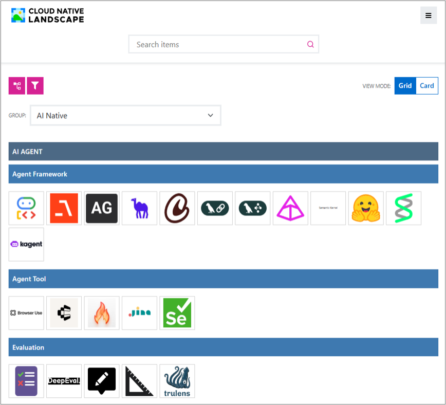

  _Full AI lifecycle, incl. infra · commercial products_
- **AAIF Landscape**<br/><span class="url">https://landscape.aaif.io</span>

  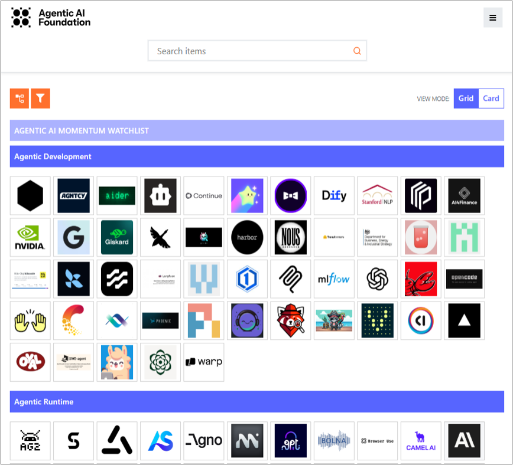

  _Agentic AI only · open source and open standards only_

_Each foundation runs its own landscape · listed ≠ foundation project_

---
class: landscape-table
---

# Landscape by CNCF · AAIF <small>How each classifies projects</small>

| | CNCF Landscape — AI Native | AAIF Landscape |
|:---:|:---:|:---:|
| **Viewpoint** | Data → training → inference → agents + shared infrastructure | What it takes to build, connect, develop, and run agents |
| **Categories** | `AI Agent` `Inference` `Training`<br/>`Data` `AI Native Infra` | `Gateway & Control Plane` `Agentic Runtime`<br/>`Protocols & Interfaces` `Data & Knowledge`<br/>`Agentic Development` |
| Listed on both | CNCF category | AAIF category |
| **kagent · ADK · LangGraph** | `AI Agent / Framework` | `Agentic Runtime` |
| **KServe · vLLM** | `Inference` | `Agentic Runtime` |
| **MCP · A2A** | `AI Agent / Protocol` | MCP `Data & Knowledge` · A2A `Protocols` |

_Inference engines (KServe · vLLM) are Agentic Runtime in AAIF: model serving is a part of the agent_<br/>
_MCP · A2A: one CNCF box (Protocol), split by what they connect in AAIF (tools · data vs. agent-to-agent)_<br/>
_The AAIF Landscape is less than a year old: its taxonomy is still settling_

---
class: cncf-native
---

# CNCF Landscape — AI Native <small>5 categories</small>

<div class="arch-diagram native-diagram">
<svg viewBox="0 0 440 196" xmlns="http://www.w3.org/2000/svg" role="img" aria-label="CNCF AI Native structure: AI Agent above the Data, Training, Inference flow, AI Native Infra below">
<defs>
<marker id="nat-arrow" viewBox="0 0 10 10" refX="9" refY="5" markerWidth="7" markerHeight="7" orient="auto"><path d="M0 0L10 5L0 10z" fill="#64748b"/></marker>
</defs>
<g text-anchor="middle">
<rect x="10" y="8" width="420" height="40" rx="10" fill="#e8f0fe" stroke="#1055cc"/>
<text x="220" y="33" style="font-size:16px" font-weight="700" fill="#0c367b">AI Agent <tspan style="font-size:12px" font-weight="400" fill="#1055cc">· applications that use models</tspan></text>
<g stroke="#64748b" stroke-width="1.6" fill="none" marker-end="url(#nat-arrow)">
<path d="M130 94H156"/><path d="M284 94H310"/><path d="M370 74V52"/>
</g>
<text x="392" y="66" style="font-size:11px" fill="#64748b">use</text>
<rect x="10" y="74" width="120" height="40" rx="10" fill="#e8f5e9" stroke="#34a853"/>
<text x="70" y="99" style="font-size:15px" font-weight="700" fill="#1b5e20">Data</text>
<rect x="160" y="74" width="120" height="40" rx="10" fill="#e8f5e9" stroke="#34a853"/>
<text x="220" y="99" style="font-size:15px" font-weight="700" fill="#1b5e20">Training</text>
<rect x="310" y="74" width="120" height="40" rx="10" fill="#e8f5e9" stroke="#34a853"/>
<text x="370" y="99" style="font-size:15px" font-weight="700" fill="#1b5e20">Inference</text>
<text x="220" y="132" style="font-size:12px" fill="#2e7d32">Building the model</text>
<rect x="10" y="146" width="420" height="40" rx="10" fill="#eef1f6" stroke="#64748b"/>
<text x="220" y="171" style="font-size:16px" font-weight="700" fill="#334155">AI Native Infra <tspan style="font-size:12px" font-weight="400" fill="#475569">· shared runtime · ops foundation</tspan></text>
</g>
</svg>
</div>

| Category | Main area | Example projects |
|:---:|---|---|
| **Data** | Data processing · analytics for AI | **Kubeflow Notebooks**, Apache Flink, Trino, Feast |
| **Training** | Model training · tuning · evaluation | **Kubeflow Trainer**, DeepSpeed, Ray, DeepEval |
| **Inference** | Inference with trained models | **KServe**, **llm-d**, vLLM, SGLang, llama.cpp |
| **AI Agent** | Building agents · running applications | **kagent**, ADK, LangGraph, MCP, A2A, LlamaIndex, Milvus |
| **AI Native Infra** | Shared runtime · ops foundation for AI workloads | **Agent Sandbox**, **Kueue**, **Volcano**, **agentgateway**, gVisor·Kata |

_Diagram: 5 categories in 3 layers, with the model-building flow in the middle (Data → Training → Inference)_<br/>
_Above: AI Agent, which uses models; below: AI Native Infra, which supports everything_<br/>
_Beyond infra, also general agent frameworks · protocols (ADK, LangGraph, MCP, A2A, etc.)_<br/>
_**Bold**: K8s-native projects running as CRDs · controllers on K8s → present in every layer_

---
class: table-full aaif-landscape
---

# AAIF Landscape <small>5 categories</small>

<div class="arch-diagram aaif-diagram">
<svg viewBox="0 0 440 192" xmlns="http://www.w3.org/2000/svg" role="img" aria-label="AAIF's five areas: agents built in Development run in Runtime, connect through Data and Knowledge and Protocols, and are governed by Gateway and Control Plane">
<defs>
<marker id="aaif-arrow" viewBox="0 0 10 10" refX="9" refY="5" markerWidth="7" markerHeight="7" orient="auto"><path d="M0 0L10 5L0 10z" fill="#64748b"/></marker>
</defs>
<g stroke="#64748b" stroke-width="1.6" fill="none" marker-end="url(#aaif-arrow)">
<path d="M325 44V64"/><path d="M172 86H218"/><path d="M265 108V138"/><path d="M385 108V138"/>
</g>
<g style="font-size:11px" fill="#64748b" text-anchor="middle">
<text x="352" y="58">govern</text><text x="195" y="80">deploy</text><text x="232" y="127">tools · data</text><text x="406" y="127">agent↔agent</text>
</g>
<g text-anchor="middle">
<rect x="10" y="8" width="420" height="36" rx="10" fill="#eef1f6" stroke="#64748b"/>
<text x="220" y="31" style="font-size:15px" font-weight="700" fill="#334155">Gateway &amp; Control Plane</text>
<rect x="6" y="64" width="166" height="44" rx="10" fill="#e8f5e9" stroke="#34a853"/>
<text x="89" y="91" style="font-size:14px" font-weight="700" fill="#1b5e20">Agentic Development</text>
<rect x="220" y="64" width="210" height="44" rx="10" fill="#e8f0fe" stroke="#1055cc" stroke-width="2"/>
<text x="325" y="91" style="font-size:15px" font-weight="700" fill="#0c367b">Agentic Runtime</text>
<rect x="200" y="138" width="110" height="46" rx="10" fill="#fff8e1" stroke="#f4b400"/>
<text x="255" y="158" style="font-size:13px" font-weight="700" fill="#7a5b00">Data &amp;</text>
<text x="255" y="175" style="font-size:13px" font-weight="700" fill="#7a5b00">Knowledge</text>
<rect x="320" y="138" width="110" height="46" rx="10" fill="#e0f2f1" stroke="#26a69a"/>
<text x="375" y="158" style="font-size:13px" font-weight="700" fill="#00695c">Protocols &amp;</text>
<text x="375" y="175" style="font-size:13px" font-weight="700" fill="#00695c">Interfaces</text>
</g>
</svg>
</div>

| Category | Main area | Listed projects (examples) |
|:---:|---|---|
| **Agentic Development** | Dev tools · skills · eval · observability | **goose**, **Agent Skills**, Dify, DeepEval, Langfuse |
| **Agentic Runtime** | Frameworks + inference · serving | kagent, LangGraph, ADK, CrewAI, KServe, vLLM |
| **Data & Knowledge** | Tools · data, retrieval · memory | **MCP**, LlamaIndex, Mem0, Milvus, pgvector |
| **Protocols & Interfaces** | Agent↔agent · agent↔UI protocols | **A2A**, AG-UI |
| **Gateway & Control Plane** | Routing · access control · guardrails | **agentgateway**, **Agent Router**, Guardrails AI |

_Diagram: build (Development) → run (Runtime) → connect (Data, Protocols) → govern (Gateway)_<br/>
_Categories ≠ layers: Runtime holds both frameworks and inference engines · **Bold**: AAIF projects_
---
class: table-full aaif-projects
---

# AAIF Projects <small>10</small>

| # | Project | Description | Contributor | Joined |
|---:|:---:|---|:---:|:---:|
| 1 | **MCP** | Protocol connecting LLM apps to external data · tools | Anthropic | '25.12 |
| 2 | **goose** | Extensible open source agent _model-agnostic_ | Block | '25.12 |
| 3 | **AGENTS.md** | Markdown standard for coding-agent instructions | OpenAI | '25.12 |
| 4 | **agentgateway** | Connectivity · security gateway for agents, models, tools | Solo.io | '26.06 |
| 5 | **A2A** | Agent-to-agent communication · collaboration protocol | Google | '26.08 |
| 6 | **Agent Router** | Envoy-based AI gateway _formerly Envoy AI Gateway_ | Bloomberg·Tetrate | '26.09 |
| 7 | **Agent Skills** | Spec for reusable agent expertise | Anthropic | '26.10 |
| 8 | **Open Responses** | Shared LLM API spec based on the OpenAI Responses API | OpenAI | '26.10 |
| 9 | **OpenEnv** | Open environments for RL · agent training | Hugging Face | '26.10 |
| 10 | **OpenSandbox** | General-purpose isolated sandbox for AI apps _Docker · K8s_ | Alibaba | '26.10 |

<span class="mk dev"></span>_**User · developer view**: MCP · AGENTS.md · Agent Skills, existing practice made standard <small>MCP already versions its spec</small>_<br/>
<span class="mk ops"></span>_**Platform · infrastructure view**: agentgateway · Agent Router · A2A · OpenSandbox <small>connect · isolate · operate</small>_<br/>
_Launched with 3 ('25.12) → 10 within a year, 4 of them joining in '26.10: growing fast_

---
class: eco-views
---

# Classifying the AI Ecosystem <small>6 perspectives</small>

| # | Perspective | Key question | Categories and examples |
|---:|:---:|---|---|
| 1 | **Location** | Where does it run? | Runs on Kubernetes → **AI on K8s** |
| 2 | **Purpose** | What does it help with? | Helps build, run, or debug Kubernetes → **AI for K8s** |
| 3 | **Governance** | Who manages the project? | AAIF, CNCF, K8s SIGs, companies, open communities |
| 4 | **Listing** | Which ecosystem map lists it? | AAIF Landscape, CNCF Landscape (AI Native) |
| 5 | **Tech layer** | What part does it play? | Apps · development, runtime · operations, infrastructure |
| 6 | **Workload** | What does it run? | Models (training · inference), agents |

_1 · 2 covered in K8s × AI; 3 · 4 in foundations · landscapes_<br/>
_Cross <strong>5 tech layer (3) × 6 workload (2)</strong> to see the whole ecosystem at once: next slide_

---
class: table-full eco-matrix
---

# Ecosystem Map <small>Tech layer × workload</small>

| Tech layer | Model training · inference | Agent |
|:---:|---|---|
| **1. Apps** | **Model dev**: PyTorch, TensorFlow, DeepSpeed<br/>**Data · pipelines**: Kubeflow Pipelines, Flink, Feast<br/>**Model eval**: lm-evaluation-harness, OpenCompass | **Frameworks**: ADK, LangGraph, CrewAI · **Apps**: goose, OpenHands<br/>**Tools**: Composio · **Skills**: AGENTS.md, Agent Skills<br/>**Memory**: LlamaIndex, Mem0 · **Eval**: Langfuse, Ragas |
| **2. Runtime** | **Training**: Kubeflow Trainer, Katib<br/>**Engines**: vLLM, SGLang · **Serving**: KServe, llm-d<br/>**Distributed**: KubeRay, LWS<br/>**Gateways**: Agent Router, LiteLLM | **Agents**: <mark>kagent</mark> · **Tasks**: <mark>AX</mark> · **Workflows**: Temporal<br/>**Sandboxes**: <mark>Agent Sandbox</mark>, <mark>Agent Substrate</mark>, <mark>OpenSandbox</mark>, E2B<br/>**Gateways**: <mark>agentgateway</mark> · **Protocols**: MCP, A2A<br/>**Guardrails**: <mark>Guardrails AI</mark>, <mark>NeMo Guardrails</mark> |
| **3. Infra** | **Scheduling**: Kueue, Volcano · **Comms**: NCCL | **Isolated runtimes**: gVisor, Kata Containers |

_Maturity: model runtimes matured on K8s for years; most agent projects are 1–2 years old_<br/>
_Infra needs: models need GPU sharing (scheduling); agents need safe isolation of generated code_<br/>
_Two gateways: LLM traffic for models (Agent Router · LiteLLM) vs. tool · agent traffic (agentgateway)_<br/>
_<mark>Highlighted</mark>: compared next, all in **Agent × Runtime**: new ground for K8s engineers_

---
class: section
---

# Comparing Selected Projects

---
class: ai-for-k8s
---

# AI for K8s <small>3 open source tools for cluster operations</small>

| | **K8sGPT** | **HolmesGPT** | **kubectl-ai** |
|:---:|:---:|:---:|:---:|
| **Role** | **Diagnose · explain** | **Root-cause analysis (RCA)** | **Natural-language query · action** |
| **How** | Built-in analyzers find issues<br/>`--explain` for LLM summary | Alerts · questions → chained<br/>tools (logs · metrics · events) | Request → `kubectl` command<br/>generated and run |
| **Status** | CNCF Sandbox ('23.12) · ★ 8.3k | CNCF Sandbox ('25.10) · ★ 3.6k<br/>from Robusta | Google Cloud open source |
| **Guardrails** | Analyzers work without an LLM<br/>`--anonymize` masking | Mostly read-only<br/>within RBAC permissions | Asks the user<br/>before running commands |
| **MCP** | **MCP server** *(diagnostics)* | **MCP client** *(external MCP)* | **MCP server** *(kubectl)* |

_Diagnose vs. investigate vs. act: the more it changes the cluster, the more guardrails matter_<br/>
_General agents (Claude Code, Codex) now diagnose too: these become MCP parts_<br/>
_Combo: K8sGPT for diagnosis (MCP server), HolmesGPT for alerts (Alertmanager · Slack)_

---
class: table-full kubectl-mcp
---

# kubectl vs. MCP <small>How agents reach the cluster</small>

<figure style="position: absolute; top: 20px; right: 54px; z-index: 10; width: 300px; margin: 0; overflow: hidden; border-radius: 6px; background: #fff; box-shadow: 0 2px 8px rgba(15, 23, 42, 0.16); text-align: center;">
  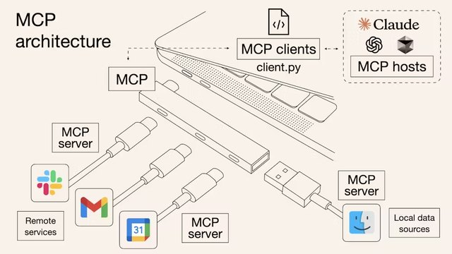
  <figcaption style="padding: 2px 8px;">
    <small>MCP pictured as a USB hub</small>
  </figcaption>
</figure>

<blockquote style="max-width: calc(100% - 320px);">
  <p>How should an agent reach K8s: run <code>kubectl</code> directly, or go through <code>MCP</code>?</p>
</blockquote>

| | Run `kubectl` directly | Kubernetes `MCP` |
|:---:|---|---|
| **Access** | Run `kubectl` · scripts in a shell (Bash) | Cluster API exposed as standard tools |
| **Pros** | No server, instant · reuse existing scripts | Same tools for every agent · control tools · params |
| **Cons** | A shell can run almost anything · output parsing | Must run an MCP server · only exposed tools |
| **Best for** | Individual dev · coding agents (Claude Code, etc.) | Teams · platforms serving many agents |
| **Examples** | `kubectl` _JSON output, safe wrappers_ | `kubernetes-mcp-server` · `kubectl-ai` · `K8sGPT` |

_kubectl: fast, flexible; MCP: control, reuse · individuals: kubectl, teams · platforms: consider MCP first_<br/>
_Either way, least privilege (RBAC · ServiceAccount) and approval before execution are key_

---
class: agw
---

# agentgateway <small>Gateway for agents · joined AAIF '26.06</small>

<div class="arch-diagram agw-diagram">
<svg viewBox="0 0 440 172" xmlns="http://www.w3.org/2000/svg" role="img" aria-label="An agent's LLM, MCP tool, and A2A calls all pass through agentgateway, which applies authentication, guardrails, and observability">
<defs>
<marker id="agw-arrow" viewBox="0 0 10 10" refX="9" refY="5" markerWidth="7" markerHeight="7" orient="auto"><path d="M0 0L10 5L0 10z" fill="#64748b"/></marker>
</defs>
<g stroke="#64748b" stroke-width="1.6" fill="none" marker-end="url(#agw-arrow)">
<path d="M92 86H126"/><path d="M266 70L298 32"/><path d="M266 86H298"/><path d="M266 102L298 140"/>
</g>
<g text-anchor="middle">
<rect x="10" y="62" width="82" height="48" rx="10" fill="#e8f0fe" stroke="#1055cc"/>
<text x="51" y="91" style="font-size:15px" font-weight="700" fill="#0c367b">Agent</text>
<rect x="128" y="34" width="138" height="104" rx="10" fill="#eef1f6" stroke="#64748b" stroke-width="2"/>
<text x="197" y="60" style="font-size:15px" font-weight="700" fill="#334155">agentgateway</text>
<text x="197" y="84" style="font-size:12px" fill="#475569">AuthN · AuthZ</text>
<text x="197" y="102" style="font-size:12px" fill="#475569">Guardrails</text>
<text x="197" y="120" style="font-size:12px" fill="#475569">Telemetry (OTel)</text>
<rect x="300" y="8" width="130" height="44" rx="10" fill="#e8f5e9" stroke="#34a853"/>
<text x="365" y="27" style="font-size:14px" font-weight="700" fill="#1b5e20">LLM</text>
<text x="365" y="44" style="font-size:11px" fill="#2e7d32">Routing · fallback</text>
<rect x="300" y="64" width="130" height="44" rx="10" fill="#fff8e1" stroke="#f4b400"/>
<text x="365" y="83" style="font-size:14px" font-weight="700" fill="#7a5b00">+ MCP tools</text>
<text x="365" y="100" style="font-size:11px" fill="#8d6e00">Tools · access</text>
<rect x="300" y="120" width="130" height="44" rx="10" fill="#e0f2f1" stroke="#26a69a"/>
<text x="365" y="139" style="font-size:14px" font-weight="700" fill="#00695c">+ Other agents</text>
<text x="365" y="156" style="font-size:11px" fill="#00695c">A2A</text>
</g>
</svg>
</div>

| | Details | Notes |
|:---:|---|---|
| **Targets** | **LLM** _routing · fallback_ + **MCP** _tools · access_ + **A2A** _agents_ | Grew from an LLM gateway |
| **Security** | **AuthN · AuthZ**: JWT · API key · OAuth, fine-grained RBAC · rate limits<br/>**Guardrails · telemetry**: content filters, OTel metrics · traces | One policy on every call path |
| **Deploy** | **Standalone**: single binary / Docker + YAML<br/>**Kubernetes**: controller + **K8s Gateway API** | K8s optional |

_Starts as an LLM gateway: route across models, fall back on failure (Agent Router · LiteLLM)_<br/>
_agentgateway adds MCP tool calls and A2A agent traffic through the same gateway_<br/>
_Auth, guardrails, and telemetry on every outbound call_

---
class: table-full agent-k8s guardrails
---

# Guardrails <small>Guardrails AI vs. NeMo Guardrails</small>

<div class="def-card">
<p><b>Broadly</b> any safeguard keeping AI on track<br/><span>Approvals · AI reviewers · RBAC · isolation, etc.</span></p>
<p><b>Here</b> <strong>content guardrails</strong> on model I/O</p>
</div>

| | **Guardrails AI** | **NeMo Guardrails** _NVIDIA_ |
|:---:|---|---|
| **Summary** | Python framework validating LLM I/O | Programmable guardrails for LLM chat apps |
| **Concept** | Input · output `Guard` of validators | Colang flows + YAML config |
| **Where** | Input · output | Input · dialog · retrieval · execution (tools) · output |
| **How** | 65 Hub validators _rules · ML · LLM_ PII · toxicity · JSON | LLM self-check · NemoGuard · Presidio · LlamaGuard, etc. |
| **Focus** | Pydantic structured output | Tool-call checks (execution rails) · LangGraph |
| **Deploy** | Python lib · server _OpenAI-compatible_ · Docker | Python lib · server _OpenAI-compatible_ · K8s Helm |
| **License** | Apache-2.0 · ★7.6k | Apache-2.0 · ★7.5k |

_Guardrails: check what an agent hears, says, and calls_<br/>
_Guardrails AI: output format · quality; NeMo Guardrails: dialog · tool-call flow control_<br/>
_Security layers: gateway (agentgateway) → content (guardrails) → isolation (Agent Sandbox)_

---
class: agent-k8s ak-usecase
---

# Agent Sandbox <small>Use Cases</small>

<div class="term-widget">
<div class="term-bar"><span></span><span></span><span></span><em>YOLO mode</em></div>
<pre><b>$</b> IS_SANDBOX=1 claude --dangerously-skip-permissions
<i># Scary on purpose: org policy may block it; root also needs the env var</i></pre>
</div>

<table>
<thead><tr><th style="text-align:center">Agent</th><th>What runs</th><th style="text-align:center">Lifetime</th></tr></thead>
<tbody>
<tr><td rowspan="3" style="text-align:center"><strong>Outside</strong><br/><em>calls in</em></td><td>Run a data-analysis <strong>Python script</strong> and return the result <em>Code Execution</em></td><td style="text-align:center"><strong>Short</strong></td></tr>
<tr><td>Isolated Chrome · VNC to click, type, and screenshot <em>Computer Use</em></td><td style="text-align:center">Medium</td></tr>
<tr><td>Run a cloud agent’s (Claude) tool calls in ready sandboxes <em>Managed Agents</em></td><td style="text-align:center">Call~session</td></tr>
<tr class="grp"><td rowspan="3" style="text-align:center"><strong>Inside</strong><br/><em>runs inside</em></td><td><strong>Claude Code · Aider</strong>: clone a repo, edit and test in a loop <em>Coding Agents</em></td><td style="text-align:center"><strong>Medium</strong></td></tr>
<tr><td>Isolate tests, generated-code checks, untrusted builds <em>CI/CD</em></td><td style="text-align:center">Short~medium</td></tr>
<tr><td><strong>OpenClaw</strong> with volumes · fixed hostname: always-on AI assistant <em>OpenClaw</em></td><td style="text-align:center"><strong>Always on</strong></td></tr>
</tbody>
</table>

_Sandbox = K8s resource for an isolated workspace (Pod + volumes) · Template defines, WarmPool pre-warms, Claim allocates_<br/>
_It only provides the environment: also fits plain isolated runs like CI/CD and dev environments_

---
class: agent-k8s ak-overview
---

# Agent on K8s <small>4 projects at a glance</small>

<div class="arch-diagram ak-diagram">
<svg viewBox="0 0 440 170" xmlns="http://www.w3.org/2000/svg" role="img" aria-label="On top, kagent and AX define what to run and run on Agent Substrate below; Agent Sandbox is a separate execution environment">
<defs>
<marker id="ak-arrow" viewBox="0 0 10 10" refX="9" refY="5" markerWidth="7" markerHeight="7" orient="auto"><path d="M0 0L10 5L0 10z" fill="#64748b"/></marker>
</defs>
<g style="font-size:11px" fill="#64748b">
<text x="10" y="16">Define · run: agent config · request handling</text>
<text x="10" y="106">Runtime: isolation · state · resources</text>
</g>
<g stroke="#64748b" stroke-width="1.6" fill="none" marker-end="url(#ak-arrow)">
<path d="M150 70L278 114"/><path d="M330 70V114"/>
</g>
<text x="236" y="96" style="font-size:10px" fill="#64748b">base (kagent 1.x)</text>
<g text-anchor="middle">
<rect x="10" y="24" width="200" height="46" rx="10" fill="#e8f0fe" stroke="#1055cc"/>
<text x="110" y="46" style="font-size:15px" font-weight="700" fill="#0c367b">kagent</text>
<text x="110" y="62" style="font-size:11px" fill="#1055cc">Define · run conversational agents</text>
<rect x="230" y="24" width="200" height="46" rx="10" fill="#e8f0fe" stroke="#1055cc"/>
<text x="330" y="46" style="font-size:15px" font-weight="700" fill="#0c367b">AX</text>
<text x="330" y="62" style="font-size:11px" fill="#1055cc">Run agent tasks</text>
<rect x="10" y="114" width="200" height="46" rx="10" fill="#eef1f6" stroke="#64748b"/>
<text x="110" y="136" style="font-size:15px" font-weight="700" fill="#334155">Agent Sandbox</text>
<text x="110" y="152" style="font-size:11px" fill="#475569">A Pod per workspace · standalone</text>
<rect x="230" y="114" width="200" height="46" rx="10" fill="#e8f5e9" stroke="#34a853"/>
<text x="330" y="136" style="font-size:15px" font-weight="700" fill="#1b5e20">Agent Substrate</text>
<text x="330" y="152" style="font-size:11px" fill="#2e7d32">Actors on shared Workers</text>
</g>
</svg>
</div>

| | **kagent**<br/><span class="nm">K8s + agent</span> | **Agent Sandbox**<br/><span class="nm">sandbox: isolated space</span> | **AX**<br/><span class="nm">Agent eXecutor</span> | **Agent Substrate**<br/><span class="nm">substrate: underlying layer</span> |
|:---:|:---:|:---:|:---:|:---:|
| **Start · version**<br/><span class="nm">as of '26.10.28</span> | '25.01<br/>`v1.0.0-alpha17` | '25.08<br/>`v1.0.8` | '26.03<br/>`v0.3.1` | '26.05<br/>`v0.6.0` |
| **Role** | Define · run agents | Isolated workspaces | Run agent tasks | Stateful runtime |
| **Unit** | Session → Actor | Sandbox → Pod | Task → Actor | Actor on Worker |
| **Governance** | CNCF Sandbox · Solo.io | K8s SIG Apps | Google open source | CNCF Sandbox · Google |

_4 projects in 18 months: agents are becoming a new K8s workload_<br/>
_Top (kagent · AX): agent config · requests; bottom (Sandbox · Substrate): isolation · state · resources_<br/>
_Session: conversation · Task: unit of work · Actor: stateful, pausable unit · Worker: Pod running Actors_

---
class: agent-k8s pod-actor
---

# Agent Deployment <small>Dedicated Pods vs. Actors</small>

<div class="term-widget">
<div class="term-bar"><span></span><span></span><span></span><em>A few days later</em></div>
<pre><b>$</b> codex resume 01a1d080-a667-7ec2-a882-d98fddf042a1
<i># The process is long gone, but the agent’s work carries on</i></pre>
</div>

<div class="arch-diagram pa-diagram">
<svg viewBox="0 0 540 178" xmlns="http://www.w3.org/2000/svg" role="img" aria-label="Left: a dedicated Pod per session, held even while idle. Right: Actors use shared Workers; idle Actors are saved to a snapshot and restored on resume">
<defs>
<marker id="pa-arrow" viewBox="0 0 10 10" refX="9" refY="5" markerWidth="7" markerHeight="7" orient="auto"><path d="M0 0L10 5L0 10z" fill="#64748b"/></marker>
</defs>
<g style="font-size:13px" font-weight="700" fill="#334155" text-anchor="middle">
<text x="130" y="16">Dedicated Pod per workspace</text>
<text x="405" y="16">Actors + shared Workers</text>
</g>
<line x1="262" y1="6" x2="262" y2="172" stroke="#cbd5e1" stroke-dasharray="4 4"/>
<g stroke="#64748b" stroke-width="1.5" fill="none" marker-end="url(#pa-arrow)">
<path d="M100 44H136"/><path d="M100 92H136"/><path d="M100 140H136"/>
<path d="M352 44L410 64"/><path d="M352 92L410 92"/><path d="M352 140H410"/>
<path d="M470 128V112" stroke-dasharray="4 3"/>
</g>
<g text-anchor="middle" style="font-size:12px">
<rect x="10" y="28" width="90" height="32" rx="8" fill="#e8f0fe" stroke="#1055cc"/><text x="55" y="49" fill="#0c367b">Session A: run</text>
<rect x="10" y="76" width="90" height="32" rx="8" fill="#f8fafc" stroke="#94a3b8" stroke-dasharray="4 3"/><text x="55" y="97" fill="#64748b">Session B: idle</text>
<rect x="10" y="124" width="90" height="32" rx="8" fill="#e8f0fe" stroke="#1055cc"/><text x="55" y="145" fill="#0c367b">Session C: run</text>
<rect x="138" y="28" width="112" height="32" rx="8" fill="#eef1f6" stroke="#64748b"/><text x="194" y="49" fill="#334155">Pod A</text>
<rect x="138" y="76" width="112" height="32" rx="8" fill="#fde7c8" stroke="#d9a35b"/><text x="194" y="97" fill="#8a5a00">Pod B · idle, held</text>
<rect x="138" y="124" width="112" height="32" rx="8" fill="#eef1f6" stroke="#64748b"/><text x="194" y="145" fill="#334155">Pod C</text>
<rect x="272" y="28" width="80" height="32" rx="8" fill="#e8f0fe" stroke="#1055cc"/><text x="312" y="49" fill="#0c367b">Actor A</text>
<rect x="272" y="76" width="80" height="32" rx="8" fill="#e8f0fe" stroke="#1055cc"/><text x="312" y="97" fill="#0c367b">Actor B</text>
<rect x="272" y="124" width="80" height="32" rx="8" fill="#f8fafc" stroke="#94a3b8" stroke-dasharray="4 3"/><text x="312" y="145" fill="#64748b">Actor C: idle</text>
<rect x="412" y="28" width="118" height="84" rx="10" fill="#e8f5e9" stroke="#34a853"/>
<text x="471" y="46" style="font-size:11px" fill="#2e7d32">Shared Worker Pool</text>
<rect x="424" y="54" width="94" height="22" rx="6" fill="#fff" stroke="#34a853"/><text x="471" y="69" fill="#1b5e20">Worker 1</text>
<rect x="424" y="82" width="94" height="22" rx="6" fill="#fff" stroke="#34a853"/><text x="471" y="97" fill="#1b5e20">Worker 2</text>
<rect x="412" y="128" width="118" height="30" rx="8" fill="#fff8e1" stroke="#f4b400"/><text x="471" y="148" fill="#7a5b00">Save snapshot</text>
<text x="502" y="124" style="font-size:10px" fill="#64748b">restore</text>
</g>
</svg>
</div>

<div class="quote-row">
<blockquote><p>Pods are a great execution unit, but often a poor fit for an agent’s lifecycle <small>CNCF Blog, 2026.07</small></p></blockquote>
</div>

| | **Dedicated Pod per workspace** | **Actor multiplexing** *(N Actors on Worker Pool)* |
|:---:|---|---|
| **How** | One Pod each (`Deployment` · `WarmPool`) | **Shared Worker Pool**, sessions as `Actor` |
| **Idle** | Pod stays held *simple but wasteful* | **Snapshot**, Worker back to pool *efficient* |
| **Projects** | **`Agent Sandbox`** (optional WarmPool) | **`kagent` 1.x alpha** · **`AX`** on **`Agent Substrate`** |
| **Choose if** | Dedicated env · simple lifecycle | Many idle; savings > restore latency |

_Analogy: dedicated Pod = private office; Actor = coworking space (step out, stuff goes in a locker = snapshot)_<br/>
_Outlook: simple dedicated Pods alongside Actor multiplexing for large, mostly idle fleets_<br/>
_Weigh: idle ratio, state size, snapshot restore latency_

---
class: agent-k8s rt-pair
---

# Execution Environments <small>Agent Sandbox vs. Agent Substrate</small>

| | **Agent Sandbox** | **Agent Substrate** |
|:---:|---|---|
| **Summary** | Declares isolated workspaces (Pod · storage), manages lifecycle | Runs stateful Actors on shared Workers |
| **Resources** | `Sandbox` · `SandboxTemplate` · `SandboxWarmPool` · `SandboxClaim` | `Actor` · `ActorTemplate` · `Worker` · `WorkerPool` · `Snapshot` |
| **Flow** | Sandbox directly · or Template → Claim _WarmPool optional_ | Worker → restore → run isolated → save, release |
| **State** | Persistent volumes · GKE Pod Snapshot _gVisor only_ | Snapshot _Full: memory + files, Data: persistent_ |
| **Isolation** | gVisor · Kata _handled by the runtime_ | gVisor · Cloud Hypervisor microVMs |
| **Used by** | Code execution tools · isolated agents | kagent 1.x (Session) · AX (Task) engine |

_Key: one Pod per workspace (Sandbox) vs. Actors time-sharing Workers (Substrate)_<br/>
_As before: Sandbox = private offices, Substrate = coworking space_<br/>
_Choose: long-lived dedicated envs → Sandbox; many idle sessions → Substrate_<br/>
_Standard: KEP-5823 <strong>Pod snapshots</strong> (checkpoint · restore) in K8s (v1.38 Alpha target)_

---
class: table-full agent-k8s ak-platform
---

# Define · Run <small>kagent vs. AX</small>

<div class="term-widget">
<div class="term-bar"><span></span><span></span><span></span><em>AX suspend · resume</em></div>
<pre><b>$</b> ax suspend task my-task  <i># checkpoint actor state, then pause</i>
<b>$</b> ax resume task my-task   <i># resume from saved state</i></pre>
</div>

| | **kagent** | **AX** _Agent Executor_ |
|:---:|---|---|
| **Summary** | Conversational agents as K8s resources | Declare and run agent tasks |
| **Define** | `AgentTemplate` (what) + `Harness` (where · how) = `Agent` | `Task` · `Workspace` · `Model` YAML → `ax apply` |
| **Unit** | `Session` _conversation, in PostgreSQL_ | `Task` _pausable work, a Substrate Actor_ |
| **Traits** | Each turn: `Data` snapshot, Worker released _new container on resume_ | `suspend` · `resume` · Workspace from a natural-language goal |
| **Built on** | `Deployment` (0.x) → **Agent Substrate** (1.x alpha) | Runs as **Agent Substrate** Actors |
| **Origin** | Solo.io · CNCF Sandbox | Google open source |

_kagent handles agents per conversation (Session); AX per unit of work (Task)_<br/>
_Common base: both run as Agent Substrate Actors (kagent from 1.x)_<br/>
_Pause and resume: kagent automatically at the end of every turn; AX with <code>suspend</code> · <code>resume</code>_

---
class: section
---

# Wrap-up

---
class: cols points wrapup
---

# Wrap-up <small>Three takeaways and a few suggestions</small>

- ### 📌 Three takeaways

  1. **Reading the ecosystem map**<br>
     CNCF: all of AI, AAIF: agents · see it by **tech layer × workload**
  2. **Layered agent security**<br>
     Gateway (`agentgateway`) → content (guardrails) → isolation (Sandbox) + **least-privilege RBAC**
  3. **Agent on K8s is emerging**<br>
     Dedicated Pods (`Agent Sandbox`) → Actors (`Agent Substrate`), `kagent` · `AX` on top
- ### 💡 The engineer’s part

  - **Keeping up with change**<br>
    Learn the map by **tech layer and purpose** before chasing tools
  - **Ownership and accountability**<br>
    Agents may build and run things, but **architecture, permission guardrails, and final accountability** stay with people

_After model serving: agent execution, isolation, gateways, new ground for K8s engineers_

<p class="thanks">Thank you!</p>
