# Kubernetes 엔지니어가 둘러본<br>AI Agent 생태계

- 김정민 / 삼성SDS
- Kubernetes Korea Group<br>Meetup 26.10

---
class: speaker
---

# 발표자
## 김정민 / 삼성SDS / Cloud Engineer
- Cloud 및 Kubernetes 관련 업무를 하고 있습니다.
- Kubernetes와 Go 테스트 관련 주제에 관심이 많습니다.
- :github: jmnote

---
class: staircase
---

# 지난 발표

- 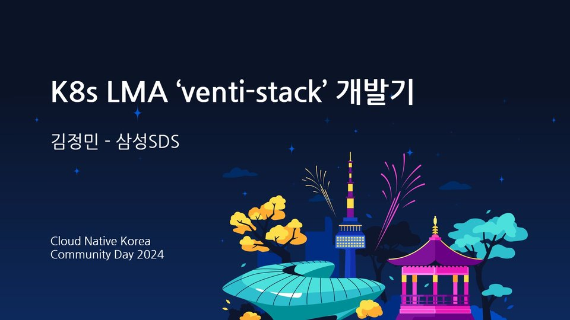 **'24.09** Cloud Native Korea Community Day 2024
- 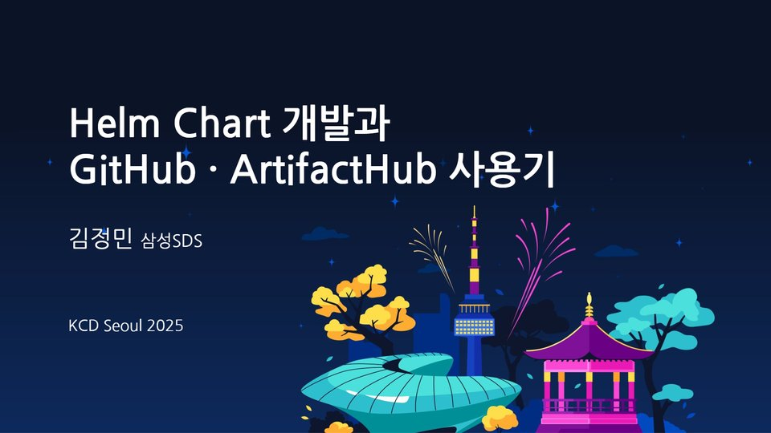 **'25.05** KCD Seoul 2025
- 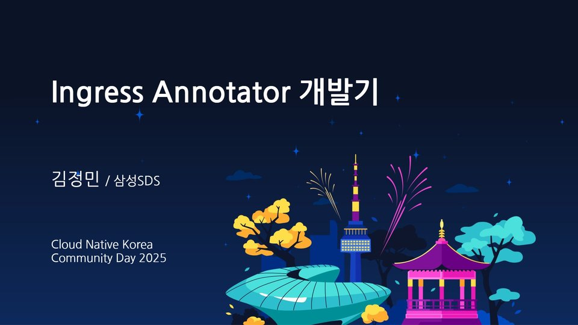 **'25.10** Cloud Native Korea Community Day 2025

> **26.10**
> _그동안 개발 주제_
> _AI 관련은 처음_

---
class: toc
---

# 목차

## 배경
## 분류 체계
## 관심 프로젝트 비교
## 마무리

---
class: section
---

# 배경 <small>2026년</small>

---
class: hero
---

# 2026년 <small>AI 시대 실감</small>

- ## 작년과는 다르다...
  - 코드를 직접 보는 일 대폭 감소
  - Markdown 문서 중심 <small>가끔 테스트 코드</small>
  - 코딩 테스트 폐지 추세 <small>AI 활용 평가 대체</small>
- 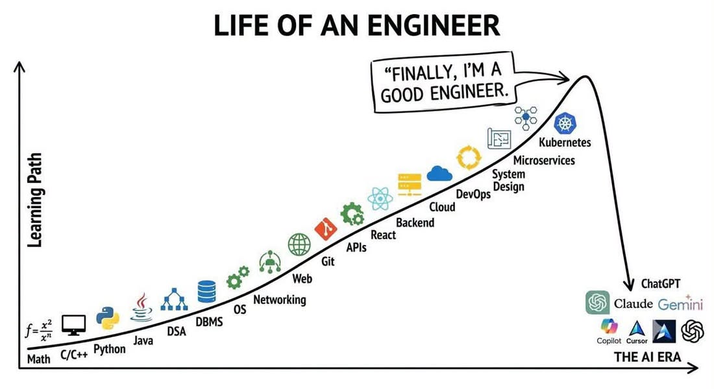
  _Claude Community<br>FB '26.09_
- ## Agent가 잘하는 것
  - 코딩, 코드 리뷰, 테스트 코드 작성, 문서 작성, 설계, 로그 분석, 문의 대응, 신기술 탐색…
  - **언어/CLI 도구 - Go, GitHub, K8s, OpenStack 그냥 다 잘함**
  - _아직 못하는 것? 내 취향에 맞는 담백한 PPT 작성_
- ## 그래서...
  - 수학·물리학 난제 해결, 취약점 발견
  - AI 블루 <small>Claude Blue</small>
  - _약간의 허탈감과 위기의식?_

---
class: hero
---

# AI Gauge

- 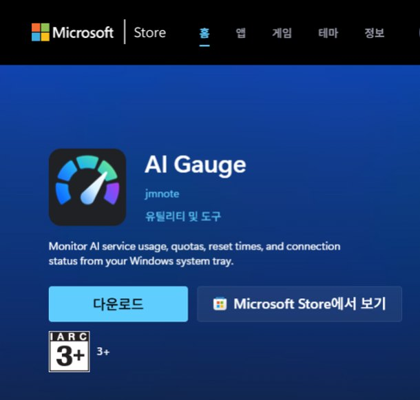
- 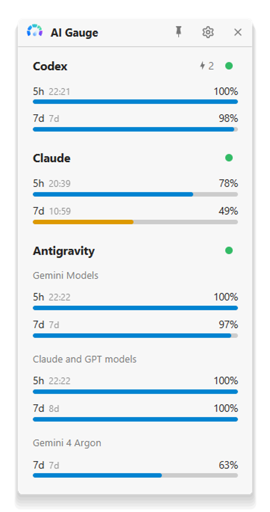 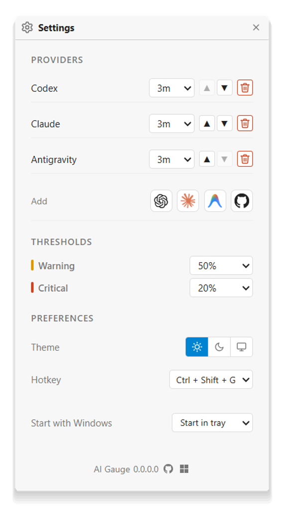
- - 5h/7d/월간 사용량, 리셋 시각, 리셋 크레딧
  - Windows용, Apache-2.0 라이선스
  - _이런 거 많은데 왜? 윈도우용 오픈소스 없어서..._

---

# Agent 사용환경
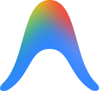 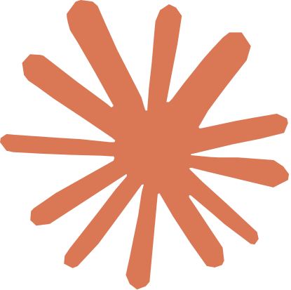 

| 구분 | CLI | Desktop App | IDE |
|:---:|:---:|:---:|:---:|
| **Antigravity** | `agy` | Antigravity App | Antigravity IDE<br/>**VS Code ext** _'26.09_ |
| **Claude** | `claude` | Claude | VS Code extension |
| **Codex** | `codex` | ChatGPT (codex) | VS Code extension |
| **기타** | - | OpenClaw | Cursor _'26.06 600억$_<br/>**Zed** _경량, ACP 연계_ |
| _의견_ | _가벼움, 터미널의 간결함_ | _브라우저 통합 등 GUI의 편리함<br/>컴퓨터를 맡기는 느낌_ | _익숙한 개발환경의 편안함_ |

_※ 간단한 질문/조사는 chat(web) 사용_

---
class: cols points compact-points
---

# 출발점과 접근법 <small>K8s 엔지니어로서 조망 a.k.a. 수박 겉핥기</small>

> 급변하는 AI 기술을 K8s 엔지니어 시선으로 폭넓게 탐색·분류·비교

- ### 출발점 (Why)

  - **쏟아지는 AI 기술**: 개별 도구를 쫓기보다 전체 생태계의 큰 그림 파악
  - **K8s 엔지니어의 시선**: AI와 K8s가 만나는 생태계 분류, 프로젝트 비교
  - **선택과 집중**: 상세 분석보다 전체적인 맥락과 조망 중심
- ### 접근법 (How)

  1. **개념 정리 · Landscape 탐색**<br>
    기본 개념 정리, AAIF · CNCF 프로젝트 조사
  2. **생태계 분류 체계**<br>
    실행 위치 · 목적 · 기술 계층 × 대상 워크로드
  3. **Agent on K8s 프로젝트 비교**<br>
    kagent · Agent Sandbox · AX · Agent Substrate 4종 비교

---
class: section
---

# 분류 체계

---
class: cols llm-example
---

# LLM 활용 예시 <small>단어 목록에서 문맥 이해로</small>

- 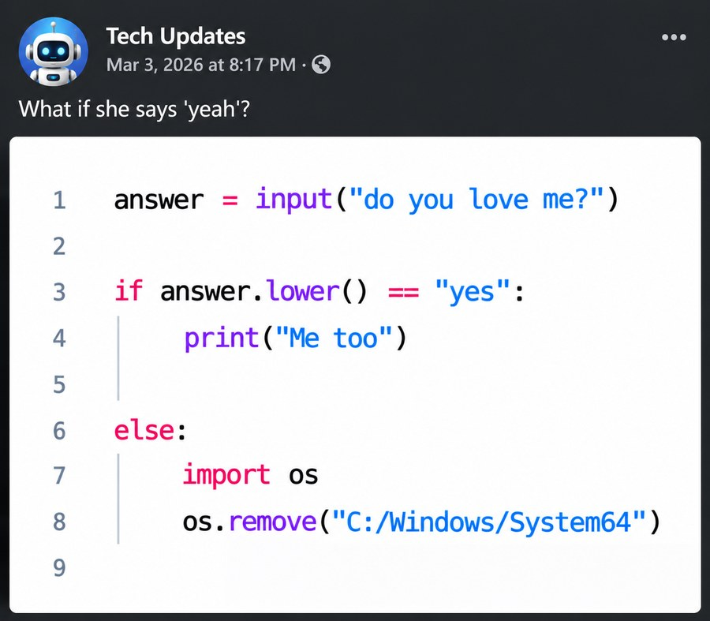

  _'yes'이면 긍정 응답, 그 외에는 OS 삭제 ;;;_<br/>
  _그런데 'yeah'라면?_
- ### “yeah”는 긍정일까?

  - **규칙 기반**: 새 표현마다 규칙 추가
  - **머신러닝(감성 분석)**: 예시를 학습해 긍정·부정을 판별
  - **LLM**: 문맥과 뉘앙스를 읽고 원하는 형식으로 응답
  > **프롬프트:** "답변이 긍정인지 판별하여 JSON 응답: {answer}"
  >
  > **응답:** `{"positive": true}`

  _→ 자연어 처리 과제 간단히 해결 (언어모델이니까...)_

---
class: cols agent-example
---

# Agent 예시 <small>루프 1회 vs 반복 판단</small>

<div class="weather-widget">
<svg role="img" aria-label="날씨 앱: 잠실 18℃ 맑음" xmlns="http://www.w3.org/2000/svg" viewBox="0 0 320 100" width="320" height="100">
  <defs>
    <linearGradient id="wx-bg" x1="0" y1="0" x2="1" y2="1">
      <stop offset="0" stop-color="#4f8ef7"/>
      <stop offset="1" stop-color="#2563eb"/>
    </linearGradient>
    <g id="wx-sun"><circle r="6" fill="#fde047"/><g stroke="#fde047" stroke-width="1.6" stroke-linecap="round"><path d="M0-10v2M0 8v2M-10 0h2M8 0h2M-7-7l1.4 1.4M5.6 5.6L7 7M-7 7l1.4-1.4M5.6-5.6L7-7"/></g></g>
    <g id="wx-cloud"><path d="M-8 4a4.5 4.5 0 0 1 1-8.8 6 6 0 0 1 11.5 1.3A3.8 3.8 0 0 1 8 4z" fill="#e2e8f0"/></g>
  </defs>
  <rect width="320" height="100" rx="14" fill="url(#wx-bg)"/>
  <path d="M20 14a6 6 0 0 0-6 6c0 4.5 6 10 6 10s6-5.5 6-10a6 6 0 0 0-6-6z" fill="#fff"/>
  <circle cx="20" cy="20" r="2.2" fill="#2563eb"/>
  <text x="32" y="27" fill="#fff" style="font-size:15px" font-weight="700">잠실</text>
  <use href="#wx-sun" x="200" y="21"/>
  <text x="216" y="29" fill="#fff" style="font-size:22px" font-weight="700">18℃</text>
  <text x="282" y="28" fill="#dbeafe" style="font-size:12px">맑음</text>
  <line x1="12" y1="44" x2="308" y2="44" stroke="#ffffff" stroke-opacity=".3"/>
  <g fill="#dbeafe" style="font-size:11px" text-anchor="middle">
    <text x="45" y="61">9시</text>
    <text x="122" y="61">12시</text>
    <text x="199" y="61">15시</text>
    <text x="276" y="61">18시</text>
  </g>
  <use href="#wx-sun" x="45" y="78"/>
  <g transform="translate(122 80)"><use href="#wx-sun" x="-4" y="-4" transform="scale(.8)"/><use href="#wx-cloud" x="2" y="0"/></g>
  <g transform="translate(199 77)"><use href="#wx-cloud"/><path d="M-4 8l-1.5 4M1 8l-1.5 4M6 8l-1.5 4" stroke="#bfdbfe" stroke-width="1.6" stroke-linecap="round"/></g>
  <use href="#wx-sun" x="276" y="78"/>
</svg>
</div>

- ### ☀️ 단순: 날씨 조회

  > SF 날씨 알려줘

  ```python
  def get_weather(city: str) -> str:
      """도시의 현재 날씨 조회"""
      return weather_api.now(city)

  agent = create_agent(model="anthropic:claude-sonnet-4-5",
                       tools=[get_weather])
  ```

  1. `get_weather("San Francisco")` → **맑음 18℃**

  > 샌프란시스코는 지금 맑고 18℃예요 ☀️

  _Agent계의 Hello World?_

  - **보편적·안전한 주제**
  - **외부 도구·데이터·자연어 처리**를 한 번에

  _→ 목표가 단순해 루프 한 번으로 끝_

- ### 🛠️ 복합: 날씨 앱 개발

  > 날씨 앱 만들어줘

  **도구:** 웹 검색 · 문서 조회 · 파일 편집 · 터미널 실행

  1. **설계** — 화면 · 구조 결정
  2. **탐색** — 위치 · 날씨 API 조사
  3. **구현** — 코드 작성 · API 연동
  4. **검증** — 실행 · 테스트 → **위치 권한 오류 ❌**
  5. **수정** — 도시 입력으로 대체 → **4번 재검증**

  **산출물:** 실행 · 테스트를 마친 날씨 앱

  _→ 단계를 지시하지 않아도 스스로 판단·반복: **자율성**_

---
class: points
---

# Agent 구성요소

<div class="arch-diagram">
<svg viewBox="0 0 520 262" xmlns="http://www.w3.org/2000/svg" role="img" aria-label="Agent 구성요소: Agent runtime이 중심에서 Model, Tools, Memory, 사용자 접점을 연결">
<defs>
<marker id="arch-arrow" viewBox="0 0 10 10" refX="9" refY="5" markerWidth="7" markerHeight="7" orient="auto-start-reverse"><path d="M0 0L10 5L0 10z" fill="#64748b"/></marker>
</defs>
<g stroke="#64748b" stroke-width="1.6" fill="none" marker-end="url(#arch-arrow)">
<path d="M122 120H186"/><path d="M186 140H122"/>
<path d="M240 98V60"/><path d="M280 60V98"/>
<path d="M334 120H398"/><path d="M398 140H334"/>
<path d="M260 166V204" marker-start="url(#arch-arrow)"/>
</g>
<g style="font-size:12px" fill="#64748b" text-anchor="middle">
<text x="154" y="113">요청</text><text x="154" y="156">응답</text>
<text x="210" y="83">판단 요청</text><text x="312" y="83">다음 행동</text>
<text x="366" y="113">실행</text><text x="366" y="156">결과</text>
<text x="300" y="190">읽기·쓰기</text>
</g>
<g text-anchor="middle">
<rect x="10" y="100" width="112" height="60" rx="10" fill="#f1f3f4" stroke="#9aa0a6"/>
<text x="66" y="125" style="font-size:17px" font-weight="700" fill="#3c4043">사용자 접점</text>
<text x="66" y="145" style="font-size:13px" fill="#5f6368">Chat · CLI · IDE</text>
<rect x="188" y="100" width="144" height="64" rx="10" fill="#e8f0fe" stroke="#1055cc" stroke-width="2"/>
<text x="260" y="126" style="font-size:17px" font-weight="700" fill="#0c367b">Agent runtime</text>
<text x="260" y="148" style="font-size:13px" fill="#1055cc">실행부 · 루프 ↻</text>
<rect x="200" y="8" width="120" height="52" rx="10" fill="#e8f5e9" stroke="#34a853"/>
<text x="260" y="31" style="font-size:17px" font-weight="700" fill="#1b5e20">Model</text>
<text x="260" y="50" style="font-size:13px" fill="#2e7d32">두뇌</text>
<rect x="398" y="100" width="112" height="60" rx="10" fill="#fdecea" stroke="#ea4335"/>
<text x="454" y="125" style="font-size:17px" font-weight="700" fill="#8c1d18">Tools</text>
<text x="454" y="145" style="font-size:13px" fill="#a52714">손발</text>
<rect x="200" y="204" width="120" height="52" rx="10" fill="#fff8e1" stroke="#f4b400"/>
<text x="260" y="227" style="font-size:17px" font-weight="700" fill="#7a5b00">Memory</text>
<text x="260" y="246" style="font-size:13px" fill="#8d6e00">기억</text>
</g>
</svg>
</div>

1. **Agent runtime**
   실행 흐름 · 상태 관리: 모델 판단과 애플리케이션 로직에 따라 실행 순서·상태·도구 호출 관리
2. **Model**
   LLM / VLM 추론: 에이전트의 두뇌 역할, 프롬프트 수신 및 모델 언어 추론 수행
3. **Memory**
   대화 상태 및 장기 기억: 세션 컨텍스트 유지 및 벡터 DB 기반 장기 지식 베이스 참조
4. **Tools**
   외부 API 호출 및 작업: 웹 검색, 외부 API 연동, CLI/코드 실행 등 실제 액션 수행

<p class="agent-summary"><em>모델(두뇌)이 판단하고, 런타임이 기억과 도구(손발)를 활용해 작업을 수행한다.</em></p>

---
class: table-full
---

# 모델 준비부터 Agent 운영까지 <small>Lifecycle</small>

| ① 모델 준비 | ② 추론 연결 | ③ Agent 개발 | ④ Agent 운영 |
|:---:|:---:|:---:|:---:|
| 직접 학습 · 파인튜닝<br/>오픈 웨이트 · 외부 API 선택 | 자체 서빙 또는 API 연결<br/>성능 · 비용 · 데이터 경계 확인 | 지침 · 실행 루프 구성<br/>도구 · 기억 연결 | 배포 · 격리 · 권한 관리<br/>관측 · 평가 · 비용 관리 |

### 모델 확보 방식에 따라 달라지는 운영 범위

| 선택 | 얻는 것 | 직접 챙길 것 |
|:---|---|---|
| **직접 학습** | 모델 설계 · 학습 과정의 통제 | 데이터 · 학습 자원 · 평가 · 서빙 |
| **오픈 웨이트 활용** | 모델 선택 · 자체 호스팅 · 추가 튜닝 | GPU 자원 · 추론 성능 · 서빙 운영 |
| **외부 API 활용** | 모델 서빙 구축 없이 빠르게 연결 | API 키 · 데이터 전송 · 비용 · 호출 제한 |

<p class="agent-summary"><em>모델은 직접 학습하거나, 오픈 웨이트·외부 API를 활용할 수 있다.</em></p>

---
class: table-full
---

# K8s × AI <small>실행 위치와 사용 목적</small>

| 관점 | AI on K8s | AI for K8s |
|:---:|---|---|
| **뜻** | **K8s를 AI의 실행 기반으로 사용** | **AI를 K8s 운영에 활용** |
| **핵심 질문** | AI 워크로드를 어디서, 어떻게 실행할까? | AI로 클러스터 운영을 어떻게 도울까? |
| **대표 작업** | 모델 학습 · 추론 서빙<br/>**Agent 실행 · 관리 (Agent on K8s)** | 장애 원인 조사 · 자연어 질의<br/>운영 조치 제안 · 실행 지원 |
| **운영 관심사** | 자원 할당 · 확장 · 실행 환경 격리<br/>상태 · 수명주기 관리 | 로그 · 메트릭 · 이벤트 연동<br/>접근 권한 · 조치 승인 |
| **프로젝트 예시** | 모델: Kubeflow · KServe<br/>Agent: kagent · Agent Sandbox | K8sGPT · HolmesGPT · kubectl-ai |

- **두 관점은 겹칠 수 있음:** 클러스터 운영을 돕는 Agent는 **AI for K8s**, K8s에서 실행되면 **Agent on K8s**에도 해당

<p class="agent-summary"><em>K8s가 AI를 실행하기도 하고, AI가 K8s 운영을 돕기도 한다.</em></p>

---
class: table-full table-dense conformance
---

# K8s & AI Conformance <small>CNCF 적합성 인증</small>

| 구분 | K8s Conformance | AI Conformance |
|:---:|---|---|
| **시작** | 2017.11 | 2025.11 |
| **핵심 질문** | 표준 Kubernetes API대로 동작하나? | AI 워크로드를 제대로 실행할 수 있나? |
| **검증 방식** | 자동 e2e 테스트 결과 제출 (Sonobuoy · Hydrophone) | 체크리스트 + 공개 증빙 자기 점검 (자동 테스트 도입 중) |
| **전제 · 갱신** | 1년 내 새 버전 재인증 | **K8s Conformance 인증 필수** · 1년마다 갱신 |
| **API·워크로드** | API 탐색·CRUD·Watch, Pod 수명주기·Probe | AI Operator의 안정적인 Custom Resource 조정 |
| **네트워크** | Service·EndpointSlice·DNS | **Gateway API 기반 추론 트래픽 관리** |
| **배치·자원 관리** | 노드 선택·자원 요청, 우선순위·할당량 | **Gang Scheduling**, GPU 공유·가상화 |
| **스케일링·관측성** | 복제본 수 조절·Scale API | AI 지표 기반 Pod·노드 확장, **가속기·워크로드 메트릭** |
| **보안·격리** | ServiceAccount·토큰, 접근 권한 판정 | 가속기 접근 격리, **워크로드 샌드박싱** <span class="hint">← Agent 실행 관련</span> |

_플랫폼 역량 인증이며 Agent 앱 자체의 품질 인증은 아님 · 요구사항은 버전별로 다름_

---
class: foundation
---

# 오픈소스 재단 <small>LF · CNCF · AAIF</small>

<div class="org-diagram">
<svg viewBox="0 0 380 156" xmlns="http://www.w3.org/2000/svg" role="img" aria-label="LF 산하에 CNCF와 AAIF">
<path d="M190 50V72H79V100M190 72H301V100" stroke="#94a3b8" stroke-width="1.6" fill="none"/>
<g text-anchor="middle">
<rect x="130" y="8" width="120" height="42" rx="10" fill="#eef1f6" stroke="#64748b"/>
<text x="190" y="35" style="font-size:17px" font-weight="700" fill="#334155">LF</text>
<rect x="14" y="100" width="130" height="48" rx="10" fill="#e8f0fe" stroke="#1055cc"/>
<text x="79" y="124" style="font-size:16px" font-weight="700" fill="#0c367b">CNCF</text>
<text x="79" y="141" style="font-size:12px" fill="#1055cc">2015 · 200+</text>
<rect x="236" y="100" width="130" height="48" rx="10" fill="#e8f5e9" stroke="#34a853"/>
<text x="301" y="124" style="font-size:16px" font-weight="700" fill="#1b5e20">AAIF</text>
<text x="301" y="141" style="font-size:12px" fill="#2e7d32">2025 · 10개</text>
</g>
</svg>
</div>

| 구분 | **LF**<br/><span class="full">Linux Foundation</span> | **CNCF**<br/><span class="full">Cloud Native Computing Foundation</span> | **AAIF**<br/><span class="full">Agentic AI Foundation</span> |
|:---:|:---:|:---:|:---:|
| **설립** | 2007-01 | 2015-07 | 2025-12 |
| **목적** | 오픈소스 프로젝트 · 산하 재단의 모체 | 클라우드 네이티브 · AI 인프라 육성 | Agentic AI 표준의 중립적 거버넌스 |
| **소속 프로젝트** | Linux 커널 · PyTorch · Node.js | **200개 이상**<br/>Kubernetes · Envoy · Kubeflow<br/>kagent · Agent Substrate 등 | **10개**<br/>MCP · A2A · agentgateway · goose<br/>AGENTS.md · Agent Router 등 |

_약 10년 주기: Linux → 클라우드 네이티브 → Agentic AI_<br/>
_CNCF는 실행 인프라, AAIF는 Agent 표준·프로토콜 중심_<br/>
_재단 간 프로젝트 이관 사례: A2A (LF → AAIF), Agent Router (CNCF → AAIF)_

---
class: cols landscape-cols
---

# Landscape by CNCF · AAIF <small>AI 전반 vs Agent 중심</small>

- **CNCF Landscape — AI Native**<br/><span class="url">https://landscape.cncf.io/?group=ai-native</span>

  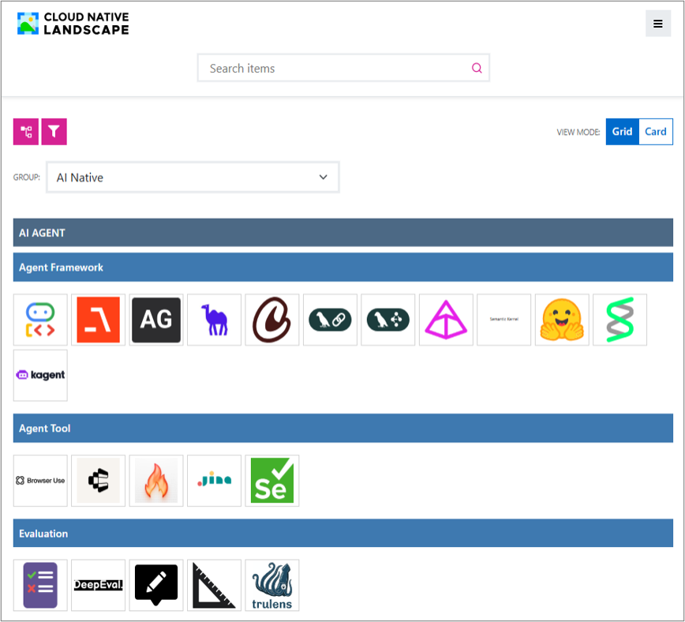

  _AI 수명주기 전체 + 인프라 · 상용 제품 포함_
- **AAIF Landscape**<br/><span class="url">https://landscape.aaif.io</span>

  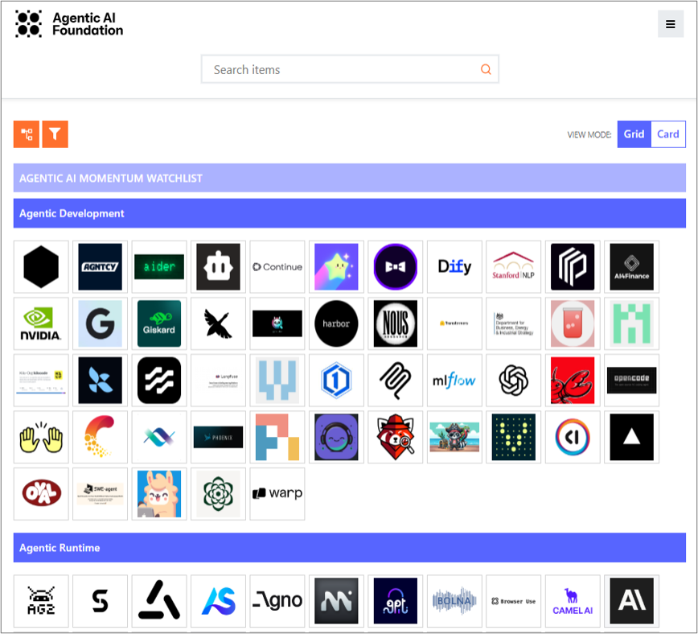

  _Agentic AI 중심 · 오픈소스·개방형 표준만_

_Landscape·회원은 재단별 별도 운영 · Landscape 등재 ≠ 재단 소속_

---
class: landscape-table
---

# Landscape by CNCF · AAIF <small>분류 관점과 프로젝트 배치</small>

| 구분 | CNCF Landscape — AI Native | AAIF Landscape |
|:---:|:---:|:---:|
| **분류 관점** | 데이터 → 학습 → 추론 → Agent + 공통 실행 인프라 | Agent를 구성·연결·개발·운영하는 기능 |
| **대분류** | `AI Agent` `Inference` `Training`<br/>`Data` `AI Native Infra` | `Gateway & Control Plane` `Agentic Runtime`<br/>`Protocols & Interfaces` `Data & Knowledge`<br/>`Agentic Development` |
| 공통 등재 예시 | CNCF 분류 | AAIF 분류 |
| **kagent · ADK · LangGraph** | `AI Agent / Framework` | `Agentic Runtime` |
| **KServe · vLLM** | `Inference` | `Agentic Runtime` |
| **MCP · A2A** | `AI Agent / Protocol` | MCP `Data & Knowledge` · A2A `Protocols` |

_추론 엔진(KServe·vLLM)이 AAIF에선 Agentic Runtime으로: 모델 서빙은 Agent의 부품_<br/>
_MCP·A2A: CNCF는 한 칸(Protocol), AAIF는 연결 대상별로 분리 (도구·데이터 vs Agent 간)_<br/>
_AAIF Landscape는 출범 1년 미만: 분류 체계 정리 중_

---
class: cncf-native
---

# CNCF Landscape — AI Native <small>대분류 5개</small>

<div class="arch-diagram native-diagram">
<svg viewBox="0 0 440 196" xmlns="http://www.w3.org/2000/svg" role="img" aria-label="CNCF AI Native 구조: Data, Training, Inference 흐름 위에 AI Agent, 아래에 AI Native Infra">
<defs>
<marker id="nat-arrow" viewBox="0 0 10 10" refX="9" refY="5" markerWidth="7" markerHeight="7" orient="auto"><path d="M0 0L10 5L0 10z" fill="#64748b"/></marker>
</defs>
<g text-anchor="middle">
<rect x="10" y="8" width="420" height="40" rx="10" fill="#e8f0fe" stroke="#1055cc"/>
<text x="220" y="33" style="font-size:16px" font-weight="700" fill="#0c367b">AI Agent <tspan style="font-size:12px" font-weight="400" fill="#1055cc">· 모델을 쓰는 애플리케이션</tspan></text>
<g stroke="#64748b" stroke-width="1.6" fill="none" marker-end="url(#nat-arrow)">
<path d="M130 94H156"/><path d="M284 94H310"/><path d="M370 74V52"/>
</g>
<text x="392" y="66" style="font-size:11px" fill="#64748b">사용</text>
<rect x="10" y="74" width="120" height="40" rx="10" fill="#e8f5e9" stroke="#34a853"/>
<text x="70" y="99" style="font-size:15px" font-weight="700" fill="#1b5e20">Data</text>
<rect x="160" y="74" width="120" height="40" rx="10" fill="#e8f5e9" stroke="#34a853"/>
<text x="220" y="99" style="font-size:15px" font-weight="700" fill="#1b5e20">Training</text>
<rect x="310" y="74" width="120" height="40" rx="10" fill="#e8f5e9" stroke="#34a853"/>
<text x="370" y="99" style="font-size:15px" font-weight="700" fill="#1b5e20">Inference</text>
<text x="220" y="132" style="font-size:12px" fill="#2e7d32">모델을 만드는 흐름</text>
<rect x="10" y="146" width="420" height="40" rx="10" fill="#eef1f6" stroke="#64748b"/>
<text x="220" y="171" style="font-size:16px" font-weight="700" fill="#334155">AI Native Infra <tspan style="font-size:12px" font-weight="400" fill="#475569">· 전체를 받치는 공통 실행·운영 기반</tspan></text>
</g>
</svg>
</div>

| 대분류 | 주요 영역 | 프로젝트 예시 |
|:---:|---|---|
| **Data** | AI용 데이터 처리·분석 | **Kubeflow Notebooks**, Apache Flink, Trino, Feast |
| **Training** | 모델 학습·조정·평가 | **Kubeflow Trainer**, DeepSpeed, Ray, DeepEval |
| **Inference** | 학습된 모델을 이용한 추론 | **KServe**, **llm-d**, vLLM, SGLang, llama.cpp |
| **AI Agent** | 에이전트 구성·애플리케이션 실행 | **kagent**, ADK, LangGraph, MCP, A2A, LlamaIndex, Milvus |
| **AI Native Infra** | AI 워크로드의 공통 실행·운영 기반 | **Agent Sandbox**, **Kueue**, **Volcano**, **agentgateway**, gVisor·Kata |

_그림: 대분류 5개를 3층으로 표현, 가운데는 모델을 만드는 흐름(Data → Training → Inference)_<br/>
_위는 모델을 쓰는 AI Agent, 아래는 전체를 받치는 AI Native Infra_<br/>
_인프라뿐 아니라 범용 에이전트 프레임워크·프로토콜(ADK, LangGraph, MCP, A2A 등)도 폭넓게 포함_<br/>
_**굵게**: K8s 위에서 CRD·컨트롤러로 동작하는 K8s 네이티브 프로젝트 → 모든 층에 존재_

---
class: table-full aaif-landscape
---

# AAIF Landscape <small>대분류 5개</small>

<div class="arch-diagram aaif-diagram">
<svg viewBox="0 0 440 192" xmlns="http://www.w3.org/2000/svg" role="img" aria-label="AAIF 5대 영역: Development에서 만든 Agent가 Runtime에서 실행되고, Data and Knowledge와 Protocols로 연결되며, Gateway and Control Plane이 통제">
<defs>
<marker id="aaif-arrow" viewBox="0 0 10 10" refX="9" refY="5" markerWidth="7" markerHeight="7" orient="auto"><path d="M0 0L10 5L0 10z" fill="#64748b"/></marker>
</defs>
<g stroke="#64748b" stroke-width="1.6" fill="none" marker-end="url(#aaif-arrow)">
<path d="M325 44V64"/><path d="M172 86H218"/><path d="M265 108V138"/><path d="M385 108V138"/>
</g>
<g style="font-size:11px" fill="#64748b" text-anchor="middle">
<text x="350" y="58">통제</text><text x="195" y="80">배포</text><text x="232" y="127">도구·데이터</text><text x="410" y="127">Agent 간</text>
</g>
<g text-anchor="middle">
<rect x="10" y="8" width="420" height="36" rx="10" fill="#eef1f6" stroke="#64748b"/>
<text x="220" y="31" style="font-size:15px" font-weight="700" fill="#334155">Gateway &amp; Control Plane</text>
<rect x="6" y="64" width="166" height="44" rx="10" fill="#e8f5e9" stroke="#34a853"/>
<text x="89" y="91" style="font-size:14px" font-weight="700" fill="#1b5e20">Agentic Development</text>
<rect x="220" y="64" width="210" height="44" rx="10" fill="#e8f0fe" stroke="#1055cc" stroke-width="2"/>
<text x="325" y="91" style="font-size:15px" font-weight="700" fill="#0c367b">Agentic Runtime</text>
<rect x="200" y="138" width="110" height="46" rx="10" fill="#fff8e1" stroke="#f4b400"/>
<text x="255" y="158" style="font-size:13px" font-weight="700" fill="#7a5b00">Data &amp;</text>
<text x="255" y="175" style="font-size:13px" font-weight="700" fill="#7a5b00">Knowledge</text>
<rect x="320" y="138" width="110" height="46" rx="10" fill="#e0f2f1" stroke="#26a69a"/>
<text x="375" y="158" style="font-size:13px" font-weight="700" fill="#00695c">Protocols &amp;</text>
<text x="375" y="175" style="font-size:13px" font-weight="700" fill="#00695c">Interfaces</text>
</g>
</svg>
</div>

| 분류 | 주요 영역 | 등재 프로젝트 예시 |
|:---:|---|---|
| **Agentic Development** | 개발 도구·스킬·평가·관측 | **goose**, **Agent Skills**, Dify, DeepEval, Langfuse |
| **Agentic Runtime** | Agent 프레임워크 + 추론·서빙 기반 | kagent, LangGraph, ADK, CrewAI, KServe, vLLM |
| **Data & Knowledge** | 도구·데이터 연결, 검색·메모리 | **MCP**, LlamaIndex, Mem0, Milvus, pgvector |
| **Protocols & Interfaces** | Agent 간·Agent–UI 통신 규약 | **A2A**, AG-UI |
| **Gateway & Control Plane** | 라우팅·접근 제어·가드레일 | **agentgateway**, **Agent Router**, Guardrails AI |

_그림: 만들고(Development) → 실행하고(Runtime) → 연결하고(Data & Knowledge, Protocols) → 통제한다(Gateway)_<br/>
_분류 ≠ 소프트웨어 계층: Runtime에 Agent 프레임워크와 추론 엔진이 함께 포함_<br/>
_**굵게**: AAIF 소속 프로젝트_
---
class: table-full aaif-projects
---

# AAIF 소속 프로젝트 <small>10개</small>

| # | 프로젝트 | 핵심 설명 | 기여자 | 합류 |
|---:|:---:|---|:---:|:---:|
| 1 | **MCP** | LLM 앱과 외부 데이터·도구 연결 프로토콜 | Anthropic | '25.12 |
| 2 | **goose** | 확장형 오픈소스 Agent _모델 무관_ | Block | '25.12 |
| 3 | **AGENTS.md** | 코딩 Agent용 지침 마크다운 표준 | OpenAI | '25.12 |
| 4 | **agentgateway** | Agent·모델·도구 간 연결·보안 게이트웨이 | Solo.io | '26.06 |
| 5 | **A2A** | Agent 간 통신·협업 프로토콜 _Agent-to-Agent_ | Google | '26.08 |
| 6 | **Agent Router** | Envoy 기반 AI 게이트웨이 _구 Envoy AI Gateway_ | Bloomberg·Tetrate | '26.09 |
| 7 | **Agent Skills** | 재사용 가능한 Agent 전문 지식 규격 | Anthropic | '26.10 |
| 8 | **Open Responses** | OpenAI Responses API 기반 공용 LLM API 규격 | OpenAI | '26.10 |
| 9 | **OpenEnv** | 강화학습·Agent 학습용 개방 환경 | Hugging Face | '26.10 |
| 10 | **OpenSandbox** | AI 앱용 범용 격리 샌드박스 _Docker·K8s 모두 지원_ | Alibaba | '26.10 |

<span class="mk dev"></span>_**사용자·개발 관점**: MCP · AGENTS.md · Agent Skills, 사용자들이 이미 쓰던 것을 표준으로 <small>MCP는 이미 버전별 스펙 운영</small>_<br/>
<span class="mk ops"></span>_**플랫폼·인프라 관점**: agentgateway · Agent Router · A2A · OpenSandbox <small>연결·격리·운영</small>_<br/>
_3개로 출범('25.12) → 1년 만에 10개, 그중 4개가 '26.10 합류: 빠르게 확장 중_

---
class: eco-views
---

# AI 생태계 분류 방법 <small>6가지 관점</small>

| # | 관점 | 핵심 질문 | 구분 및 대표 예시 |
|---:|:---:|---|---|
| 1 | **실행 위치** | 어디에서 실행하는가? | Kubernetes 위에서 실행하면 **AI on K8s** |
| 2 | **사용 목적** | 무엇을 돕는가? | Kubernetes 개발·운영·문제 해결을 돕는 **AI for K8s** |
| 3 | **소속** | 누가 프로젝트를 관리하는가? | AAIF, CNCF, K8s SIG, 기업 및 오픈 커뮤니티 |
| 4 | **등재** | 어느 생태계 지도에서 찾는가? | AAIF Landscape, CNCF Landscape (AI Native) |
| 5 | **기술 계층** | 무엇을 담당하는가? | 애플리케이션·개발, 실행·운영, 기반 인프라 |
| 6 | **대상 워크로드** | 어떤 워크로드를 다루는가? | 모델(학습·추론), 에이전트(Agent) |

_1·2 실행 위치·사용 목적은 K8s × AI에서, 3·4 소속·등재는 재단·Landscape에서 살펴봄_<br/>
_<strong>5 기술 계층(3) × 6 대상 워크로드(2)</strong>로 교차 정리하면 생태계가 한눈에: 다음 장_

---
class: table-full eco-matrix
---

# 생태계 분류표 <small>기술 계층 × 대상 워크로드</small>

| 기술 계층 | 모델 학습·추론 | Agent |
|:---:|---|---|
| **1. 앱·개발** | **모델 개발**: PyTorch, TensorFlow, DeepSpeed<br/>**데이터·파이프라인**: Kubeflow Pipelines, Flink, Feast<br/>**모델 평가**: lm-evaluation-harness, OpenCompass | **프레임워크**: ADK, LangGraph, CrewAI · **에이전트 앱**: goose, OpenHands<br/>**도구·연동**: Composio · **지침·스킬**: AGENTS.md, Agent Skills<br/>**지식·메모리**: LlamaIndex, Mem0 · **평가·관측**: Langfuse, Ragas |
| **2. 실행·운영** | **학습 운영**: Kubeflow Trainer, Katib<br/>**추론 엔진**: vLLM, SGLang · **모델 서빙**: KServe, llm-d<br/>**분산 실행**: KubeRay, LWS<br/>**게이트웨이**: Agent Router, LiteLLM | **정의·운영**: <mark>kagent</mark> · **작업 실행**: <mark>AX</mark> · **워크플로**: Temporal<br/>**실행 환경**: <mark>Agent Sandbox</mark>, <mark>Agent Substrate</mark>, <mark>OpenSandbox</mark>, E2B<br/>**게이트웨이**: <mark>agentgateway</mark> · **프로토콜**: MCP, A2A<br/>**가드레일**: <mark>Guardrails AI</mark>, <mark>NeMo Guardrails</mark> |
| **3. 기반 인프라** | **큐·스케줄링**: Kueue, Volcano · **집단 통신**: NCCL | **격리 런타임**: gVisor, Kata Containers |

_성숙도 차이: 모델 쪽 실행·운영은 수년간 K8s 위에서 다듬어짐, Agent 쪽은 대부분 최근 1~2년 사이 등장_<br/>
_인프라 요구 차이: 모델은 GPU 효율적 공유(큐·스케줄링), Agent는 생성 코드 안전한 격리_<br/>
_게이트웨이도 둘: 모델 앞 LLM 트래픽(Agent Router·LiteLLM) vs Agent 앞 도구·Agent 간 트래픽(agentgateway)_<br/>
_<mark>강조</mark>: 다음 장에서 비교할 관심 프로젝트, 모두 **Agent × 실행·운영** 칸: K8s 엔지니어의 새 영역_

---
class: section
---

# 관심 프로젝트 비교

---
class: ai-for-k8s
---

# AI for K8s <small>클러스터 운영 지원 오픈소스 3종 비교</small>

| 구분 | **K8sGPT** | **HolmesGPT** | **kubectl-ai** |
|:---:|:---:|:---:|:---:|
| **핵심 역할** | **상태 진단 · 결과 설명** | **장애 원인 조사 (RCA)** | **자연어 기반 조회·조작** |
| **동작 방식** | 내장 Analyzer 규칙으로 문제 탐색,<br/>`--explain` 시 LLM 설명 제공 | Alert·질문 기반 다중 도구<br/>(로그·메트릭·이벤트) 연쇄 호출 | 자연어 요청을 해석하여<br/>`kubectl` 명령 생성 및 실행 |
| **소속 · 성숙도** | CNCF Sandbox ('23.12) · ★ 8.3k | CNCF Sandbox ('25.10, Robusta) · ★ 3.6k | Google Cloud 오픈소스 |
| **가드레일** | LLM 없이 Analyzer 단독 실행<br/>`--anonymize` 익명화 지원 | 조회 중심 조사<br/>RBAC 권한 범위 내 동작 | 명령 실행 전<br/>사용자 확인 프롬프트 |
| **MCP 연동** | **MCP Server 제공** *(진단 기능 노출)* | **MCP Client 지원** *(외부 MCP 호출)* | **MCP Server 지원** *(kubectl 노출)* |

_진단 vs 조사 vs 조작: 클러스터를 직접 바꾸는 조작일수록 가드레일이 중요_<br/>
_범용 Agent(Claude Code·Codex 등)가 직접 진단·조사까지 하게 되면서, 독립 도구보다 MCP로 연결되는 부품으로_<br/>
_조합 예: K8sGPT는 진단 부품(MCP Server), HolmesGPT는 알림 받아 원인 조사(AlertManager·Slack)_

---
class: table-full kubectl-mcp
---

# kubectl vs MCP <small>에이전트의 클러스터 접근 방식</small>

<figure style="position: absolute; top: 20px; right: 54px; z-index: 10; width: 300px; margin: 0; overflow: hidden; border-radius: 6px; background: #fff; box-shadow: 0 2px 8px rgba(15, 23, 42, 0.16); text-align: center;">
  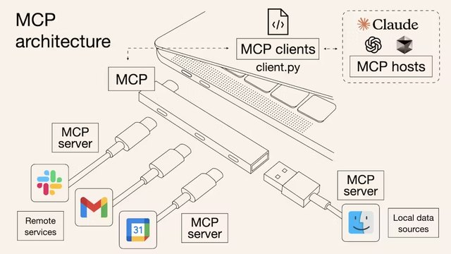
  <figcaption style="padding: 2px 8px;">
    <small>MCP를 USB 허브에 비유한 그림</small>
  </figcaption>
</figure>

<blockquote style="max-width: calc(100% - 320px);">
  <p>Agent가 K8s에 접근할 때: <code>kubectl</code> CLI를 직접 쓸까? <code>MCP</code>로 연결할까?</p>
</blockquote>

| 구분 | `kubectl` 직접 실행 | Kubernetes `MCP` |
|:---:|---|---|
| **접근 방식** | 쉘(Bash)에서 `kubectl`·스크립트 직접 실행 | 표준화된 Tool 이름으로 클러스터 API 기능 노출 |
| **장점** | 서버 없이 즉시 사용 · 기존 스크립트 재사용 | 여러 Agent에 일관된 도구 제공 · 허용 도구·파라미터 통제 |
| **단점** | 쉘 권한이면 사실상 무엇이든 실행 · 출력 파싱에 의존 | MCP 서버 구축·운영 필요 · 노출한 도구 범위로 제한 |
| **적합한 곳** | 개인 개발 · 코딩 Agent (Claude Code 등) | 팀·플랫폼 단위로 여러 Agent에 제공 |
| **구현체** | `kubectl` _JSON 출력, 안전 래퍼 스크립트_ | `kubernetes-mcp-server` · `kubectl-ai` · `K8sGPT` _MCP 모드_ |

_kubectl은 빠르고 유연, MCP는 통제와 재사용: 개인은 kubectl, 팀·플랫폼은 MCP부터 검토_<br/>
_어느 쪽이든 최소 권한(RBAC·ServiceAccount)과 실행 전 승인 절차가 핵심_

---
class: agw
---

# agentgateway <small>Agent용 게이트웨이 · '26.06 AAIF 합류</small>

<div class="arch-diagram agw-diagram">
<svg viewBox="0 0 440 172" xmlns="http://www.w3.org/2000/svg" role="img" aria-label="Agent의 LLM, MCP 도구, A2A 호출이 모두 agentgateway를 거치며 인증·가드레일·관측이 적용됨">
<defs>
<marker id="agw-arrow" viewBox="0 0 10 10" refX="9" refY="5" markerWidth="7" markerHeight="7" orient="auto"><path d="M0 0L10 5L0 10z" fill="#64748b"/></marker>
</defs>
<g stroke="#64748b" stroke-width="1.6" fill="none" marker-end="url(#agw-arrow)">
<path d="M92 86H126"/><path d="M266 70L298 32"/><path d="M266 86H298"/><path d="M266 102L298 140"/>
</g>
<g text-anchor="middle">
<rect x="10" y="62" width="82" height="48" rx="10" fill="#e8f0fe" stroke="#1055cc"/>
<text x="51" y="91" style="font-size:15px" font-weight="700" fill="#0c367b">Agent</text>
<rect x="128" y="34" width="138" height="104" rx="10" fill="#eef1f6" stroke="#64748b" stroke-width="2"/>
<text x="197" y="60" style="font-size:15px" font-weight="700" fill="#334155">agentgateway</text>
<text x="197" y="84" style="font-size:12px" fill="#475569">인증·인가</text>
<text x="197" y="102" style="font-size:12px" fill="#475569">가드레일</text>
<text x="197" y="120" style="font-size:12px" fill="#475569">관측 (OTel)</text>
<rect x="300" y="8" width="130" height="44" rx="10" fill="#e8f5e9" stroke="#34a853"/>
<text x="365" y="27" style="font-size:14px" font-weight="700" fill="#1b5e20">LLM</text>
<text x="365" y="44" style="font-size:11px" fill="#2e7d32">라우팅·폴백</text>
<rect x="300" y="64" width="130" height="44" rx="10" fill="#fff8e1" stroke="#f4b400"/>
<text x="365" y="83" style="font-size:14px" font-weight="700" fill="#7a5b00">+ MCP 도구</text>
<text x="365" y="100" style="font-size:11px" fill="#8d6e00">도구 통합·접근 제어</text>
<rect x="300" y="120" width="130" height="44" rx="10" fill="#e0f2f1" stroke="#26a69a"/>
<text x="365" y="139" style="font-size:14px" font-weight="700" fill="#00695c">+ 다른 Agent</text>
<text x="365" y="156" style="font-size:11px" fill="#00695c">A2A</text>
</g>
</svg>
</div>

| 구분 | 내용 | 비고 |
|:---:|---|---|
| **연결 대상** | **LLM** _라우팅·폴백_ + **MCP** _도구 통합·접근 제어_ + **A2A** _Agent 간 통신_ | LLM 게이트웨이에서 확장 |
| **보안 · 관측** | **인증·인가**: JWT · API Key · OAuth, 세분화된 권한·Rate Limit<br/>**가드레일 · 관측**: 콘텐츠 필터링, OpenTelemetry 메트릭·트레이싱 | 호출 경로에서 공통 보안 정책 강제 |
| **배포 방식** | **독립 실행**: 경량 단일 바이너리 / Docker + YAML 설정<br/>**Kubernetes**: 전용 컨트롤러 + **K8s Gateway API** 연동 | K8s 필수는 아님 |

_출발점은 LLM 게이트웨이: 여러 모델로 라우팅, 장애 시 다른 모델로 폴백 (Agent Router·LiteLLM)_<br/>
_agentgateway는 여기서 확장: MCP 도구 호출과 A2A Agent 간 통신까지 한 관문에서 처리_<br/>
_모든 바깥 호출에 인증·가드레일·관측 일괄 적용_

---
class: table-full agent-k8s guardrails
---

# 가드레일 <small>Guardrails AI vs NeMo Guardrails</small>

<div class="def-card">
<p><b>넓은 의미</b> AI가 엇나가지 않게 막는 모든 안전장치<br/><span>권한 확인 · AI 검토자 · RBAC · 격리 등</span></p>
<p><b>여기서는</b> 모델 입출력 내용을 검사하는 <strong>콘텐츠 가드레일</strong></p>
</div>

| 구분 | **Guardrails AI** | **NeMo Guardrails** _NVIDIA_ |
|:---:|---|---|
| **한 줄 정의** | LLM 입력·출력을 검증하는 Python 프레임워크 | LLM 대화 시스템에 프로그래밍 가능한 가드레일 추가 |
| **핵심 개념** | Validator를 조합한 Input·Output `Guard` | Colang 흐름 + YAML 설정 |
| **검사 위치** | 입력 · 출력 | 입력 · 대화 · 검색(RAG) · 실행(도구 호출) · 출력 |
| **검사 방식** | Hub Validator 65종 _규칙·ML·LLM_ PII·독성·JSON 형식 등 | LLM 자가 점검 · 안전 모델(NemoGuard) · 외부 연동(Presidio·LlamaGuard 등) |
| **중심** | Pydantic 기반 구조화 출력 검증 | 도구 호출 검사(execution rails) · LangGraph 연동 |
| **배포** | Python 라이브러리 · 서버 _OpenAI 호환 경로_ · Docker | Python 라이브러리 · 서버 _OpenAI 호환_ · K8s Helm 마이크로서비스 |
| **라이선스 · 인기** | Apache-2.0 · ★7.6k | Apache-2.0 · ★7.5k |

_가드레일: Agent가 무엇을 듣고, 말하고, 호출하는지 확인_<br/>
_Guardrails AI는 출력 형식·품질 검증 중심, NeMo Guardrails는 대화·도구 호출 흐름 통제 중심_<br/>
_보안 층 정리: 관문 통제(agentgateway) → 내용 검사(가드레일) → 실행 격리(Agent Sandbox)_

---
class: agent-k8s ak-usecase
---

# Agent Sandbox <small>Use Cases</small>

<div class="term-widget">
<div class="term-bar"><span></span><span></span><span></span><em>YOLO mode</em></div>
<pre><b>$</b> IS_SANDBOX=1 claude --dangerously-skip-permissions
<i># 일부러 길고 무섭게: 조직 정책상 막히기도, root면 환경변수까지 필요</i></pre>
</div>

<table>
<thead><tr><th style="text-align:center">Agent 위치</th><th>실행 내용</th><th style="text-align:center">일반적인 유지 기간</th></tr></thead>
<tbody>
<tr><td rowspan="3" style="text-align:center"><strong>외부</strong><br/><em>Agent가 외부에서 호출함</em></td><td>데이터 분석용 <strong>Python 스크립트</strong> 즉석 실행 및 결과 반환 <em>Code Execution</em></td><td style="text-align:center"><strong>단기</strong></td></tr>
<tr><td>격리된 Chrome 브라우저·VNC 화면 구동 후 웹 클릭·입력·스크린샷 <em>Computer Use</em></td><td style="text-align:center">중기</td></tr>
<tr><td>클라우드 Agent(Claude)의 도구 호출을 미리 준비된 샌드박스에서 대행 실행 <em>Managed Agents</em></td><td style="text-align:center">호출~세션 단위</td></tr>
<tr class="grp"><td rowspan="3" style="text-align:center"><strong>내부</strong><br/><em>Agent가 샌드박스 안에서 실행됨</em></td><td><strong>Claude Code·Aider</strong> 구동: Git 저장소 클론 후 코드 수정 및 테스트 반복 <em>Coding Agents</em></td><td style="text-align:center"><strong>중기</strong></td></tr>
<tr><td>CI/CD에서 테스트 실행·생성 코드 검증·신뢰할 수 없는 빌드 단계 격리 <em>CI/CD</em></td><td style="text-align:center">단기~중기</td></tr>
<tr><td>영속 볼륨·고정 hostname을 연동한 <strong>OpenClaw</strong> 구동: 상시 개인/팀 AI 비서 <em>OpenClaw</em></td><td style="text-align:center"><strong>상시</strong></td></tr>
</tbody>
</table>

_Sandbox = 격리된 작업 환경(Pod+볼륨)을 선언하는 K8s 리소스 · 확장: Template로 정의, WarmPool로 미리 준비, Claim으로 할당_<br/>
_Sandbox는 실행 환경만 제공하는 오케스트레이터: CI/CD·개발 환경처럼 순수 격리 실행용으로도 활용_

---
class: agent-k8s ak-overview
---

# Agent on K8s <small>4종 한눈에</small>

<div class="arch-diagram ak-diagram">
<svg viewBox="0 0 440 170" xmlns="http://www.w3.org/2000/svg" role="img" aria-label="위층 kagent와 AX는 무엇을 실행할지 정의하고 아래층 Agent Substrate 위에서 실행됨, Agent Sandbox는 독립된 실행 환경">
<defs>
<marker id="ak-arrow" viewBox="0 0 10 10" refX="9" refY="5" markerWidth="7" markerHeight="7" orient="auto"><path d="M0 0L10 5L0 10z" fill="#64748b"/></marker>
</defs>
<g style="font-size:11px" fill="#64748b">
<text x="10" y="16">정의·실행: Agent 구성·요청 관리</text>
<text x="10" y="106">실행 환경: 격리 환경·상태·자원 관리</text>
</g>
<g stroke="#64748b" stroke-width="1.6" fill="none" marker-end="url(#ak-arrow)">
<path d="M150 70L278 114"/><path d="M330 70V114"/>
</g>
<text x="250" y="96" style="font-size:11px" fill="#64748b" text-anchor="middle">기반 (kagent 1.x)</text>
<g text-anchor="middle">
<rect x="10" y="24" width="200" height="46" rx="10" fill="#e8f0fe" stroke="#1055cc"/>
<text x="110" y="46" style="font-size:15px" font-weight="700" fill="#0c367b">kagent</text>
<text x="110" y="62" style="font-size:11px" fill="#1055cc">대화형 Agent 정의·운영</text>
<rect x="230" y="24" width="200" height="46" rx="10" fill="#e8f0fe" stroke="#1055cc"/>
<text x="330" y="46" style="font-size:15px" font-weight="700" fill="#0c367b">AX</text>
<text x="330" y="62" style="font-size:11px" fill="#1055cc">Agent 작업(Task) 실행</text>
<rect x="10" y="114" width="200" height="46" rx="10" fill="#eef1f6" stroke="#64748b"/>
<text x="110" y="136" style="font-size:15px" font-weight="700" fill="#334155">Agent Sandbox</text>
<text x="110" y="152" style="font-size:11px" fill="#475569">작업 환경별 Pod · 독립</text>
<rect x="230" y="114" width="200" height="46" rx="10" fill="#e8f5e9" stroke="#34a853"/>
<text x="330" y="136" style="font-size:15px" font-weight="700" fill="#1b5e20">Agent Substrate</text>
<text x="330" y="152" style="font-size:11px" fill="#2e7d32">Actor on 공유 Worker</text>
</g>
</svg>
</div>

| 구분 | **kagent**<br/><span class="nm">K8s + agent</span> | **Agent Sandbox**<br/><span class="nm">sandbox: 격리된 실행 공간</span> | **AX**<br/><span class="nm">Agent eXecutor</span> | **Agent Substrate**<br/><span class="nm">substrate: 기반·하부층</span> |
|:---:|:---:|:---:|:---:|:---:|
| **시작 · 버전**<br/><span class="nm">'26.10.28 기준</span> | '25.01<br/>`v1.0.0-alpha17` | '25.08<br/>`v1.0.8` | '26.03<br/>`v0.3.1` | '26.05<br/>`v0.6.0` |
| **핵심 역할** | Agent 정의·운영 | 격리 작업 환경 수명주기 | Agent 작업(Task) 실행 | 상태형 워크로드 런타임 |
| **실행 단위** | Session → Actor | Sandbox → Pod | Task → Actor | Actor on Worker |
| **거버넌스** | CNCF Sandbox · Solo.io | K8s SIG Apps | Google 오픈소스 | CNCF Sandbox · Google |

_시간순: 1년 반 사이 4개 등장, Agent 실행이 K8s의 새 워크로드로_<br/>
_위층(kagent·AX)은 Agent 구성·요청 관리, 아래층(Agent Sandbox·Substrate)은 격리 환경·상태·자원 관리_<br/>
_용어: Session 대화 단위 · Task 작업 단위 · Actor 상태를 가진 실행 단위(멈췄다 이어감) · Worker Actor를 실행하는 Pod_

---
class: agent-k8s pod-actor
---

# Agent 배포 단위 <small>전용 Pod 유지 vs Actor 기반 자원 재사용</small>

<div class="term-widget">
<div class="term-bar"><span></span><span></span><span></span><em>며칠 뒤</em></div>
<pre><b>$</b> codex resume 01a1d080-a667-7ec2-a882-d98fddf042a1
<i># 프로세스는 이미 끝났어도 Agent 작업은 이어짐</i></pre>
</div>

<div class="arch-diagram pa-diagram">
<svg viewBox="0 0 540 178" xmlns="http://www.w3.org/2000/svg" role="img" aria-label="왼쪽: 세션마다 전용 Pod, 대기 중에도 Pod 점유. 오른쪽: Actor가 공유 Worker를 쓰고, 대기 중인 Actor는 Snapshot으로 저장 후 재개 시 복원">
<defs>
<marker id="pa-arrow" viewBox="0 0 10 10" refX="9" refY="5" markerWidth="7" markerHeight="7" orient="auto"><path d="M0 0L10 5L0 10z" fill="#64748b"/></marker>
</defs>
<g style="font-size:13px" font-weight="700" fill="#334155" text-anchor="middle">
<text x="120" y="16">작업 환경별 전용 Pod</text>
<text x="405" y="16">Actor + 공유 Worker</text>
</g>
<line x1="262" y1="6" x2="262" y2="172" stroke="#cbd5e1" stroke-dasharray="4 4"/>
<g stroke="#64748b" stroke-width="1.5" fill="none" marker-end="url(#pa-arrow)">
<path d="M100 44H136"/><path d="M100 92H136"/><path d="M100 140H136"/>
<path d="M352 44L410 64"/><path d="M352 92L410 92"/><path d="M352 140H410"/>
<path d="M470 128V112" stroke-dasharray="4 3"/>
</g>
<g text-anchor="middle" style="font-size:12px">
<rect x="10" y="28" width="90" height="32" rx="8" fill="#e8f0fe" stroke="#1055cc"/><text x="55" y="49" fill="#0c367b">세션 A 실행</text>
<rect x="10" y="76" width="90" height="32" rx="8" fill="#f8fafc" stroke="#94a3b8" stroke-dasharray="4 3"/><text x="55" y="97" fill="#64748b">세션 B 대기</text>
<rect x="10" y="124" width="90" height="32" rx="8" fill="#e8f0fe" stroke="#1055cc"/><text x="55" y="145" fill="#0c367b">세션 C 실행</text>
<rect x="138" y="28" width="112" height="32" rx="8" fill="#eef1f6" stroke="#64748b"/><text x="194" y="49" fill="#334155">Pod A</text>
<rect x="138" y="76" width="112" height="32" rx="8" fill="#fde7c8" stroke="#d9a35b"/><text x="194" y="97" fill="#8a5a00">Pod B · 유휴 점유</text>
<rect x="138" y="124" width="112" height="32" rx="8" fill="#eef1f6" stroke="#64748b"/><text x="194" y="145" fill="#334155">Pod C</text>
<rect x="272" y="28" width="80" height="32" rx="8" fill="#e8f0fe" stroke="#1055cc"/><text x="312" y="49" fill="#0c367b">Actor A</text>
<rect x="272" y="76" width="80" height="32" rx="8" fill="#e8f0fe" stroke="#1055cc"/><text x="312" y="97" fill="#0c367b">Actor B</text>
<rect x="272" y="124" width="80" height="32" rx="8" fill="#f8fafc" stroke="#94a3b8" stroke-dasharray="4 3"/><text x="312" y="145" fill="#64748b">Actor C 대기</text>
<rect x="412" y="28" width="118" height="84" rx="10" fill="#e8f5e9" stroke="#34a853"/>
<text x="471" y="46" style="font-size:11px" fill="#2e7d32">공유 Worker Pool</text>
<rect x="424" y="54" width="94" height="22" rx="6" fill="#fff" stroke="#34a853"/><text x="471" y="69" fill="#1b5e20">Worker 1</text>
<rect x="424" y="82" width="94" height="22" rx="6" fill="#fff" stroke="#34a853"/><text x="471" y="97" fill="#1b5e20">Worker 2</text>
<rect x="412" y="128" width="118" height="30" rx="8" fill="#fff8e1" stroke="#f4b400"/><text x="471" y="148" fill="#7a5b00">Snapshot 저장</text>
<text x="500" y="124" style="font-size:10px" fill="#64748b">복원</text>
</g>
</svg>
</div>

<div class="quote-row">
<blockquote><p>Pod는 훌륭한 Execution 단위지만, Agent의 Lifecycle 단위로는 맞지 않는 경우가 많음 <small>CNCF 블로그, 2026.07</small></p></blockquote>
</div>

| 구분 | **작업 환경별 전용 Pod 유지** | **Actor 단위 다중화** *(N Actors on Worker Pool)* |
|:---:|---|---|
| **동작 방식** | 작업 환경마다 전용 Pod (`Deployment`·`WarmPool`) | Pod는 **공유 Worker Pool**로 두고, 세션을 `Actor`로 관리 |
| **유휴 시 특징** | 작업 대기 중에도 Pod를 계속 점유 *직관적이지만 비효율* | 대기 시 **Snapshot** 저장 후 Worker를 풀로 반환 *효율적* |
| **대표 프로젝트** | **`Agent Sandbox`** (Pod 관리, WarmPool 선택) | **`Agent Substrate`** 기반 **`kagent` 1.x alpha** · **`AX`** |
| **선택 기준** | 전용 환경 유지·단순한 수명주기 관리가 맞을 때 | 유휴 비율이 높고, 복원 지연보다 자원 절감이 클 때 |

_비유: 전용 Pod는 개인 사무실, Actor는 공유 오피스 (자리 비우면 짐은 사물함 = Snapshot)_<br/>
_발전 방향: 직관적인 전용 Pod 격리와, 유휴 세션이 많은 대규모 환경을 겨냥한 Actor 다중화의 공존_<br/>
_선택 시 고려사항: 유휴 비율, 보존할 상태의 크기, 스냅샷 복원 지연(Latency)_

---
class: agent-k8s rt-pair
---

# 실행 환경 <small>Agent Sandbox vs Agent Substrate</small>

| 구분 | **Agent Sandbox** | **Agent Substrate** |
|:---:|---|---|
| **한 줄 정의** | 격리 작업 환경(Pod·저장소)을 선언하고 수명주기 관리 | 상태를 가진 Actor를 공유 Worker 위에서 실행하는 런타임 |
| **핵심 리소스** | `Sandbox` · `SandboxTemplate` · `SandboxWarmPool` · `SandboxClaim` | `Actor` · `ActorTemplate` · `Worker` · `WorkerPool` · `Snapshot` |
| **실행 흐름** | Sandbox 직접 생성 · 확장 시 Template → Claim _WarmPool 선택_ | Worker 배정 → Snapshot 복원 → 격리 실행 → 저장 후 Worker 반환 |
| **상태 보존** | 영속 볼륨 · GKE Pod Snapshot _gVisor 전용_ | Snapshot _Full: 메모리+파일, Data: 영속 데이터_ |
| **격리** | gVisor · Kata _런타임이 담당_ | gVisor · Cloud Hypervisor microVM |
| **쓰임** | 코드 실행 도구 · Agent 자체 격리 실행 | kagent 1.x(Session) · AX(Task)의 공통 실행 엔진 |

_핵심 차이: 작업 환경 하나에 Pod 하나(Agent Sandbox) vs 여러 Actor가 Worker를 시간차로 공유(Agent Substrate)_<br/>
_앞 장 비유로: Agent Sandbox는 개인 사무실 관리, Agent Substrate는 공유 오피스 운영_<br/>
_선택: 전용 환경을 오래 유지하면 Agent Sandbox, 쉬는 세션이 많으면 Agent Substrate_<br/>
_표준화 동향: KEP-5823 <strong>Pod 스냅샷</strong>(체크포인트·복원)을 K8s 표준으로 (v1.38 Alpha 목표)_

---
class: table-full agent-k8s ak-platform
---

# 정의·실행 <small>kagent vs AX</small>

<div class="term-widget">
<div class="term-bar"><span></span><span></span><span></span><em>AX 중단·재개</em></div>
<pre><b>$</b> ax suspend task my-task  <i># actor 상태 체크포인트 후 일시 정지</i>
<b>$</b> ax resume task my-task   <i># 저장된 상태로 작업 재개</i></pre>
</div>

| 구분 | **kagent** | **AX** _Agent Executor_ |
|:---:|---|---|
| **한 줄 정의** | 대화형 Agent를 K8s 리소스로 정의·운영 | Agent 작업(Task)을 선언하고 실행 |
| **정의 방식** | `AgentTemplate`(무엇을) + `Harness`(어디서·어떻게) = `Agent` CRD | `Task` · `Workspace` · `Model` YAML → `ax apply` |
| **실행 단위** | `Session` _대화, PostgreSQL 저장_ | `Task` _중단·재개 가능한 작업, Substrate Actor로 실행_ |
| **특징** | 턴 종료 시 영속 데이터 스냅샷(`Data`) 저장 후 Worker 반납 _재개 시 새 컨테이너_ | `suspend`·`resume` · Workspace를 자연어 goal로 자동 구성 |
| **기반** | `Deployment`(0.x) → **Agent Substrate**(1.x alpha) | **Agent Substrate** Actor로 실행 |
| **시작** | Solo.io · CNCF Sandbox | Google 오픈소스 |

_kagent는 대화(Session) 단위, AX는 작업(Task) 단위로 Agent를 다룸_<br/>
_공통 기반: 둘 다 Agent Substrate의 Actor로 실행 (kagent는 1.x부터)_<br/>
_멈추고 이어가기: kagent는 턴이 끝날 때마다 자동으로, AX는 <code>suspend</code>·<code>resume</code> 명령으로_

---
class: section
---

# 마무리

---
class: cols points wrapup
---

# Wrap-up <small>세 줄 요약 및 제언</small>

- ### 📌 세 줄 요약

  1. **생태계 지도 읽기**<br>
     CNCF는 AI 전반, AAIF는 Agent 중심 · **기술 계층 × 대상 워크로드**로 정리하면 한눈에
  2. **Agent 보안은 층층이**<br>
     관문 통제(`agentgateway`) → 내용 검사(가드레일) → 실행 격리(Sandbox) + **RBAC 최소 권한**
  3. **Agent on K8s의 태동**<br>
     전용 Pod(`Agent Sandbox`)에서 Actor 다중화(`Agent Substrate`)로, 그 위에 `kagent`·`AX`
- ### 💡 엔지니어의 몫

  - **변화의 속도에 대처하기**<br>
    개별 도구를 쫓기보다 **기술 계층과 목적** 중심의 지도를 먼저 파악
  - **권한과 책임의 영역**<br>
    구현·실행은 Agent에 위임하더라도, **아키텍처 설계 · 권한 가드레일 · 최종 책임**은 사람의 영역

_모델 서빙에 이어 Agent 실행·격리·게이트웨이: K8s 엔지니어의 새 영역_

<p class="thanks">Thank you!</p>
