# Kubernetes 엔지니어가 둘러본<br>AI Agent 생태계

<p class="author">김정민 / 삼성SDS</p>

<p class="event">Kubernetes Korea Group<br>Meetup 26.10</p>

---
class: speaker
---

<div class="speaker-sidebar">
  <h2>발표자</h2>
</div>

<div class="speaker-main">
  
  <div class="speaker-title">김정민 / 삼성SDS / Cloud Engineer</div>
  <div class="speaker-bio">
    Samsung Kubernetes Engine을 개발하는 업무를 하고 있습니다.<br>
    K8s와 Go 테스트 관련 주제에 관심이 많습니다.
  </div>
  <div class="speaker-link">
    발표자료 <a href="https://github.com/jmnote/slides" target="_blank" rel="noopener">https://github.com/jmnote/slides</a>
  </div>
  <div class="speaker-github">
    <svg viewBox="0 0 24 24"><path fill-rule="evenodd" clip-rule="evenodd" d="M12 2C6.477 2 2 6.484 2 12.017c0 4.425 2.865 8.18 6.839 9.504.5.092.682-.217.682-.483 0-.237-.008-.868-.013-1.703-2.782.605-3.369-1.343-3.369-1.343-.454-1.158-1.11-1.466-1.11-1.466-.908-.62.069-.608.069-.608 1.003.07 1.53 1.032 1.53 1.032.892 1.53 2.341 1.088 2.91.832.092-.647.35-1.088.636-1.338-2.22-.253-4.555-1.113-4.555-4.951 0-1.093.39-1.988 1.029-2.688-.103-.253-.446-1.272.098-2.65 0 0 .84-.27 2.75 1.026A9.564 9.564 0 0112 6.844c.85.004 1.705.115 2.504.337 1.909-1.296 2.747-1.027 2.747-1.027.546 1.379.202 2.398.1 2.651.64.7 1.028 1.595 1.028 2.688 0 3.848-2.339 4.695-4.566 4.943.359.309.678.92.678 1.855 0 1.338-.012 2.419-.012 2.747 0 .268.18.58.688.482A10.019 10.019 0 0022 12.017C22 6.484 17.522 2 12 2z"/></svg>
    <a href="https://github.com/jmnote" target="_blank" rel="noopener">jmnote</a>
  </div>
</div>

---
class: toc
---

<div class="toc-sidebar">
  <h2>목차</h2>
</div>

<div class="toc-main">
  <div class="toc-list">
    <div class="toc-item">
      <span class="toc-num">Ⅰ.</span>
      <span class="toc-text">배경</span>
    </div>
    <div class="toc-item">
      <span class="toc-num">Ⅱ.</span>
      <span class="toc-text">분류 체계</span>
    </div>
    <div class="toc-item">
      <span class="toc-num">Ⅲ.</span>
      <span class="toc-text">관심 프로젝트 비교</span>
    </div>
    <div class="toc-item">
      <span class="toc-num">Ⅳ.</span>
      <span class="toc-text">마무리</span>
    </div>
  </div>
</div>

---
class: section
---

<div class="section-content">
  <span class="section-badge">Ⅰ</span>
  <span class="section-title">배경 <small class="pen">2026년</small></span>
</div>

---
---

<header class="slide-header">
<h1>2026년 <small>AI 시대 실감</small></h1>
</header>

<div class="two-cols">
<div>

### 작년과는 다르다…

- 코드를 직접 보는 일 대폭 감소
- Markdown 문서 중심 <span class="pen">(가끔 테스트 코드)</span>
- 기업 코딩테스트 폐지 추세 <span class="pen">(AI 활용 평가 대체)</span>

### Agent가 잘하는 것

코딩, 코드 리뷰, 테스트 코드 작성, 문서 작성, 설계, 로그 분석, 문의 대응, 신기술 탐색…

<p class="highlight-blue">언어/도구 go, gh, kubectl, openstack cli… 그냥 다 잘함</p>

<p class="pen">아직 못하는 것? 내 마음에 드는 PPT 작성 ㅎ</p>

</div>
<div>

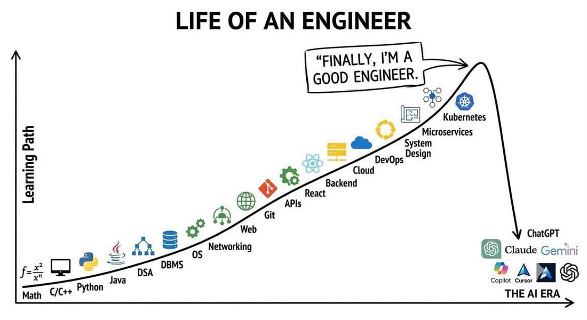
<div class="pen source">claude community - Facebook 2026-09-18</div>

<div class="pen notes">
- 수학/물리학 난제 해결<br>
- 보안 취약점 발견<br>
- 'AI 블루' / 'claude Blue'<br>
약간의 허탈감과 위기의식?
</div>

</div>
</div>

---
class: table-lg
---

<header class="slide-header">
  <h1>Agent 사용환경</h1>
  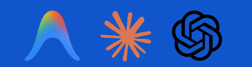
</header>

| 구분 | CLI | Desktop App | IDE |
|:---:|:---:|:---:|:---:|
| **Antigravity** | `agy` | Antigravity App | Antigravity IDE<br/>VS Code ext <span class="pen">'26.09</span> |
| **Claude** | `claude` | Claude | VS Code extension |
| **Codex** | `codex` | ChatGPT (codex) | VS Code extension |
| **기타** | - | OpenClaw | Cursor <span class="pen">'26.06 600억$</span><br/>Zed <span class="pen">경량, ACP 연계</span> |
| <span class="pen">의견</span> | <span class="pen">가벼움, 터미널의 간결함</span> | <span class="pen">브라우저 통합 등 GUI의 편리함<br/>컴퓨터를 맡기는 느낌</span> | <span class="pen">익숙한 개발환경의 편안함</span> |

<div class="pen" style="margin-top: 12px; font-size: 22px;">※ 간단한 질문/조사는 chat(web) 사용</div>

---
---

# AI Gauge <small>Windows 시스템 트레이 쿼터 모니터링 앱</small>

- **5h / 7d / 월간 사용량, 리셋 시각, 리셋 크레딧 확인** *(Codex, Claude, Antigravity, GitHub Copilot 등)*
- **Windows용 시스템 트레이 앱**, **Apache-2.0 라이선스** (Microsoft Store 배포)
- **'26.09 개발** — 당시 찾아본 도구 중 원하는 **윈도우용 × 오픈소스** 조합을 찾지 못해 직접 개발

<div class="gallery-3">

| Microsoft Store | 사용량·쿼터 모니터링 | 프로바이더·알림 설정 |
|:---:|:---:|:---:|
| 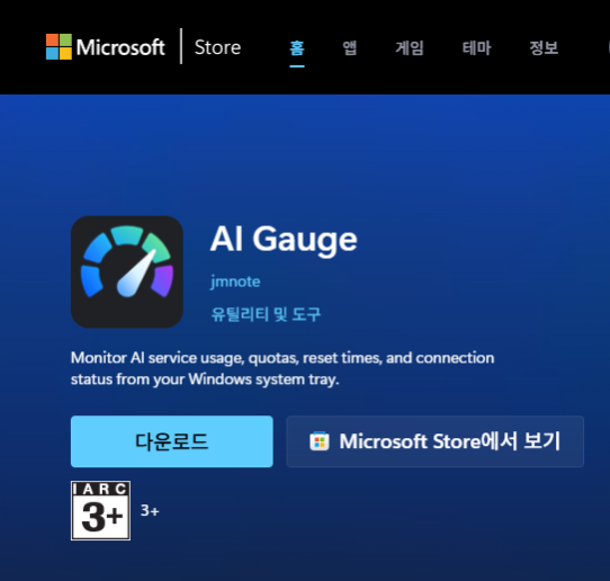 | 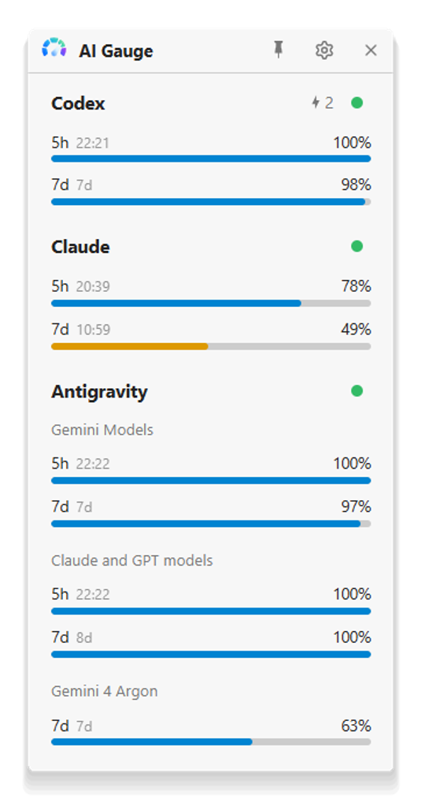 | 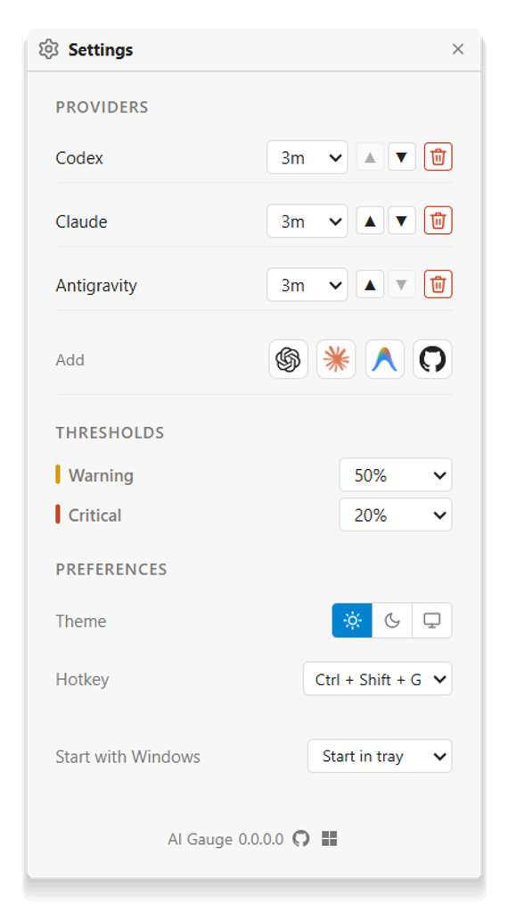 |

</div>

---
---

# 출발점과 접근법 <small>K8s 엔지니어 시선의 조망</small>

<p class="highlight-blue" style="font-size: 24px; margin-bottom: 24px;">
  급변하는 AI 기술을 K8s 엔지니어 시선으로 폭넓게 탐색·분류·비교
</p>

<div class="two-cols">
<div>

### 출발점 (Why)

- **쏟아지는 AI 기술**: 개별 도구를 쫓기보다 전체 생태계의 큰 그림 파악
- **K8s 엔지니어의 시선**: AI와 K8s가 만나는 생태계 분류, 프로젝트 비교
- **선택과 집중**: 상세 분석보다 전체적인 맥락과 조망 중심

</div>
<div>

### 접근법 (How)

- **01 개념 정리 · Landscape 탐색**<br>
  기본 개념 정리, AAIF · CNCF 프로젝트 조사
- **02 생태계 분류 체계**<br>
  실행 위치 · 목적 · 기술 계층 × 대상 워크로드
- **03 Agent on K8s 프로젝트 비교**<br>
  kagent · Agent Sandbox · AX · Agent Substrate 4종 비교

</div>
</div>

---
class: section
---

<div class="section-content">
  <span class="section-badge">Ⅱ</span>
  <span class="section-title">분류 체계</span>
</div>

---
---

# LLM 활용 <small>코드 규칙에서 자연어 추론으로</small>

<div class="two-cols">
<div>

### 패러다임의 변화

- **규칙 기반 코딩 (`if/else`)**:
  - `positives = ["yes", "yeah", "yep", ...]`
  - 끝없는 예외 처리와 표현의 한계
- **전통 머신러닝 (감성 분석)**:
  - 긍정/부정 분류 모델 학습 및 확률 점수화
- **LLM 등장 이후**:
  - 프롬프트 몇 줄로 복잡한 뉘앙스와 맥락 파악
  - 원하는 JSON 구조(`{"positive": true}`)로 즉시 추출

<div style="background: #eaf1fb; border-left: 4px solid #1055cc; padding: 10px 16px; border-radius: 4px; font-size: 19px; margin-top: 16px;">
  <b>프롬프트:</b> "그녀의 대답이 긍정인지 부정인지 판단해서 JSON으로 응답해줘: {answer}"<br>
  <b>응답:</b> <code>{"positive": true}</code>
</div>

</div>
<div>

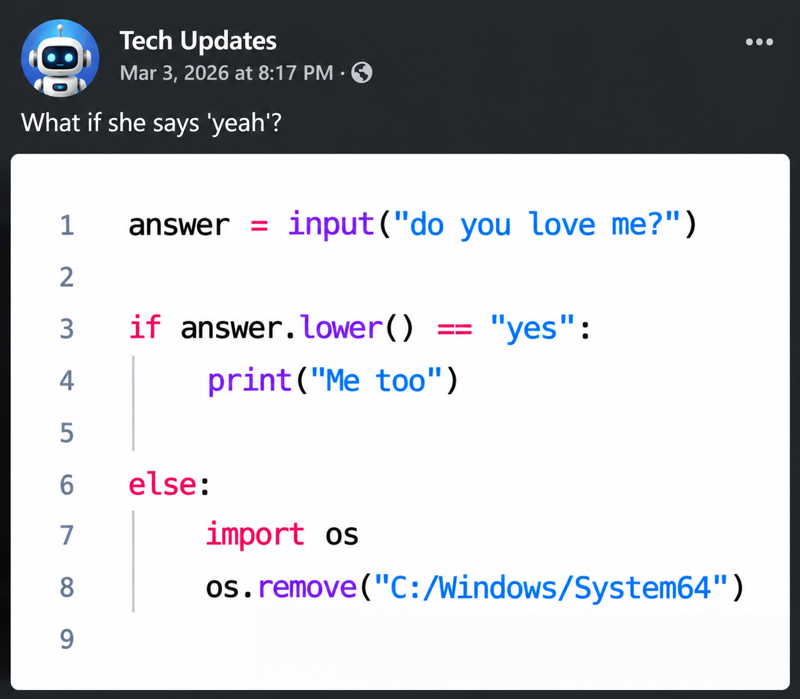

<div class="pen" style="font-size: 24px; text-align: center; margin-top: 8px;">
  "What if she says 'yeah'?" — 규칙 코딩의 악몽을 LLM이 해결!
</div>

</div>
</div>

---
---

# AI Agent 개발 예시 <small>날씨 조회 에이전트 (LangChain)</small>

- [LangChain 공식 Quickstart](https://docs.langchain.com/oss/python/langchain/quickstart)의 `get_weather` 예제로 본 **에이전트 동작과 프롬프트 구성** *(모의 도구)*

```python
from langchain.agents import create_agent

def get_weather(city: str) -> str:
    """Get weather for a given city."""        # 1. 도구 프롬프트 (Docstring + 타입 힌트)
    return f"It's always sunny in {city}!"

agent = create_agent(
    model="anthropic:claude-sonnet-4-5",       # 2. 추론 모델 (Model runtime)
    tools=[get_weather],                       # 3. 사용할 도구 목록 (Tools)
    system_prompt="You are a helpful assistant", # 4. 시스템 프롬프트 (역할 · 행동 지침)
)
result = agent.invoke({"messages": [{"role": "user", "content": "what is the weather in sf"}]})
```

---
---

# AI Agent 개발 예시 <small>실행 흐름과 도구 호출</small>

<div class="two-cols">
<div>

### 4단계 실행 흐름

1. **사용자 요청 입력**<br>
   `"what is the weather in sf"`
2. **프롬프트 합성 & 모델 전송**<br>
   `system_prompt` + `get_weather`의 Docstring·인자 스키마를 LLM에 전달
3. **도구 호출 결정**<br>
   LLM이 스키마를 해석하고 `get_weather("San Francisco")` 호출 결정
4. **결과 반영 & 최종 답변 생성**<br>
   런타임이 함수를 실행하고 반환값을 LLM에 넘겨 최종 자연어 응답 생성

</div>
<div>

### 복합 작업과 확장

- **도구 호출 반복 (ReAct Loop)**<br>
  단순 조회를 넘어 결과에 따라 추가 도구를 연쇄 호출
- **실무 설계 예시: CI/CD 실패 분석**<br>
  - **입력**: commit 내역, CI 로그, 디버그 지침
  - **작업**: 원인 파악, 코드 수정안 diff 생성, 단위 테스트 검증
  - **가드레일**: 안전을 위해 자동 머지/배포는 제외하고 제안만 수행
- **Google ADK Python**<br>
  에이전트 정의와 로컬 CLI(`adk run` · `adk web`) 제공

</div>
</div>

---
class: visual
---

# AI Agent 구성요소 <small>아키텍처</small>

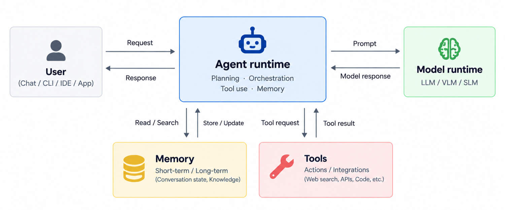

---
---

# AI Agent 구성요소 <small>4대 핵심 역할</small>

<div class="table-lg">

| 구성요소 | 핵심 역할 | 설명 |
|:---:|:---:|---|
| **Agent runtime** | 실행 흐름 · 상태 관리 | 모델 판단과 애플리케이션 로직에 따라 실행 순서·상태·도구 호출 관리 |
| **Model runtime** | LLM / VLM 추론 | 에이전트의 두뇌 역할, 프롬프트 수신 및 모델 언어 추론 수행 |
| **Memory** | 대화 상태 및 장기 기억 | 세션 컨텍스트 유지 및 벡터 DB 기반 장기 지식 베이스 참조 |
| **Tools** | 외부 API 호출 및 작업 | 웹 검색, 외부 API 연동, CLI/코드 실행 등 실제 액션 수행 |

</div>

<p class="pen" style="margin-top: 24px; text-align: center; font-size: 26px;">
  👉 Model(두뇌) + Tools(손발) + Memory(기억)을 Agent Runtime(몸체)이 유기적으로 조율
</p>

---
---

# AI 모델 학습부터 Agent 운영까지

<div style="margin-bottom: 20px;">

| 1. 모델 학습 | 2. 모델 서빙 | 3. Agent 개발 | 4. Agent 운영 |
|:---:|:---:|:---:|:---:|
| • 학습 데이터셋 정제<br/>• 사전학습 (Pre-training)<br/>• 파인튜닝 (SFT / DPO) | • 가중치 호스팅 (vLLM, TGI)<br/>• 추론 최적화 & 가속 (GPU)<br/>• OpenAI 호환 API 엔드포인트 | • 프롬프트 & ReAct 루프<br/>• 도구 연동 (Tools / MCP)<br/>• 멀티에이전트 워크플로우 | • 실행 런타임 샌드박스<br/>• Observability & 추적<br/>• 보안, 게이트웨이, 평가 |

</div>

| 구분 | 장점 | 단점 | 비고 |
|:---:|---|---|---|
| **직접 모델 개발**<br/>*(Training)* | • 자체 기술 및 독자 모델 확보<br/>• 특화 도메인 모델 완성 가능 | • 막대한 컴퓨팅 자원 및 인력 필요<br/>• 높은 실패 위험성과 가성비 | • 대규모 분산 학습 인프라 구축<br/>• 고속 네트워크 / Slurm / Kubeflow 활용 |
| **오픈 웨이트 모델**<br/>*(Open-Weight)* | • 자체 호스팅으로 완벽한 데이터 통제<br/>• 도메인 특화 파인튜닝 가능<br/>• 클라우드 락인 회피 | • GPU 인프라 유지 비용 부담<br/>• 서빙 파이프라인 운영 복잡도 | • Kubernetes(vLLM, Ray) 기반 GPU 스케줄링<br/>• Triton/vLLM 등 서빙 인프라 자동화 필요 |
| **외부 API 서비스**<br/>*(Commercial API)* | • 모델 인프라 운영 부담 제로<br/>• 최신 최고 성능(SOTA) 모델 즉시 활용<br/>• 빠른 비즈니스 검증 | • 높은 사용량 시 비용 예측 불확실<br/>• 데이터 보안 및 규제 컴플라이언스<br/>• Rate Limit 제약 | • AI Gateway (LiteLLM 등) 구축<br/>• 키 관리, 캐싱, 토큰 쿼터/레이트 리밋 제어 |

---
class: dense
---

# K8s × AI <small>실행 위치와 사용 목적</small>

| 구분 | 1. 모델 학습·서빙 on K8s | 2. AI for K8s (클러스터 운영·지원) | 3. Agent on K8s (에이전트 실행·격리) |
|:---:|---|---|---|
| **핵심 목적** | **대규모 AI 인프라 수용**<br/>• 모델 학습·서빙 파이프라인 컨테이너화<br/>• 분산 대규모 GPU 풀 오케스트레이션 | **AIOps 기반 클러스터 운영·지원**<br/>• 클러스터 상태 진단 및 장애 원인 조사<br/>• 자연어 기반 클러스터 진단·쿼리·조작 | **안전한 자율 실행 샌드박스·세션**<br/>• 에이전트·생성 코드의 동적 격리 실행<br/>• 상태 보존 세션(중단·재개) 및 빠른 환경 할당 |
| **핵심 K8s 기술** | • GPU 가상화·슬라이싱 (MIG, vGPU)<br/>• **Kueue** 기반 배치 큐잉 & 자원 선점<br/>• **DRA** (Dynamic Resource Allocation) | • 클러스터 이벤트·로그·메트릭 수집 연동<br/>• Controller·CRD·도구 연동 진단·복구 루프<br/>• RBAC 최소 권한 격리 및 실행 승인 가드레일 | • **gVisor** · **Kata Containers** · MicroVM 격리<br/>• NetworkPolicy 및 임시·영속 볼륨 제어<br/>• Warm Pool·스냅샷 기반 Pod·Worker 수명주기 제어 |
| **관련 오픈소스** | **Kubeflow**, **Ray (KubeRay)**, **vLLM**, **KServe**, **llm-d**, **LWS**, Triton | **K8sGPT**, **HolmesGPT**, **kubectl-ai** | **kagent**, **Agent Sandbox**, **AX**, **Agent Substrate**, **OpenSandbox**, E2B |

- **Agent on K8s ⊂ AI on K8s** — 모델 학습·서빙과 에이전트 실행을 설명 편의상 나눔
- **AI on은 실행 위치, AI for는 사용 목적** — K8s 위에서 클러스터를 돕는 Agent는 둘 다 해당
- **kagent**의 목적은 **Agent on K8s**이지만, 클러스터 운영 자동화(**AI for K8s**) Use case 많음

---
class: dense
---

# K8s & AI Conformance <small>CNCF 적합성 인증</small>

<p class="highlight-blue" style="font-size: 21px; margin: 0 0 10px 0;">
  상호운용성 확보를 위한 CNCF 적합성 인증 · 기본 K8s 인증 위에 AI/ML 실행 역량 추가 확인
</p>

| 검증 영역 | Kubernetes Conformance | AI 추가 검증 영역 예시 |
|:---:|---|---|
| **시작** | '17.11 | '25.11 |
| **API·워크로드** | API 탐색·CRUD·Watch, 워크로드 제어, Pod 수명주기·Probe | AI Operator의 Pod·웹훅·Custom Resource 조정 |
| **네트워크** | Service·EndpointSlice·DNS | Gateway API 기반 추론 트래픽 관리 |
| **배치·자원 관리** | 노드 선택·자원 요청·우선순위·할당량 | Gang Scheduling, GPU 공유·가상화(권고) |
| **스케일링·관측성** | 복제본 수 조절·Scale API | AI 지표 기반 Pod 확장·가속기 노드 확장(조건부), 가속기·워크로드 메트릭 |
| **보안·격리** | ServiceAccount·토큰·접근 권한 판정 | 가속기 접근 격리·중재, 호스트 커널과 강한 실행 격리(권고) |
| **설정·스토리지·확장** | ConfigMap·Secret·볼륨, CRD·Admission Webhook | 기본 인증에 포함 |

<p class="pen" style="font-size: 20px; margin-top: 10px;">
  ※ 플랫폼의 기반 인프라 역량을 검증하며, Agent 애플리케이션 전체를 인증하는 것은 아님 (출처: CNCF k8s-conformance)
</p>

---
class: visual
---

# 재단 (3) LF · CNCF · AAIF <small>생태계 관계도</small>

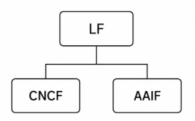

---
---

# 재단 (3) LF · CNCF · AAIF <small>역할 및 소속 비교</small>

<div class="table-lg">

| 구분 | **LF**<br/>Linux Foundation | **CNCF**<br/>Cloud Native Computing Foundation | **AAIF**<br/>Agentic AI Foundation |
|:---:|---|---|---|
| **설립** | 2007-01 | 2015-07 | 2025-12 |
| **목적** | Linux 지원에서 출발한 오픈소스 프로젝트 · 산하 재단의 모체 | 클라우드 네이티브 컴퓨팅 대중화, 컨테이너·인프라 및 AI 네이티브 생태계 육성 | Agentic AI 도구·프로토콜의 중립적 거버넌스, 상호운용성 및 생태계 육성 |
| **소속 프로젝트** | Linux 커널 · PyTorch · Node.js | **200개 이상**<br/>Kubernetes · Prometheus · Envoy · Kubeflow · kagent · Agent Substrate | **10개**<br/>MCP · A2A · agentgateway · goose · AGENTS.md · Agent Router 등 |

</div>

- **Landscape·회원은 재단별 별도 운영**: 재단별 관심사와 거버넌스 기준 차이
- **프로젝트 이동**: A2A (LF → AAIF), Agent Router (CNCF → AAIF)
- **Landscape 양쪽 등록**: kagent (소속은 CNCF, AAIF에도 등재) 등 다수

---
---

# Landscape by CNCF · AAIF <small>관점과 범위의 차이</small>

<div class="two-cols">
<div>

<div style="font-weight: 700; color: #1055cc; margin-bottom: 8px; text-align: center;">CNCF Landscape — AI Native</div>

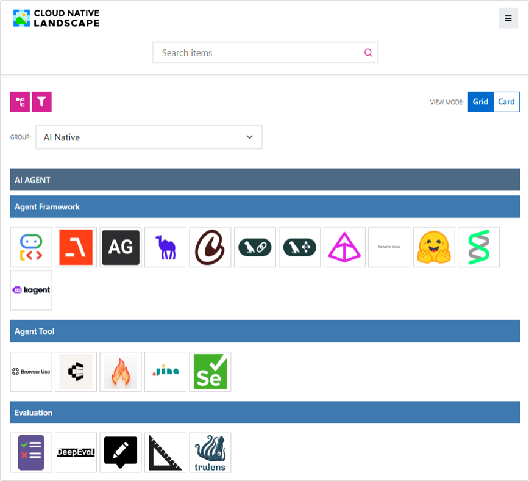

<div class="pen" style="font-size: 22px; text-align: center; margin-top: 8px;">
  LangChain, LangGraph (AI Agent / Agent Framework)
</div>

</div>
<div>

<div style="font-weight: 700; color: #1055cc; margin-bottom: 8px; text-align: center;">AAIF Landscape</div>

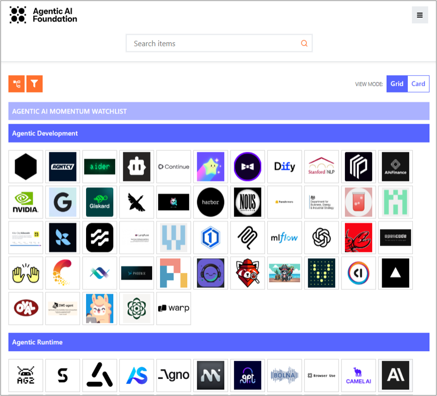

<div class="pen" style="font-size: 22px; text-align: center; margin-top: 8px;">
  MCP (Data & Knowledge), kagent (Agentic Runtime)
</div>

</div>
</div>

---
---

# Landscape by CNCF · AAIF <small>분류 체계 비교표</small>

<div class="table-lg">

| 구분 | CNCF Landscape — AI Native | AAIF Landscape |
|:---:|---|---|
| **URL** | https://landscape.cncf.io/?group=ai-native | https://landscape.aaif.io/ |
| **관점·범위** | AI 수명주기(데이터·학습·추론·에이전트)와 클라우드 네이티브 인프라 | Agentic AI 생태계의 오픈소스·개방형 표준 분류 |
| **대분류** | `AI Agent` · `Inference` · `Training` · `Data` · `AI Native Infra` | `Gateway & Control Plane` · `Agentic Runtime` · `Protocols & Interfaces` · `Data & Knowledge` · `Agentic Development` |
| **등재 기준** | GitHub ★ 300+ *(상용·폐쇄형 제품도 설명 있으면 포함)* | 오픈소스 한정, GitHub ★ 1,000+ *(폐쇄형·독점 규격 제외)* |
| **공통 등재** | • **kagent · ADK · LangGraph**: `AI Agent / Framework`<br/>• **KServe · vLLM**: `Inference`<br/>• **MCP · A2A**: `AI Agent / Protocol` | • **kagent · ADK · LangGraph**: `Agentic Runtime`<br/>• **KServe · vLLM**: `Agentic Runtime`<br/>• **MCP**: `Data & Knowledge` / **A2A**: `Protocols` |

</div>

---
class: visual
---

# CNCF Landscape — AI Native <small>구조도</small>

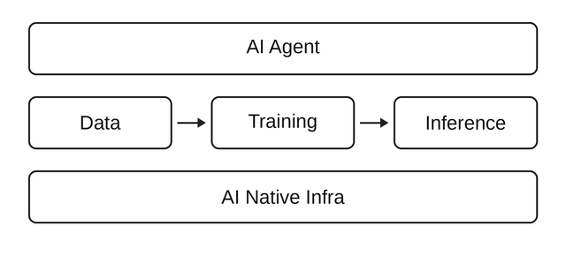

---
---

# CNCF Landscape — AI Native <small>5대 영역 세부 분류</small>

<p class="highlight-blue" style="font-size: 21px; margin: 0 0 12px 0;">
  모델 파이프라인(Data → Training → Inference) 위에 <b>AI Agent</b>, 아래에 <b>AI Native Infra</b>
</p>

| 대분류 | 주요 영역 | 프로젝트 예시 |
|:---:|---|---|
| **AI Agent** | 에이전트 구성·애플리케이션 실행 | **kagent**, ADK, LangGraph, MCP, A2A, LlamaIndex, Milvus |
| **Inference** | 학습된 모델을 이용한 추론 | **KServe**, **llm-d**, vLLM, SGLang, llama.cpp |
| **Training** | 모델 학습·조정·평가 | **Kubeflow Training Operator**, DeepSpeed, Ray, DeepEval |
| **Data** | AI용 데이터 처리·분석 | **Kubeflow Notebooks**, Apache Flink, Trino, Feast |
| **AI Native Infra** | AI 워크로드의 공통 실행·운영 기반 | **Agent Sandbox**, **Kueue**, **agentgateway**, **gVisor·Kata** |

<p class="pen" style="font-size: 22px; margin-top: 14px;">
  ※ 인프라뿐 아니라 범용 에이전트 프레임워크·프로토콜(ADK, LangGraph, MCP, A2A 등)을 폭넓게 포함
</p>

---
---

# AAIF Landscape <small>5대 영역 세부 분류</small>

<p class="highlight-blue" style="font-size: 21px; margin: 0 0 12px 0;">
  Agentic AI 생태계의 오픈소스 및 개방형 표준 분류
</p>

| 분류 | 주요 영역 | 등재 프로젝트 예시 |
|:---:|---|---|
| **Gateway & Control Plane** | 연결·라우팅·접근 제어·가드레일 | **agentgateway**, **Agent Router**, Guardrails AI, NeMo Guardrails |
| **Agentic Runtime** | 에이전트 구성·실행과 모델·추론·서빙 기반 | **kagent**, LangGraph, Google ADK, CrewAI, **KServe**, vLLM, Temporal |
| **Protocols & Interfaces** | 에이전트·시스템 간 통신 규약·인터페이스 | **A2A**, AG-UI |
| **Data & Knowledge** | 데이터 연결·검색·지식·메모리·벡터 DB | **MCP**, LlamaIndex, Mem0, Milvus, pgvector |
| **Agentic Development** | 에이전트 개발 도구·스킬·평가·관측 | **goose**, **Agent Skills**, Dify, DeepEval, Langfuse |

<p class="pen" style="font-size: 22px; margin-top: 14px;">
  ※ 분류 ≠ 소프트웨어 계층. Runtime에 프레임워크와 추론 엔진이 함께 포함되며, MCP는 Data & Knowledge에 배치
</p>

---
class: dense
---

# AAIF 소속 프로젝트 (10) <small>개방형 표준과 핵심 프로젝트</small>

| # | 프로젝트 | 핵심 설명 | 기여자 | 합류 |
|---:|:---:|---|:---:|:---:|
| 1 | **MCP** | LLM 앱과 외부 데이터·도구를 연결하는 범용 프로토콜 | Anthropic | '25.12 |
| 2 | **goose** | 어떤 LLM과도 쓸 수 있는 확장형 오픈소스 에이전트 | Block | '25.12 |
| 3 | **AGENTS.md** | 코딩 에이전트에게 컨텍스트·지침을 주는 표준 마크다운 형식 | OpenAI | '25.12 |
| 4 | **agentgateway** | 에이전트·모델·도구·API 사이 연결 및 보안 게이트웨이 | Solo.io | '26.06 |
| 5 | **A2A** | 에이전트 간 통신·협업 프로토콜 (Agent-to-Agent) | Google | '26.08 |
| 6 | **Agent Router** | Envoy 기반 AI 게이트웨이 (구 Envoy AI Gateway) | Bloomberg·Tetrate | '26.09 |
| 7 | **Agent Skills** | 재사용 가능한 에이전트 전문 지식의 개방형 디렉토리 규격 | Anthropic | '26.10 |
| 8 | **Open Responses** | 모델 제공자 간 공유 가능한 LLM 응답 API 형식 | OpenAI | '26.10 |
| 9 | **OpenEnv** | 강화학습 및 에이전트 학습용 개방 환경 | Hugging Face | '26.10 |
| 10 | **OpenSandbox** | AI 애플리케이션용 범용 격리 샌드박스 플랫폼 | Alibaba | '26.10 |

- **사용자·개발 관점**: `MCP` · `AGENTS.md` · `Agent Skills` (일상 도구 및 작업 지침)
- **플랫폼·인프라 관점**: `agentgateway` · `Agent Router` · `A2A` · `OpenSandbox` (연결·격리·운영)

---
---

# AI 생태계 분류 방법 <small>6가지 관점</small>

| # | 관점 | 핵심 질문 | 구분 및 대표 예시 |
|---:|:---:|---|---|
| 1 | **실행 위치** | 어디에서 실행하는가? | Kubernetes 위에서 실행하면 **AI on K8s** |
| 2 | **사용 목적** | 무엇을 돕는가? | Kubernetes 개발·운영·문제 해결을 돕는 **AI for K8s** |
| 3 | **소속** | 누가 프로젝트를 관리하는가? | AAIF, CNCF, K8s SIG, 기업 및 오픈 커뮤니티 |
| 4 | **등재** | 어느 생태계 지도에서 찾는가? | AAIF Landscape, CNCF Landscape (AI Native) |
| 5 | **기술 계층** | 무엇을 담당하는가? | 애플리케이션·개발, 실행·운영, 기반 인프라 |
| 6 | **대상 워크로드** | 어떤 워크로드를 다루는가? | 모델 학습(Training), 모델 추론(Inference), 에이전트(Agent) |

<p class="pen" style="font-size: 22px; margin-top: 16px;">
  👉 5. 기술 계층(3계층) × 6. 대상 워크로드(2축)를 교차 매트릭스로 정리하면 복잡한 생태계가 한눈에 정리됨!
</p>

---
class: dense
---

# 생태계 분류표 <small>기술 계층 × 대상 워크로드</small>

<p class="highlight-blue" style="font-size: 20px; margin: 0 0 10px 0;">
  기술 계층(앱·실행·인프라) × 대상 워크로드(모델 vs 에이전트) 기준 엔지니어링 역할 배치
</p>

| 기술 계층 | 모델 학습·추론 | 에이전트 (Agent) |
|:---:|---|---|
| **1. 앱·개발** | • **모델 개발**: PyTorch, TensorFlow, DeepSpeed<br/>• **데이터·파이프라인**: Flink, Feast, Kubeflow Pipelines<br/>• **모델 평가**: lm-evaluation-harness, OpenCompass | • **프레임워크**: ADK, LangGraph, CrewAI<br/>• **에이전트 앱**: goose, OpenHands, Cline<br/>• **도구·연동**: Composio<br/>• **지침·스킬**: AGENTS.md, Agent Skills<br/>• **학습 환경**: OpenEnv<br/>• **지식·메모리**: LlamaIndex, Milvus, Mem0<br/>• **평가·관측**: DeepEval, Langfuse, Ragas |
| **2. 실행·운영** | • **학습 운영**: Kubeflow Trainer, Katib<br/>• **추론 엔진**: vLLM, SGLang, llama.cpp<br/>• **모델 서빙**: KServe, llm-d, AIBrix<br/>• **게이트웨이**: Agent Router, LiteLLM<br/>• **분산 실행**: KubeRay, LWS | • **정의·운영**: **kagent**<br/>• **작업 실행**: **AX**<br/>• **워크플로**: Temporal<br/>• **실행 환경**: **Agent Sandbox**, **Agent Substrate**, **OpenSandbox**, E2B<br/>• **프로토콜·API**: MCP, A2A, Open Responses<br/>• **게이트웨이**: **agentgateway**<br/>• **가드레일**: Guardrails AI, NeMo Guardrails |
| **3. 기반 인프라** | • **큐·스케줄링**: Kueue, Volcano<br/>• **집단 통신**: NCCL<br/>• **스토리지**: CubeFS | • **격리 런타임**: gVisor, Kata Containers<br/>• **스토리지**: CubeFS |

---
class: section
---

<div class="section-content">
  <span class="section-badge">Ⅲ</span>
  <span class="section-title">관심 프로젝트 비교</span>
</div>

---
---

# AI for K8s <small>클러스터 운영 지원 오픈소스 3종 비교</small>

| 구분 | **K8sGPT** | **HolmesGPT** | **kubectl-ai** |
|:---:|:---:|:---:|:---:|
| **핵심 역할** | **상태 진단 · 결과 설명** | **장애 원인 조사 (RCA)** | **자연어 기반 조회·조작** |
| **동작 방식** | 내장 Analyzer 규칙으로 문제 탐색,<br/>`--explain` 시 LLM 설명 제공 | Alert·질문 기반 다중 도구<br/>(로그·메트릭·이벤트) 연쇄 호출 | 자연어 요청을 해석하여<br/>`kubectl` 명령 생성 및 실행 |
| **소속 · 현황** | CNCF Sandbox ('23.12) · ★ 8.3k | CNCF Sandbox ('25.10, Robusta) · ★ 3.6k | Google Cloud 오픈소스 |
| **가드레일** | • LLM 없이 Analyzer 단독 실행<br/>• `--anonymize` 익명화 지원 | • 조회 중심 조사, RBAC 연동<br/>• AlertManager·Slack 연동 | • 명령 실행 전 사용자 확인 프롬프트<br/>• 단일 바이너리/플러그인 형태 |
| **MCP 연동** | **MCP Server 제공** *(진단 기능 노출)* | **MCP Client 지원** *(외부 MCP 호출)* | **MCP Server 지원** *(kubectl 노출)* |

- **범용 에이전트(Claude/Codex 등) 역량 향상**: 단순 로그 분석을 넘어 전용 부품으로 전환 추세
- **조합 활용**: `K8sGPT`를 **진단 부품(MCP Server)**으로, `HolmesGPT`를 **알림 연동 조사관**으로 구성

---
class: visual
---

# MCP vs kubectl <small>에이전트의 클러스터 접근 방식</small>

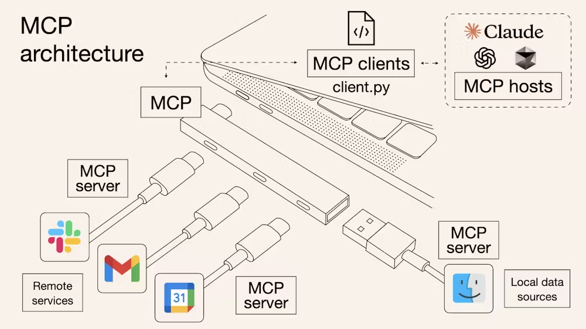

---
---

# MCP vs kubectl <small>접근 방식 장단점 비교</small>

<p class="highlight-blue" style="font-size: 21px; margin: 0 0 12px 0;">
  범용 에이전트에 K8s를 연결할 때: <code>kubectl</code> CLI를 직접 실행할까, <code>MCP</code>로 연결할까?
</p>

| 구분 | `kubectl` 직접 실행 | Kubernetes `MCP` |
|:---:|---|---|
| **접근 방식** | 에이전트가 쉘(Bash)에서 `kubectl` CLI·스크립트 직접 실행 | 표준화된 Tool 이름으로 클러스터 API 기능 노출 |
| **장점** | • 별도 서버 구축 없이 즉시 사용 가능<br/>• 기존 `kubectl` 플러그인·사내 쉘 스크립트 그대로 재사용 | • 여러 에이전트에 일관된 표준 도구 규격 제공<br/>• 허용할 Tool 목록(Read-only 등)과 파라미터 스키마 명시적 통제 |
| **대표 구현** | `kubectl` *(JSON 출력 모드, 안전 래퍼 스크립트)* | • `containers/kubernetes-mcp-server` *(K8s API 직결)*<br/>• `kubectl-ai` *(MCP Server 모드)* · `K8sGPT` *(Analyzer 노출)* |

- **MCP는 표준 USB 허브에 비유**: 규격화된 포트로 다양한 도구를 간편하게 연결
- **핵심은 인증과 권한(RBAC)**: `kubectl`이든 `MCP`든 **Read-only 최소 권한**과 **변경 작업 승인 절차**가 필수

---
class: visual
---

# agentgateway <small>단일 진입점 아키텍처</small>

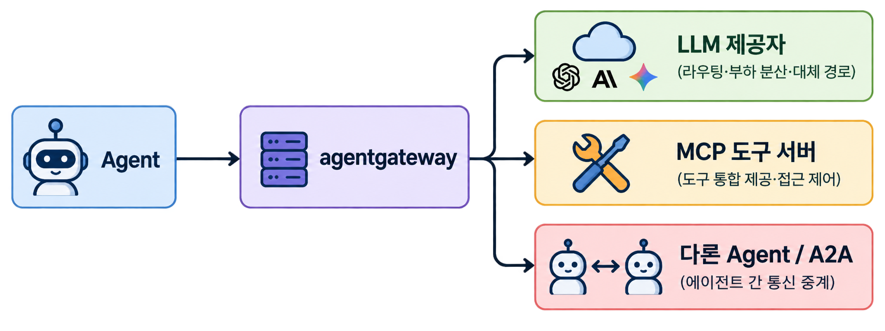

---
---

# agentgateway <small>역할 및 주요 기능</small>

<p class="highlight-blue" style="font-size: 21px; margin: 0 0 12px 0;">
  에이전트의 외부 호출 경로(LLM · MCP 도구 · A2A)를 중계하고 보안·정책·관측을 일괄 적용
</p>

| 구분 | 핵심 내용 | 비고 |
|:---:|---|---|
| **연결 대상** | **LLM** (라우팅·폴백) · **MCP** (도구 통합·접근 제어) · **A2A** (에이전트 간 통신) | 단일 진입점으로 다중 백엔드 통합 |
| **보안 · 관측** | • **인증·인가**: JWT · API Key · OAuth, 세분화된 권한 및 Rate Limit<br/>• **가드레일 · 관측**: 콘텐츠 필터링, OpenTelemetry 메트릭·트레이싱 | 호출 경로에서 공통 보안 정책 강제 |
| **배포 방식** | • **독립 실행**: 경량 단일 바이너리 / Docker + YAML 설정<br/>• **Kubernetes**: 전용 컨트롤러 + **K8s Gateway API** 동적 연동 | K8s 환경 필수 아님 (클라우드 네이티브 지원) |

- **일반 AI Gateway와의 차이**: LLM 라우팅을 넘어 **MCP 도구 서버와 A2A 에이전트 간 통신**까지 포괄
- **Solo.io 시작 ('26.06 AAIF 합류)**: Rust 기반 고성능 런타임 및 K8s Gateway API 네이티브 연동

---
class: dense
---

# Agent on K8s (4) <small>주요 프로젝트 4종 종합 비교</small>

- 에이전트 정의·실행(**`kagent` · `AX`**) vs 실행환경·자원 관리(**`Agent Sandbox` · `Agent Substrate`**)
- **`kagent`·`AX`**(상위 플랫폼)는 **`Agent Substrate`**(하위 런타임) 기반

| 구분 | **kagent** | **Agent Sandbox** | **AX** (Agent Executor) | **Agent Substrate** |
|:---:|:---:|:---:|:---:|:---:|
| **Repo 생성월** | '25.01 | '25.08 | '26.03 | '26.05 |
| **버전** | `v1.0.0-alpha17` | `v1.0.8` | `v0.3.1` | `v0.6.0` |
| **핵심 역할** | 에이전트 정의 및 운영 관리 | 격리 작업 환경 수명주기 관리 | 에이전트 작업(Task) 선언·실행 | 상태형 워크로드 실행 런타임 |
| **실행 자원 관리** | Session별 Substrate Actor 실행 | Sandbox별 Pod 관리 (WarmPool) | Task별 Substrate Actor 실행 | Actor·Worker 분리, Worker 재사용 |
| **프로젝트 관계** | Substrate 사용 | 독립 프로젝트 | Substrate 사용 | kagent·AX 실행 기반 |
| **거버넌스** | CNCF Sandbox | Kubernetes SIG Apps | Google 오픈소스 | CNCF Sandbox ('26.10) |
| **시작 주체** | Solo.io | Google 엔지니어 | Google | Google |

<p class="pen" style="font-size: 20px; margin-top: 10px;">
  ※ OpenSandbox: 로컬(Docker)부터 K8s Pod·Firecracker까지 통합 다루는 범용 샌드박스 플랫폼 ('26.10 AAIF 합류)
</p>

---
class: visual
---

# kagent (K8s + agent) <small>아키텍처</small>

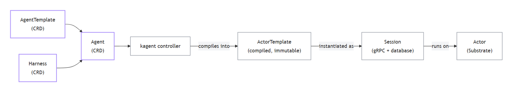

---
---

# kagent (K8s + agent) <small>핵심 구성요소 및 동작 흐름</small>

<p class="highlight-blue" style="font-size: 21px; margin: 0 0 12px 0;">
  <b>기반 전환</b>: <code>Deployment</code> (0.x) → <b><code>Agent Substrate</code></b> (1.x alpha 기준)
</p>

| 구성요소 | 역할 | 비고 |
|:---:|---|---|
| **AgentTemplate** | 모델·시스템 프롬프트·도구·스킬 정의 | 무엇을 할 것인가 (업무 정의) |
| **Harness** | 실행 플랫폼 설정 (런타임, 컨테이너 이미지, WorkerPool, 스냅샷) | 어디서 / 어떻게 실행할 것인가 (환경 정의) |
| **Agent** | `AgentTemplate`과 `Harness`를 결합한 호출 대상 | Kubernetes CRD |
| **Session** | Agent와 사용자가 주고받는 대화 세션 (PostgreSQL 저장) | 자체 API 계층 (CRD 아님) |

- **3단계 실행 흐름**:
  1. **Agent 구성**: `AgentTemplate`과 `Harness`를 결합해 `Agent` 리소스 선언
  2. **`ActorTemplate` 생성**: Substrate가 인식할 수 있는 Actor 템플릿으로 변환
  3. **`Session`별 `Actor` 실행**: 턴 종료 시 상태 스냅샷 저장 후 공유 Worker 반납

---
---

# Agent Sandbox <small>격리 환경 수명주기 관리</small>

<p class="highlight-blue" style="font-size: 21px; margin: 0 0 10px 0;">
  K8s에서 격리된 작업 환경을 선언하고 Pod·저장소·수명주기를 관리하는 플랫폼 (SIG Apps, v1.0.8)
</p>

<div style="background: #eef4fc; padding: 10px 16px; border-radius: 6px; font-family: monospace; font-size: 18px; margin-bottom: 14px; text-align: center;">
  SandboxTemplate 정의 → SandboxWarmPool 준비 → SandboxClaim 할당 → Sandbox(Pod+볼륨) 실행·정리
</div>

| 구분 | 핵심 내용 | 비고 |
|:---:|---|---|
| **핵심 CRD** | `Sandbox` · `SandboxTemplate` · `SandboxWarmPool` · `SandboxClaim` | K8s CRD·컨트롤러로 동작 (WarmPool 선택) |
| **활용 방식** | 외부 에이전트의 코드 실행 도구 / 에이전트 자체(OpenClaw 등) 격리 실행 | 추론 루프 없음 (실제 격리는 gVisor/Kata 담당) |
| **상태 보존** | • **영속 볼륨**: Pod 재시작 시 파일 데이터 보존<br/>• **GKE Pod Snapshot**: 메모리+파일시스템 체크포인트·복원 | GKE Sandbox(gVisor) 전용 기능 |
| **표준화 동향** | **KEP-5823** (Pod-Level Checkpoint/Restore, K8s v1.38 Alpha 목표) | 자체 `SnapshotProvider` 추상화 논의 중 |

---
---

# Agent Sandbox <small>6가지 주요 활용 사례</small>

| Agent 위치 | 실행 내용 | 수명주기 |
|:---:|---|:---:|
| **외부**<br/>*(에이전트가<br/>외부에서 호출)* | **로그·데이터 분석용 Python 스크립트 즉석 실행** 및 결과 반환 *(Code Interpreter)* | **단기**<br/>*(호출·세션)* |
| | **격리된 Chrome 브라우저·VNC 화면 구동** 후 웹 클릭·입력·스크린샷 *(Playwright)* | **세션 단위** |
| | **클라우드 에이전트(Claude 등)의 지시**로 사내 코드 빌드·도구 실행만 K8s에서 대행 | **세션 단위** |
| **내부**<br/>*(에이전트가<br/>샌드박스 내부)* | **Claude Code·Aider 구동**: Git 저장소 클론 후 코드 수정 및 테스트 반복 | **중기**<br/>*(작업 단위)* |
| | **PR마다 임시 검증 환경 기동**: 실패 테스트 재현 및 에이전트 패치 자동 검증 | **파이프라인** |
| | **영속 볼륨·고정 도메인을 연동한 OpenClaw 구동**: 24시간 개인/팀 AI 비서 상주 | **장기**<br/>*(상시)* |

<p class="pen" style="font-size: 22px; margin-top: 14px;">
  ※ Sandbox 자체는 LLM 추론을 하지 않으므로 CI/CD·원격 개발 환경처럼 순수 격리 실행용으로도 활용 가능
</p>

---
class: visual
---

# AX (Agent Executor) <small>작업 실행 워크플로우</small>

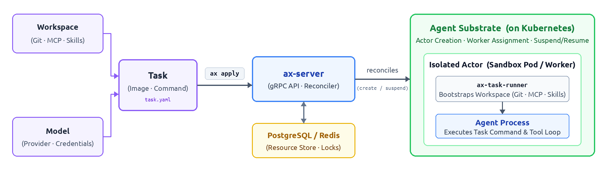

---
---

# AX (Agent Executor) <small>에이전트 작업 선언 및 관리</small>

<p class="highlight-blue" style="font-size: 20px; margin: 0 0 10px 0;">
  ① YAML 작성 (Task·Workspace·Model) → ② <code>ax apply</code> (ax-server·DB) → ③ Substrate Actor 실행
</p>

| 구분 | 역할 | 비고 |
|:---:|---|---|
| **Task** | 실행할 컨테이너 이미지 · 명령 · 자원 · 연결할 Workspace 정의 | K8s의 `Job` / `Pod`에 대응 |
| **Workspace** | 작업에 필요한 **Git 저장소 · MCP 서버 · 스킬** 환경 세팅 | 자연어 `goal`로 환경 자동 구성 지원 |
| **Model** | 에이전트가 사용할 LLM 제공자 · 모델명 · API 키 참조 | 모델 연결 및 인증 설정 |
| **CLI (`ax`)** | `ax apply` · `get` · `watch` · **`suspend`(중단)** · **`resume`(재개)** · `ssh` | K8s 스타일 문법, 자체 서버·DB 저장 |

- **장기 워크로드 지향**: 일반 `Job`으로 다루기 어려운 상태형 에이전트 작업 관리
- **중단·재개 (v0.3.1)**: `/workspace` 복원 후 프로세스 재시작, 작업 상태는 애플리케이션이 보존

---
class: visual
---

# Agent Substrate <small>상태형 워크로드 런타임</small>

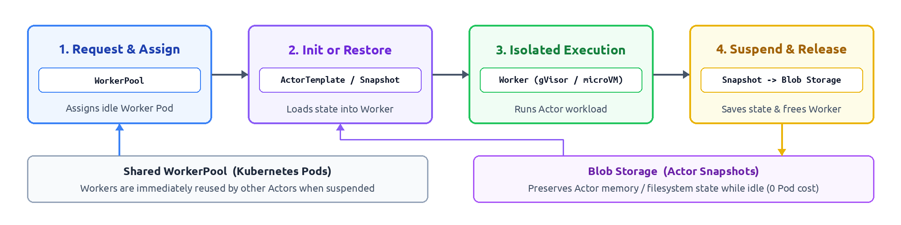

---
---

# Agent Substrate <small>핵심 아키텍처 및 자원 공유</small>

<p class="highlight-blue" style="font-size: 20px; margin: 0 0 10px 0;">
  ① Worker 배정 → ② 초기화·복원 (Snapshot) → ③ 격리 실행 → ④ Snapshot 저장 후 Worker 반납
</p>

| 구성요소 | 핵심 역할 | 비고 |
|:---:|---|---|
| **Actor · ActorTemplate** | 상태와 고유 식별자를 가진 워크로드 인스턴스 및 생성 템플릿 | 작업이 중단되어도 식별자·상태 영속 유지 |
| **Worker · WorkerPool** | `Actor`를 실제로 실행하는 준비된 Pod 공간 및 풀 관리 | 여러 `Actor`가 시간차로 Worker Pod를 재사용 |
| **Snapshot** | 설정 범위에 따른 상태 저장 (`Full`: 메모리+파일, `Data`: 영속 데이터) | 저장 후 다른 Worker에서도 즉시 복원 가능 |
| **격리 환경** | **gVisor** 또는 **Cloud Hypervisor microVM** 기반 격리 실행 | 강력한 보안 경계 제공 |

- **자원 효율 극대화**: 유휴 세션마다 무거운 Pod를 유지하지 않고, 스냅샷 저장 후 Worker 반납
- **하위 런타임**: `AX`(Task)와 `kagent` 1.x(Session)의 공통 기반 실행 엔진으로 동작

---
---

# Agent 배포 단위 <small>Pod vs Actor 아키텍처 비교</small>

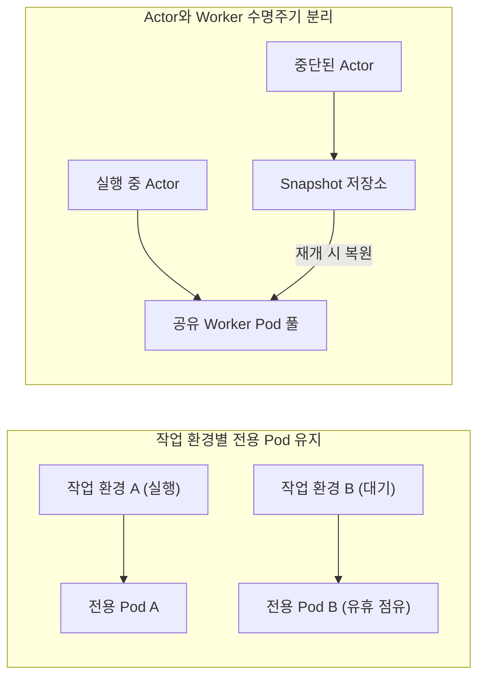

<div class="pen" style="font-size: 25px; text-align: center; margin-top: 24px; line-height: 1.5;">
  "Pod는 훌륭한 실행(Execution) 단위지만,<br>
  에이전트의 긴 수명주기(Lifecycle) 단위로는 맞지 않는 경우가 많다."
  <div style="font-size: 18px; color: #71849d; margin-top: 6px;">— CNCF 블로그, 2026.07</div>
</div>

---
---

# Agent 배포 단위 <small>Pod vs Actor 선택 기준</small>

| 구분 | **작업 환경별 전용 Pod 유지** | **Actor 단위 다중화** *(N Actors on Worker Pool)* |
|:---:|---|---|
| **동작 방식** | 작업 환경마다 전용 Pod 할당 (`Deployment` 또는 `WarmPool`) | Pod는 **공유 Worker Pool**로 두고, 세션을 **`Actor`**로 관리 |
| **유휴 시 특징** | 작업 대기 중에도 Pod를 계속 점유 *(직관적이나 비용 증가)* | 대기 시 **Snapshot** 저장 후 Worker 즉시 반납 *(비용 최소화)* |
| **대표 프로젝트** | **`Agent Sandbox`** (Pod 관리, WarmPool 선택) | **`Agent Substrate`** 기반 **`kagent` 1.x alpha** · **`AX`** |
| **선택 기준** | 전용 환경을 계속 유지하거나 단순한 수명주기 관리가 적합할 때 | 유휴 비율이 높고, 스냅샷 복원 지연보다 자원 절감 이득이 클 때 |

- **생태계의 발전 방향**: 직관적인 **전용 Pod 격리**와 대규모 유휴 세션을 겨냥한 **Actor 다중화**의 공존
- **선택 시 고려사항**: 유휴 비율, 보존해야 할 상태의 크기, 스냅샷 복원 지연(Latency)의 종합적 평가

---
class: section
---

<div class="section-content">
  <span class="section-badge">Ⅳ</span>
  <span class="section-title">마무리</span>
</div>

---
---

# Wrap-up <small>세 줄 요약 및 제언</small>

<div class="two-cols">
<div>

### 📌 세 줄 요약

1. **생태계 분류 체계**<br>
   Landscape를 바탕으로 **실행 위치·사용 목적**과 **기술 계층**별 구조적 조망
2. **클러스터 도구와 보안 경계**<br>
   진단 부품화(`K8sGPT`) / `kubectl`과 `MCP` 모두 **RBAC 최소 권한**이 핵심
3. **Agent on K8s의 태동**<br>
   에이전트 수명주기 격리를 위한 전용 런타임(Substrate, Sandbox) 급부상

</div>
<div>

### 💡 엔지니어의 몫

- **변화의 속도에 대처하기**<br>
  개별 도구를 쫓기보다 **기술 계층과 목적** 중심의 지도를 먼저 파악
- **권한과 책임의 영역**<br>
  구현·실행은 에이전트에 위임하더라도, **아키텍처 설계 · 권한 가드레일 · 최종 책임**은 사람의 영역!

<div class="pen" style="font-size: 26px; text-align: right; margin-top: 36px;">
  Thank you! 👏
</div>

</div>
</div>
