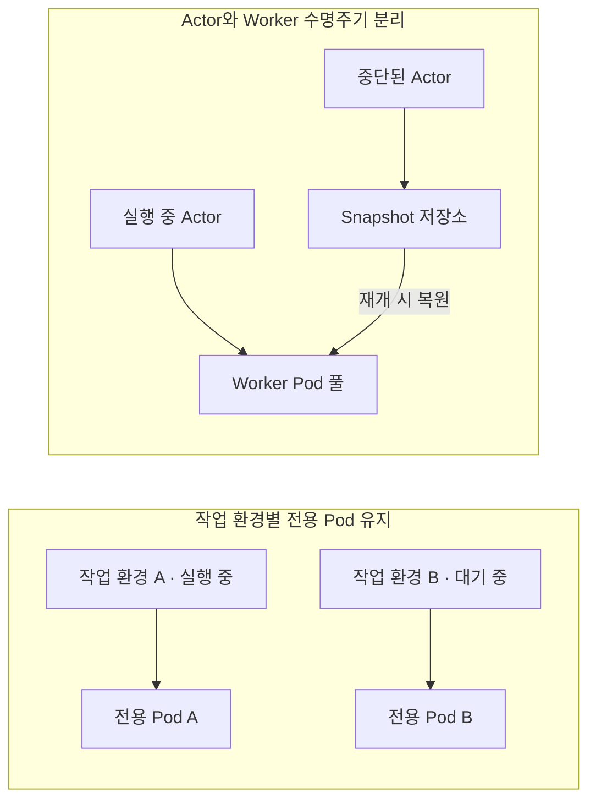

# Kubernetes 엔지니어가 둘러본<br>AI Agent 생태계

쿠버네티스 코리아 유저 그룹 밋업 · 2026.10.28

---
class: compact
---

# 목차

1. 배경
2. 분류 체계
3. 관심 프로젝트 비교
4. 마무리

---
class: section
---

1장

# 배경

---
class: compact
---

# 2026년 AI 시대

**작년과는 또 다르다…**

| 변화하는 개발 풍경 | AI Agent가 잘하는 것 |
|---|---|
| • **코드를 직접 보는 일 대폭 감소**<br/>• **Markdown 문서 중심** 작업 *(가끔 테스트 코드 확인)*<br/>• **코딩테스트 대신 AI 활용 평가 도입** *([넥슨 2026 인턴십](https://byline.network/2026/09/2-451/))*<br/>• 약간의 허탈감? → **AI 블루 / Claude Blue** *(Claude Community - Facebook, 2026-09-18)* | • **업무**: 코딩, 코드 리뷰, 테스트 코드 작성, 문서 작성, 설계, 로그 분석, 문의 대응, 신기술 탐색…<br/>• **언어·도구**: `go`, `gh`, `kubectl`, `openstack` CLI… 그냥 다 잘함<br/>• **아직 못하는 것?**: 내 맘에 드는 PPT 작성 ㅎ |

- **“그럼 내 컴퓨터를 통째로 맡겨도 될까?”** → 먼저 에이전트를 사용하는 환경부터 살펴보자


---
class: compact
---

# Agent 사용환경

| 구분 | CLI | Desktop App | IDE |
|---|---|---|---|
| **Antigravity** | `agy` | Antigravity App | Antigravity IDE<br/>VS Code ext ('26.09) |
| **Claude** | `claude` | Claude | VS Code extension |
| **Codex** | `codex` | ChatGPT (codex) | VS Code extension |
| **기타** | - | OpenClaw | Cursor *([SpaceX 인수 발표 '26.06, 약 600억 달러](https://www.eweek.com/news/spacex-cursor-acquisition-ai-coding-agents-neuron/))*<br/>Zed *(경량, ACP 연계)* |
| **의견** | 가벼움, 터미널의 간결함 | 브라우저 통합 등 GUI의 편리함<br/>컴퓨터를 맡기는 느낌 | 익숙한 개발환경의 편안함 |

- ※ **간단한 질문/조사는 Chat(Web) 사용**

---
class: compact
---

# AI Gauge

- **5h / 7d / 월간 사용량, 리셋 시각, 리셋 크레딧 확인** *(Codex, Claude, Antigravity, GitHub Copilot 등)*
- **Windows용 시스템 트레이 앱**, **Apache-2.0 라이선스** (Microsoft Store 배포)
- **'26.09 개발** — 당시 찾아본 도구 중 원하는 **윈도우용 × 오픈소스** 조합을 찾지 못해 직접 개발

| Microsoft Store | 사용량·쿼터 모니터링 | 프로바이더·알림 설정 |
|:---:|:---:|:---:|
|  |  |  |

---
class: compact
---

# 출발점과 접근법

**급변하는 AI 기술을 K8s 엔지니어 시선으로 폭넓게 탐색·분류·비교**

### 출발점

- **쏟아지는 AI 기술** — 개별 도구를 쫓기보다 전체 생태계의 큰 그림 파악
- **K8s 엔지니어의 시선** — AI와 K8s가 만나는 생태계 분류, 프로젝트 비교
- **선택과 집중** — 발표·조사 시간 고려해 개별 상세 분석은 생략

### 접근법

1. **01 개념 정리 · Landscape 탐색**
   - 기본 개념 정리, AAIF · CNCF 프로젝트 조사, Landscape 분류 비교
2. **02 생태계 분류**
   - 실행 위치·사용 목적, 재단 소속·Landscape 등재, 기술 계층, 대상 워크로드 기준
3. **03 Agent on K8s 프로젝트 비교**
   - kagent, Agent Sandbox, AX, Agent Substrate **4종 비교** · OpenSandbox 소개 · agentgateway는 연결 계층으로 별도 설명

---
class: section
---

2장

# 분류 체계

---
class: compact llm-example
---

# LLM 활용


- **규칙 기반 코딩 (`if/else`)**:
  - `positives = ["yes", "yeah", "yep", "of course", ...]`
- **LLM 이전의 AI (감성 분석)**:
  - 긍정/부정 분류용 머신러닝 모델 사용하여 확률 점수화 처리
- **LLM 이후**:
  - 프롬프트 몇 줄로 파악
  - 원하는 JSON 형식(`{"positive": true}`)까지 바로 반환

```text
프롬프트: "그녀의 대답이 긍정인지 부정인지 판단해서 JSON으로 응답해줘: {answer}"
응답:     {"positive": true}
```

---
class: compact
---

# AI Agent 개발 예시: 날씨 조회 에이전트

- [LangChain 공식 Quickstart](https://docs.langchain.com/oss/python/langchain/quickstart)의 `get_weather` 예제로 본 **에이전트 동작과 프롬프트 구성** *(실제 날씨 API 대신 고정 응답을 반환하는 모의 도구)*

```python
from langchain.agents import create_agent

def get_weather(city: str) -> str:
    """Get weather for a given city."""        # 1. 도구 프롬프트 (Docstring + 타입 힌트)
    return f"It's always sunny in {city}!"

agent = create_agent(
    model="anthropic:claude-sonnet-4-5",       # 2. 추론 모델 (Model runtime)
    tools=[get_weather],                       # 3. 사용할 도구 목록 (Tools)
    system_prompt="You are a helpful assistant", # 4. 시스템 프롬프트 (역할 · 행동 지침)
)
result = agent.invoke({"messages": [{"role": "user", "content": "what is the weather in sf"}]})
```

---
class: compact
---

# AI Agent 개발 예시: 날씨 조회 에이전트 — 실행 흐름

- **실행 예시**:
  1. 사용자가 `"what is the weather in sf"` 입력
  2. 런타임이 `system_prompt` + `get_weather`의 Docstring·인자 정보를 LLM에 전송
  3. LLM이 Docstring을 보고 `get_weather("San Francisco")` 호출 결정
  4. 런타임이 함수를 실행하고 그 결과(텍스트)를 LLM에 넘겨 최종 답변 생성

- **도구 호출 한 번으로 끝나는 단순한 Agent 작업**
  - 복합 작업에서는 모델 판단에 따라 **도구 호출을 반복**할 수 있음
  - 설계 예: **PR의 실패한 테스트 조사·수정안 제안** — 입력: commit·CI 로그·지침 / 출력: diff·원인 설명·테스트 기록 *(머지·배포 제외)*
- **Google ADK Python**도 에이전트 정의와 로컬 실행 CLI(`adk run` · `adk web`) 제공 — [Python Quickstart](https://adk.dev/get-started/python/) *(2026-10-28 문서 기준)*

---
class: visual
---

# AI Agent 구성요소


---
class: compact
---

# AI Agent 구성요소


| 구성요소 | 핵심 역할 | 설명 |
|---|---|---|
| **Agent runtime** | 실행 흐름 · 상태 관리 | 모델 판단과 애플리케이션 로직에 따라 실행 순서·상태·도구 호출 관리 |
| **Model runtime** | LLM / VLM 추론 | 에이전트의 두뇌 역할, 프롬프트 수신 및 모델 언어 추론 수행 |
| **Memory** | 대화 상태 및 장기 기억 | 세션 컨텍스트 유지 및 벡터 DB 기반 장기 지식 베이스 참조 |
| **Tools** | 외부 API 호출 및 작업 | 웹 검색, 외부 API 연동, 코드 실행 등 실제 액션 실행 |

---
class: compact
---

# AI 모델 학습부터 Agent 운영까지

| 1. 모델 학습 | 2. 모델 서빙 | 3. Agent 개발 | 4. Agent 운영 |
|---|---|---|---|
| • 학습 데이터셋 정제<br/>• 사전학습 (Pre-training)<br/>• 파인튜닝 (SFT / DPO) | • 가중치 호스팅 (vLLM, TGI)<br/>• 추론 최적화 & 가속 (GPU)<br/>• OpenAI 호환 API 엔드포인트 | • 프롬프트 & ReAct 루프<br/>• 도구 연동 (Tools / MCP)<br/>• 멀티에이전트 워크플로우 | • 실행 런타임 샌드박스<br/>• Observability & 추적<br/>• 보안, 게이트웨이, 평가 |

| 구분 | 장점 | 단점 | 비고 |
|---|---|---|---|
| **직접 모델 개발**<br/>*(Training)* | • 기술 및 역량 확보<br/>• 특화 도메인 모델 확보 가능 | • 컴퓨팅 자원 및 인력 필요<br/>• 실패 위험성, 가성비 | • 대규모 분산 학습 인프라 구축<br/>• 고속 네트워크 필요 / Slurm / Kubeflow 활용 |
| **오픈 웨이트 모델**<br/>*(Open-Weight)* | • 자체 호스팅 시 데이터 통제 가능<br/>• 도메인 특화 파인튜닝 가능<br/>• 클라우드 락인 회피 | • GPU 인프라 비용 부담<br/>• 서빙 파이프라인 운영 복잡도 높음 | • Kubernetes(vLLM, Ray) 기반 GPU 스케줄링<br/>• vLLM/Triton 등 서빙 인프라 자동화 필요 |
| **외부 API 서비스**<br/>*(Commercial API)* | • 모델 서빙 인프라 부담 감소<br/>• 최고 성능(SOTA) 모델 즉시 활용<br/>• 빠른 비즈니스 검증 | • 비용 예측 어려움 (토큰 과금)<br/>• 데이터 보안 및 규제 제약<br/>• Rate Limit 제한 | • AI Gateway (LiteLLM 등) 구축<br/>• 키 관리, 캐싱, 토큰 쿼터/레이트 리밋 제어 |

---
class: compact dense
---

# K8s × AI — 실행 위치와 사용 목적

| 구분 | 1. 모델 학습·서빙 on K8s | 2. AI for K8s (클러스터 운영·지원) | 3. Agent on K8s (에이전트 실행·격리) |
|---|---|---|---|
| **핵심 목적** | **대규모 AI 인프라 수용**<br/>• 모델 학습·서빙 파이프라인 컨테이너화<br/>• 분산 대규모 GPU 풀 오케스트레이션 | **AIOps 기반 클러스터 운영·지원**<br/>• 클러스터 상태 진단 및 장애 원인 조사<br/>• 자연어 기반 클러스터 진단·쿼리·조작 | **안전한 자율 실행 샌드박스·세션**<br/>• 에이전트·생성 코드의 동적 격리 실행<br/>• 상태 보존 세션(중단·재개) 및 빠른 환경 할당 |
| **핵심 K8s 기술** | • GPU 가상화·슬라이싱 (MIG, vGPU)<br/>• **Kueue** 기반 배치 큐잉 & 자원 선점<br/>• **DRA** (Dynamic Resource Allocation) | • 클러스터 이벤트·로그·메트릭 수집 연동<br/>• Controller·CRD·도구 연동 진단·복구 루프<br/>• RBAC 최소 권한 격리 및 실행 승인 가드레일 | • **gVisor** · **Kata Containers** · MicroVM 격리<br/>• NetworkPolicy 및 임시·영속 볼륨 제어<br/>• Warm Pool·스냅샷 기반 Pod·Worker 수명주기 제어 |
| **관련 오픈소스** | **Kubeflow**, **Ray (KubeRay)**, **vLLM**, **KServe**, **llm-d**, **LWS**, Triton | **K8sGPT**, **HolmesGPT**, **kubectl-ai** | **kagent**, **Agent Sandbox**, **AX**, **Agent Substrate**, **OpenSandbox**, E2B |

- **Agent on K8s ⊂ AI on K8s** — 모델 학습·서빙과 에이전트 실행을 설명 편의상 나눔
- **AI on은 실행 위치, AI for는 사용 목적** — K8s 위에서 클러스터를 돕는 Agent는 둘 다 해당
- **kagent**의 목적은 **Agent on K8s**이지만, 클러스터 운영 자동화(**AI for K8s**) Use case 많음

---
class: compact dense
---

# K8s & AI Conformance

**상호운용성 확보를 위해 요구사항 충족 여부를 확인하는 CNCF 적합성 인증 프로그램**

**AI Conformance는 기본 Kubernetes 인증 위에 AI/ML 실행 역량을 추가 확인한다.**

| 검증 영역 | Kubernetes Conformance | AI 추가 검증 영역 예시 |
|---|---|---|
| **시작** | '17.11 | '25.11 |
| **API·워크로드** | API 탐색·CRUD·Watch, 워크로드 제어, Pod 수명주기·Probe | AI Operator의 Pod·웹훅·Custom Resource 조정 |
| **네트워크** | Service·EndpointSlice·DNS | Gateway API 기반 추론 트래픽 관리 |
| **배치·자원 관리** | 노드 선택·자원 요청·우선순위·할당량 | Gang Scheduling, GPU 공유·가상화(권고) |
| **스케일링·관측성** | 복제본 수 조절·Scale API | AI 지표 기반 Pod 확장·가속기 노드 확장(조건부), 가속기·워크로드 메트릭 |
| **보안·격리** | ServiceAccount·토큰·접근 권한 판정 | 가속기 접근 격리·중재, 호스트 커널과 강한 실행 격리(권고) |
| **설정·스토리지·확장 API** | ConfigMap·Secret·볼륨, CRD·Admission Webhook | 기본 인증에 포함 |

- **설명용 영역 비교**이며 공식 일대일 대응표가 아님. 플랫폼의 기반 역량을 확인하며 **Agent 애플리케이션 전체를 인증하지는 않음**.
- 기준·출처: [Kubernetes 버전별 인증](https://github.com/cncf/k8s-conformance) · [AI v1.37 요구사항](https://github.com/cncf/k8s-ai-conformance/blob/main/docs/AIConformance-1.37.yaml). 실제 인증은 대상 버전의 기준 적용.

---
class: visual
---

# 재단 (3) LF · CNCF · AAIF


---
class: compact
---

# 재단 (3) LF · CNCF · AAIF


| 구분 | **LF**<br/>Linux Foundation | **CNCF**<br/>Cloud Native Computing Foundation | **AAIF**<br/>Agentic AI Foundation |
|---|---|---|---|
| **설립** | 2007-01 | 2015-07 | 2025-12 |
| **목적** | Linux 지원에서 출발한 오픈소스 프로젝트 · 산하 재단의 모체 | 클라우드 네이티브 컴퓨팅 대중화, 컨테이너·인프라 및 AI 네이티브 생태계 육성 | Agentic AI 도구·프로토콜의 중립적 거버넌스, 상호운용성 및 생태계 육성 |
| **소속 프로젝트** | Linux 커널 · PyTorch · Node.js | **200개 이상**<br/>Kubernetes · Prometheus · Envoy · Kubeflow · kagent · Agent Substrate | **10개**<br/>MCP · A2A · agentgateway · goose · AGENTS.md · Agent Router 등 |

- **Landscape·회원(member)은 재단별로 따로 운영**
- **프로젝트 이동 사례**: A2A (LF → AAIF), Agent Router (CNCF → AAIF)
- **Landscape 양쪽 등록**: kagent (CNCF & AAIF, 소속은 CNCF) 등 다수

---
class: compact
---

# Landscape by CNCF · AAIF

- **겹치는 프로젝트 많으나 분류 체계 다름 → 관점·범위 차이**

| **CNCF Landscape — AI Native**<br/>https://landscape.cncf.io/?group=ai-native | **AAIF Landscape**<br/>https://landscape.aaif.io/ |
|:---:|:---:|
|  |  |
| 예: `LangChain`, `LangGraph` (`AI Agent / Agent Framework`) | 예: `MCP` (`Data & Knowledge`), `kagent` (`Agentic Runtime`) |

---
class: compact
---

# Landscape by CNCF · AAIF

- **겹치는 프로젝트 많으나 분류 체계 다름 → 관점·범위 차이**

| 구분 | CNCF Landscape — AI Native | AAIF Landscape |
|---|---|---|
| **URL** | https://landscape.cncf.io/?group=ai-native | https://landscape.aaif.io/ |
| **관점·범위** | AI 수명주기(데이터·학습·추론·에이전트)와 클라우드 네이티브 인프라 | Agentic AI 생태계의 오픈소스·개방형 표준 분류 |
| **대분류** | `AI Agent` · `Inference` · `Training` · `Data` · `AI Native Infra` | `Gateway & Control Plane` · `Agentic Runtime` · `Protocols & Interfaces` · `Data & Knowledge` · `Agentic Development` |
| **일반 등재 기준** | GitHub ★ 300+ *(상용·폐쇄형 제품도 설명 있으면 포함)* | 오픈소스 한정, GitHub ★ 1,000+ *(폐쇄형·독점 규격 제외)* |
| **공통 등재 예시** | • **kagent · ADK · LangGraph**: `AI Agent / Framework`<br/>• **KServe · vLLM**: `Inference`<br/>• **MCP · A2A**: `AI Agent / Protocol`<br/>• **agentgateway**: `AI Native Infra / Gateway` | • **kagent · ADK · LangGraph**: `Agentic Runtime`<br/>• **KServe · vLLM**: `Agentic Runtime`<br/>• **MCP**: `Data & Knowledge` / **A2A**: `Protocols & Interfaces`<br/>• **agentgateway**: `Gateway & Control Plane` |

---
class: visual
---

# CNCF Landscape - AI Native


---
class: compact
---

# CNCF Landscape - AI Native

**AI 수명주기(데이터·학습·추론·에이전트)와 클라우드 네이티브 인프라**


- **모델 파이프라인(`Data → Training → Inference`), 위에 `AI Agent`, 아래 `AI Native Infra`**

| 대분류 | 주요 영역 | 프로젝트 예시 |
|---|---|---|
| **AI Agent** | 에이전트 구성·애플리케이션 실행 | **kagent**, ADK, LangGraph, MCP, A2A, LlamaIndex, Milvus |
| **Inference** | 학습된 모델을 이용한 추론 | **KServe**, **llm-d**, vLLM, SGLang, llama.cpp |
| **Training** | 모델 학습·조정·평가 | **Kubeflow Training Operator**, DeepSpeed, Ray, DeepEval |
| **Data** | AI용 데이터 처리·분석 | **Kubeflow Notebooks**, Apache Flink, Trino, Feast |
| **AI Native Infra** | AI 워크로드의 공통 실행·운영 기반 | **Agent Sandbox**, **Kueue**, **agentgateway**, **gVisor·Kata** |

- ※ **인프라뿐 아니라 범용 에이전트 프레임워크·프로토콜(ADK, LangGraph, MCP, A2A 등) 폭넓게 포함 *(K8s 필수 아님)***

---
class: compact
---

# AAIF Landscape

**Agentic AI 생태계의 오픈소스·개방형 표준 분류**

| 분류 | 주요 영역 | 등재 프로젝트 |
|---|---|---|
| **Gateway & Control Plane** | 연결·라우팅·접근 제어·가드레일 | **agentgateway**, **Agent Router**, Guardrails AI, NeMo Guardrails |
| **Agentic Runtime** | 에이전트 구성·실행과 모델·추론·서빙 기반 | **kagent**, LangGraph, Google ADK, CrewAI, **KServe**, vLLM, Temporal |
| **Protocols & Interfaces** | 에이전트·시스템 간 통신 규약·인터페이스 | **A2A**, AG-UI |
| **Data & Knowledge** | 데이터 연결·검색·지식·메모리·벡터 DB | **MCP**, LlamaIndex, Mem0, Milvus, pgvector |
| **Agentic Development** | 에이전트 개발 도구·스킬·평가·관측 | **goose**, **Agent Skills**, Dify, DeepEval, Langfuse |

- **분류 ≠ 소프트웨어 계층**, 같은 분류라도 대체재 아닌 경우 많음
- **`Agentic Runtime`에 프레임워크·모델·추론 엔진이 함께 들어감. `MCP`는 `Data & Knowledge`에 배치됨**

---
class: compact dense
---

# AAIF 소속 프로젝트 (10)

**프로토콜·규격**(MCP · A2A · Open Responses) · **지침·스킬**(AGENTS.md · Agent Skills) · **게이트웨이**(agentgateway · Agent Router) · **에이전트·실행 환경**(goose · OpenEnv · OpenSandbox)

| # | 프로젝트 | 설명 | 기여자 | AAIF 합류 |
|---:|---|---|---|---|
| 1 | **MCP** | LLM 앱과 외부 데이터·도구를 연결하는 프로토콜 | Anthropic | '25.12 |
| 2 | **goose** | 어떤 LLM과도 쓰는 확장형 오픈소스 에이전트 | Block | '25.12 |
| 3 | **AGENTS.md** | 코딩 에이전트에게 지침을 주는 단순 형식 | OpenAI | '25.12 |
| 4 | **agentgateway** | 에이전트·모델·도구·API 사이 연결 게이트웨이 | Solo.io | '26.06 |
| 5 | **A2A** | 에이전트 간 통신·협업 프로토콜 | Google ('25 LF 기증) | '26.08 |
| 6 | **Agent Router** | Envoy 기반 AI 게이트웨이. 구 Envoy AI Gateway | Bloomberg·Tetrate 엔지니어 | '26.09 |
| 7 | **Agent Skills** | 재사용 가능한 에이전트 전문성의 개방 형식 | Anthropic | '26.10 |
| 8 | **Open Responses** | 제공자 간 공유 LLM API 형식 | OpenAI | '26.10 |
| 9 | **OpenEnv** | 에이전트 학습용 개방 환경 | Hugging Face | '26.10 |
| 10 | **OpenSandbox** | AI 애플리케이션용 범용 샌드박스 플랫폼 | Alibaba | '26.10 |

- **사용자·개발 관점**: `MCP` · `AGENTS.md` · `Agent Skills` (일상 도구·지침 표준)
- **플랫폼·인프라 관점**: `agentgateway` · `Agent Router` · `A2A` · `OpenSandbox` (연결·격리·운영)

---
class: compact
---

# 분류 방법

| # | 관점 | 질문 | 구분·예시 |
|---:|---|---|---|
| 1 | **실행 위치** | 어디에서 실행하는가? | Kubernetes 위에서 실행하면 **AI on K8s** |
| 2 | **사용 목적** | 무엇을 돕는가? | Kubernetes의 개발·관리·문제 해결을 돕는 **AI for K8s** |
| 3 | **소속** | 누가 프로젝트를 호스팅·관리하는가? | AAIF, CNCF, K8s SIG, 기업·커뮤니티 |
| 4 | **등재** | 어느 생태계 지도에서 찾는가? | AAIF Landscape, CNCF Landscape의 AI Native 및 관련 분류 |
| 5 | **기술 계층** | 무엇을 담당하는가? | 앱·개발, 실행·운영, 기반 인프라 |
| 6 | **대상** | 어떤 워크로드를 다루는가? | 모델 학습, 모델 추론, 에이전트 실행 |

- 앞서 **1·2(실행 위치·사용 목적)**와 **3·4(재단 소속·Landscape 등재)**를 차례로 살펴봄
- 이제 **5. 기술 계층 × 6. 대상 워크로드**를 교차해 전체 생태계를 한눈에 분류

---
class: compact dense
---

# 생태계 분류표 — 모델 vs 에이전트 스택

- **기술 계층**(앱·개발 / 실행·운영 / 인프라) × **대상 워크로드**(모델 / 에이전트) 기준 재분류
- Landscape 대신 **실제 엔지니어링 역할** 중심 배치 *(AAIF 10개 및 범용 도구 포함)*

| 기술 계층 | 모델 학습·추론 | 에이전트 |
|---|---|---|
| **1. 앱·개발** | • **모델 개발**: PyTorch, TensorFlow, DeepSpeed<br/>• **데이터·파이프라인**: Flink, Feast, Kubeflow Pipelines<br/>• **모델 평가**: lm-evaluation-harness, OpenCompass | • **프레임워크**: ADK, LangGraph, CrewAI<br/>• **에이전트 앱**: goose, OpenHands, Cline<br/>• **도구·연동**: Composio<br/>• **지침·스킬**: AGENTS.md, Agent Skills<br/>• **학습 환경**: OpenEnv<br/>• **지식·메모리**: LlamaIndex, Milvus, Mem0<br/>• **평가·관측**: DeepEval, Langfuse, Ragas |
| **2. 실행·운영** | • **학습 운영**: Kubeflow Trainer, Katib<br/>• **추론 엔진**: vLLM, SGLang, llama.cpp<br/>• **모델 서빙**: KServe, llm-d, AIBrix<br/>• **게이트웨이**: Agent Router, LiteLLM<br/>• **분산 실행**: KubeRay, LWS | • **정의·운영**: **kagent**<br/>• **작업 실행**: **AX**<br/>• **워크플로**: Temporal<br/>• **실행 환경**: **Agent Sandbox**, **Agent Substrate**, **OpenSandbox**, E2B<br/>• **프로토콜·API**: MCP, A2A, Open Responses<br/>• **게이트웨이**: **agentgateway**<br/>• **가드레일**: Guardrails AI, NeMo Guardrails |
| **3. 기반 인프라** | • **큐·스케줄링**: Kueue, Volcano<br/>• **집단 통신**: NCCL<br/>• **저장**: CubeFS | • **격리 런타임**: gVisor, Kata Containers<br/>• **저장**: CubeFS |

---
class: section
---

3장

# 관심 프로젝트 비교

---
class: compact
---

# AI for K8s — K8sGPT · HolmesGPT · kubectl-ai

- **클러스터 운영 지원 오픈소스 3종 비교**

| 구분 | **K8sGPT** | **HolmesGPT** | **kubectl-ai** |
|---|---|---|---|
| **핵심 역할** | **상태 진단 · 결과 설명** | **장애 원인 조사 (RCA)** | **자연어 기반 조회·조작** |
| **동작 방식** | 내장 Analyzer(규칙)로 문제를 찾고, `--explain` 시 LLM으로 설명 | Alert·질문에서 시작해 여러 도구(로그·메트릭·이벤트)를 호출하며 조사 | 자연어 요청을 해석해 `kubectl` 명령 생성·실행 |
| **소속 · 현황** | CNCF Sandbox ('23.12) · ★ 8.3k ('26.10) | CNCF Sandbox ('25.10, Robusta) · ★ 3.6k ('26.10) | Google Cloud Platform 오픈소스 |
| **가드레일·특징** | • LLM 없이 Analyzer만 실행 가능<br/>• `--anonymize` 익명화 지원 | • 조회 도구 중심 조사 · 실제 권한은 도구·RBAC 구성에 따름<br/>• AlertManager·PagerDuty·Slack 연동 | • 명령 실행 전 사용자 확인 프롬프트<br/>• 단일 바이너리·플러그인 형태 |
| **MCP 연동** | **MCP Server 제공** *(진단 기능을 노출)* | **MCP Client 지원** *(외부 MCP 도구 호출)* | **MCP Server 모드 지원** *(kubectl 도구 노출)* |

- **범용 에이전트(Claude/Codex 등)가 상태/로그 분석 잘함 → 역할 변화 필요**
- **활용 관점**: `K8sGPT`는 **진단 부품(MCP Server)**, `HolmesGPT`는 **알림 연동 조사 에이전트**로 구성 가능

---
class: visual
---

# MCP vs kubectl — 에이전트의 클러스터 접근 방식


---
class: compact
---

# MCP vs kubectl — 에이전트의 클러스터 접근 방식

- **범용 에이전트(Claude/Codex 등)에 Kubernetes를 연결할 때: `kubectl` CLI를 직접 실행할까, `MCP`로 연결할까?**


| 구분 | `kubectl` 직접 실행 | Kubernetes `MCP` |
|---|---|---|
| **접근 방식** | 에이전트가 쉘(Bash)에서 `kubectl` CLI·스크립트 직접 실행 | 표준화된 Tool 이름으로 클러스터 기능 노출 |
| **장점** | • 별도 서버 구축 없이 즉시 사용 가능<br/>• 익숙한 명령·플러그인·팀 스크립트 그대로 재사용 | • 여러 에이전트·클라이언트에 공통 도구 규격 제공<br/>• 허용할 Tool 목록(Read-only 등)과 입력 스키마를 명시적으로 제한 |
| **대표 구현** | `kubectl` *(JSON 출력 · 명령별 wrapper 구성)* | • `containers/kubernetes-mcp-server` *(Go, K8s API 직결)*<br/>• `kubectl-ai` *(MCP Server 모드)* · `K8sGPT` *(Analyzer MCP 노출)*<br/>• `kagent-tool-server` *(K8s·Helm·Istio·Argo 등)* |

- **MCP는 흔히 편리한 USB 허브에 비유** *(표준 규격으로 여러 에이전트·도구를 손쉽게 연결)*
- 단, 편리함 외에 **누구를 인증하고 어떤 권한(RBAC)을 부여할지**에 대한 주의 필요
- **`kubectl`도 마찬가지**: kubeconfig 권한을 그대로 열기보다 **Read-only 최소 권한**과 **변경 시 승인 절차**가 핵심

---
class: visual
---

# agentgateway


---
class: compact
---

# agentgateway

- **에이전트의 외부 호출 경로(LLM · MCP 도구 · A2A)를 중계하고 보안·정책·관측을 적용**하는 게이트웨이


| 구분 | 핵심 내용 | 비고 |
|---|---|---|
| **연결 대상** | **LLM** (라우팅·폴백) · **MCP** (도구 통합·접근 제어) · **A2A** (에이전트 간 통신) | 단일 진입점으로 다중 백엔드 연결 |
| **보안 · 관측** | • **인증·인가**: JWT · API Key · OAuth, 세분화된 권한·Rate Limit<br/>• **가드레일 · 관측**: 콘텐츠 필터링, OpenTelemetry 메트릭·트레이싱 | 호출 경로에서 공통 정책 일괄 적용 |
| **배포 방식** | • **독립 실행**: 단일 바이너리 / Docker + YAML 설정<br/>• **Kubernetes**: 전용 컨트롤러 + **K8s Gateway API** 동적 구성 | K8s 필수 아님 *(K8s 연동 기본 제공)* |

- **일반 AI Gateway와의 차이**: LLM API 라우팅을 넘어 **MCP 도구 서버 · A2A 에이전트 간 통신**까지 단일 진입점으로 통합 제어
- **Solo.io 시작 ('26.06 AAIF 합류)**: Rust 기반 경량 실행 및 **Kubernetes Gateway API** 네이티브 연동 지원

---
class: compact dense
---

# Agent on K8s (4)

- 에이전트 정의·실행(**`kagent` · `AX`**) vs 실행환경·자원 관리(**`Agent Sandbox` · `Agent Substrate`**)
- **`kagent`·`AX`**(상위 플랫폼)는 **`Agent Substrate`**(하위 런타임) 기반 *(kagent `v1.0.0-alpha17` · AX `v0.3.1` 확인 기준)*

| 구분 | **kagent** | **Agent Sandbox** | **AX**<br/>Agent Executor | **Agent Substrate** |
|---|---|---|---|---|
| **Repo 생성월** | '25.01 | '25.08 | '26.03 | '26.05 |
| **버전** | `v1.0.0-alpha17` | `v1.0.8` | `v0.3.1` | `v0.6.0` |
| **역할** | 에이전트 정의·운영 | 격리 실행 환경 관리 | 에이전트 작업 실행 | 상태형 워크로드 실행 |
| **실행 자원 관리** | Session별 Substrate Actor 실행 | Sandbox별 Pod 관리, WarmPool 활용 | Task별 Substrate Actor 실행 | Actor·Worker 수명주기 분리, Worker 재사용 |
| **프로젝트 관계** | Substrate 사용 | 독립 프로젝트 | Substrate 사용 | kagent·AX 실행 기반 |
| **거버넌스** | CNCF Sandbox | Kubernetes SIG Apps | Google 오픈소스 | [CNCF Sandbox ('26.10)](https://www.cncf.io/projects/agent-substrate/) |
| **시작 주체** | Solo.io | Google 엔지니어 | Google | Google |

- ※ **OpenSandbox** ('25.12 Alibaba 시작 → '26.10 AAIF 합류)
  로컬(Docker)부터 K8s Pod·Firecracker까지 통합 API로 다루는 별도 범용 샌드박스 플랫폼 (K8s 전용 아님)

- 저장소 생성 순서와 현재 의존 관계는 별개이며, 표에는 이번 비교에서 확인한 버전을 적었다.

---
class: visual
---

# kagent (K8s + agent)


---
class: compact
---

# kagent (K8s + agent)

- **기반 전환**: `Deployment` (0.x) → **`Agent Substrate`** (1.x alpha 문서 기준, 2026-10-28)
- **실행 흐름**: **① Agent 구성** (`AgentTemplate + Harness`) → **② `ActorTemplate` 생성** → **③ `Session`별 `Actor` 실행** *(턴 종료 시 스냅샷 저장, Worker 반납)*


| 구성요소 | 역할 | 비고 |
|---|---|---|
| **AgentTemplate** | 모델·시스템 프롬프트·도구·스킬 정의 | 무엇을 (업무) |
| **Harness** | 플랫폼 (Agent 런타임, 이미지, WorkerPool, 스냅샷 등) | 어디서 / 어떻게 (실행환경) |
| **Agent** | `AgentTemplate`과 `Harness`를 결합한 호출 대상 | Kubernetes CRD |
| **Session** | Agent와 나누는 대화. PostgreSQL에 저장 | 자체 API (CRD 아님) |

---
class: compact
---

# Agent Sandbox

**Kubernetes에서 격리된 작업 환경을 선언하고 Pod·저장소·수명주기를 관리하는 오픈소스 플랫폼** (Kubernetes SIG Apps, v1.0.8)

**Agent Sandbox는 환경 수명주기를 관리하는 계층이며, 실제 실행 격리는 Pod의 gVisor·Kata 등 런타임이 담당한다.**

```text
SandboxTemplate 정의 → SandboxWarmPool 준비 → SandboxClaim 요청·할당 → Sandbox(단일 Pod + 저장소) 실행·유지·정리
```

| 구분 | 핵심 내용 | 비고 |
|---|---|---|
| **핵심 CRD** | `Sandbox` · `SandboxTemplate` · `SandboxWarmPool` · `SandboxClaim` | K8s CRD·컨트롤러로 동작 *(WarmPool은 선택 사항)* |
| **활용 방식** | 외부 에이전트의 코드 실행 도구 / 에이전트 자체(OpenClaw 등) 격리 실행 | 추론 루프는 없음 *(실제 격리는 gVisor·Kata 등 런타임 담당)* |
| **상태 보존** | • **영속 볼륨**: Pod 재시작 시 파일 유지<br/>• **GKE Pod Snapshot**: 메모리+파일시스템 체크포인트·복원 | GKE 스냅샷은 GKE Sandbox(gVisor) 전용 부가 기능 |
| **표준화 동향** | **KEP-5823** (Pod-Level Checkpoint/Restore, K8s v1.38 Alpha 목표) | 자체 `SnapshotProvider` 추상화 논의 중 (#694) |

---
class: compact
---

# Agent Sandbox 활용 사례 (6)

- 공식 문서의 6가지 주요 Use Cases를 **Agent 위치(샌드박스 외부/내부)**와 이해하기 쉬운 **실행내용** 중심으로 재구성

| Agent 위치(샌드박스 기준) | 실행내용 | 수명주기 |
|---|---|---|
| **외부** | **로그·데이터 분석용 Python 스크립트를 즉석 생성해 실행**하고 결과만 받기 *(Code Interpreter)* | **단기** *(호출·세션)* |
| | **격리된 Chrome 브라우저·VNC 화면을 띄워** 웹 페이지 클릭·입력·스크린샷 찍기 *(Playwright)* | **세션 단위** |
| | **Anthropic 클라우드 에이전트**가 시킨 사내 코드 빌드·도구 실행만 내 K8s에서 대신 처리하기 | **세션 단위** |
| **내부** | **Claude Code·Aider를 컨테이너 안에 띄워** Git 저장소 클론 후 코드 수정·테스트 반복하기 | **중기** *(작업 단위)* |
| | **PR마다 임시 환경을 띄워** 실패한 테스트를 재현하고 에이전트가 고친 코드 빌드·검증하기 | **파이프라인 단위** |
| | **영속 볼륨과 고정 도메인을 붙인 OpenClaw**를 24시간 띄워 두고 개인·팀 비서로 쓰기 | **장기** *(상시)* |

- **Sandbox 자체는 LLM 추론을 하지 않음** *(CI/CD·IDE처럼 LLM 없이 격리 실행 용도로만 사용 가능)*

---
class: visual
---

# AX (Agent Executor) — 에이전트 작업과 작업 환경을 선언하고 실행·관리


---
class: compact
---

# AX (Agent Executor) — 에이전트 작업과 작업 환경을 선언하고 실행·관리


**① YAML 작성 (`Task · Workspace · Model`) → ② `ax apply` (`ax-server` · DB 저장) → ③ Substrate `Actor` 실행**

| 구분 | 역할 | 비고 |
|---|---|---|
| **Task** | 실행할 컨테이너 이미지 · 명령 · 자원 · 연결할 Workspace 정의 | K8s의 `Job` / `Pod`에 비유 가능 |
| **Workspace** | 작업에 필요한 **Git 저장소 · MCP 서버 · 스킬** 세팅 *(자연어 `goal`로 환경 자동 구성 가능)* | 에이전트용 작업 폴더 + 도구 세팅 |
| **Model** | 에이전트가 사용할 LLM 제공자 · 모델명 · API 키 참조 | 모델 연결 설정 |
| **CLI (`ax`)** | `ax apply` · `get` · `watch` · **`suspend`(일시중단)** · **`resume`(재개)** · `ssh` · `delete` | K8s 스타일 YAML 사용 (`kubectl`에 비유 가능)<br/>*(K8s CRD 아님, `ax-server`·DB 저장)* |

- **장기 워크로드 지향**: `Deployment`나 `Batch Job`으로 다루기 어려운 상태형 에이전트 작업 관리
- **중단·재개 (v0.3.1)**: `/workspace` 복원 후 프로세스 재시작. 작업을 이어갈 상태는 애플리케이션이 저장
- **CRD 대신 자체 DB 사용**: Task 상태를 자체 서버·DB에서 관리

---
class: visual
---

# Agent Substrate — 상태형 워크로드의 중단·복원 및 자원 공유 런타임


---
class: compact
---

# Agent Substrate — 상태형 워크로드의 중단·복원 및 자원 공유 런타임


**① `Worker` 배정 (`WorkerPool`) → ② 초기화·복원 (`Snapshot`) → ③ 격리 실행 (gVisor·microVM) → ④ `Snapshot` 저장 후 `Worker` 반납**

| 구분 | 역할 | 비고 |
|---|---|---|
| **Actor · ActorTemplate** | 상태·식별자를 가진 워크로드 인스턴스 (`Actor`) 및 생성 템플릿 | 중단되어도 식별자·상태 유지 |
| **Worker · WorkerPool** | `Actor`를 실행하는 준비된 Pod 공간 (`Worker`) 및 풀 관리 | 여러 `Actor`가 시간차로 재사용 |
| **Snapshot** | 설정 범위에 따라 저장하는 상태 (`Full`: 메모리·파일, `Data`: 영속 데이터) | 다른 `Worker`에서 복원 가능 |
| **격리 환경** | **gVisor** 또는 **Cloud Hypervisor microVM** 기반 격리 실행 | Substrate 문서의 sandbox는 이를 뜻함 |

- **자원 효율**: 유휴 `Actor`마다 Pod를 유지하지 않고, 스냅샷 저장 후 소수의 `Worker` Pod 풀을 공유
- **역할 경계**: 추론·도구 선택은 상위 플랫폼이 맡으며, **`AX`(Task) · `kagent` 1.x(Session)의 하위 런타임**으로 동작

---
class: compact
---

# Agent 배포 단위 — Pod vs Actor


**Pod는 훌륭한 실행(Execution) 단위지만, 에이전트의 수명주기(Lifecycle) 단위로는 맞지 않는 경우가 많음** *([CNCF 기고문, '26.07](https://www.cncf.io/blog/2026/07/14/is-a-pod-the-right-deployment-unit-for-an-ai-agent/))*

---
class: compact
---

# Agent 배포 단위 — Pod vs Actor — 비교와 선택

| 구분 | **작업 환경별 전용 Pod 유지** | **Actor 단위 다중화** *(N Actors on Worker Pool)* |
|---|---|---|
| **동작 방식** | 작업 환경마다 전용 Pod 할당 (`Deployment` 또는 `WarmPool`에서 배정) | Pod는 **공유 Worker Pool**로 두고, 세션·작업을 **`Actor`**로 관리 |
| **유휴 시 특징** | 작업·대기 중 Pod를 계속 점유 *(단순하고 직관적이나 유휴 환경이 많으면 비용 증가)* | 대기 시 **Snapshot** 저장 후 Worker 즉시 반납 *(유휴 Pod 비용 최소화)* |
| **대표 프로젝트** | **`Agent Sandbox`** (Pod 관리, `WarmPool` 선택) | **`Agent Substrate`** 기반 **`kagent` 1.x alpha** · **`AX`** |
| **선택 기준** | 전용 환경을 계속 유지하거나 단순한 Pod 수명주기 관리가 적합한 작업 | 유휴 비율이 높고, 상태 저장·복원 비용보다 Worker 공유 이득이 큰 작업 |

- **초기 생태계의 발전 과정**: 직관적인 **전용 Pod 격리(`Agent Sandbox`)**와 대규모 유휴 세션을 겨냥한 **Actor·Worker 다중화(`Agent Substrate` · pre-1.0)**가 함께 발전 중

- Agent 정의·대화 Session·작업 환경은 서로 다른 단위다. **Session마다 Pod가 필요한 것은 아님**.
- 실제 선택에는 **유휴 비율·보존 상태·복원 지연**을 함께 확인한다. Snapshot 저장·복원에도 비용이 든다.

---
class: section
---

4장

# 마무리

---
class: compact
---

# EOF

### 세 줄 요약

- **생태계 분류**: Landscape를 바탕으로 **목적**과 **기술 계층**별 정리
- **클러스터 도구와 권한**: `K8sGPT`·`HolmesGPT`의 역할 변화 / `kubectl`·`MCP` 모두 **RBAC 최소 권한**이 핵심
- **Agent on K8s**: 에이전트 실행·운영을 위한 생태계 발전 중 *(초기·알파 단계 프로젝트 포함)*

### 마무리

- **변화의 속도**: 하나를 깊게 파는 사이에도 새로운 것이 등장
- **개별 도구보다 지도가 먼저**: **목적 · 기술 계층**을 알면 새 프로젝트의 위치도 빠르게 파악 가능
- **엔지니어의 몫**: 구현·실행은 에이전트에 맡겨도 **설계 · 권한 경계 · 최종 책임**은 사람의 영역
