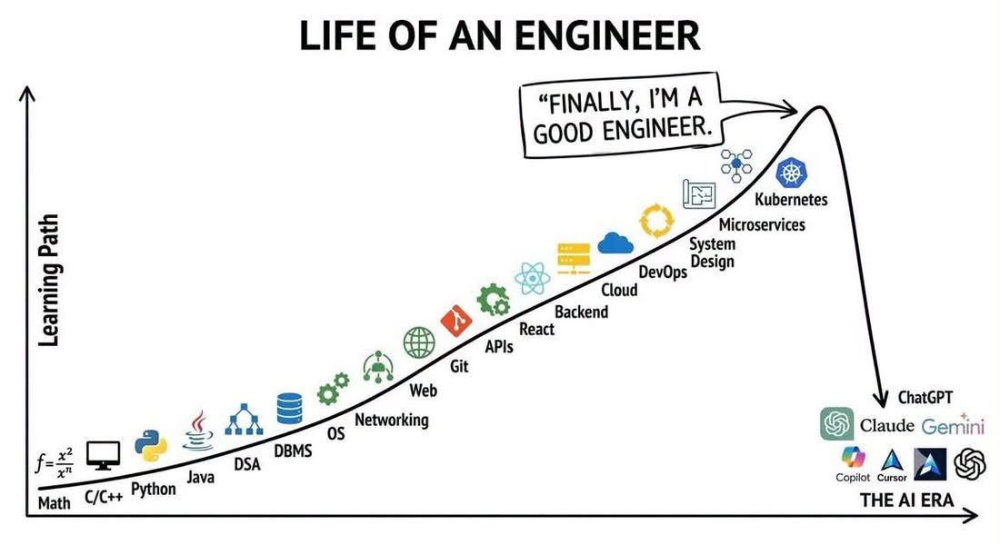

# 템플릿 쇼케이스 <small style="font-size: 36px; color: #a5c7f8; font-weight: normal;">Template Showcase</small>

홍길동 / 소속

Time Machine Conference 1955-11-12

---
class: speaker
---

  <h2>발표자</h2>

  
  
홍길동/ 소속 / Cloud Engineer

  

    Time Machine을 개발하는 업무를 하고 있습니다. 
    시간과 공간 테스트 관련 주제에 관심이 많습니다.
  

  

    발표자료 <a href="https://github.com/jmnote/slides" target="_blank" rel="noopener">https://github.com/jmnote/slides</a>
  

  

    

    <a href="https://github.com/jmnote" target="_blank" rel="noopener">jmnote</a>
  

---
class: timeline
---

  <strong>'24.09</strong>
  Cloud Native Korea Community Day 2024

  <strong>'25.05</strong>
  KCD Seoul 2025

  <strong>'25.10</strong>
  Cloud Native Korea Community Day 2025

  
'26.10 밋업

  
AI 관련 주제는 처음!

---
class: toc
---

# 목차
## 배경
## 분류 체계
## 관심 프로젝트 비교
## 마무리

---
class: section
---

  Ⅰ
  섹션 <small class="pen">T4: Divider</small>

---

<header class="slide-header">
  <h1>T5. 기본 본문형 <small>Header + Bullets</small></h1>
  추천: 60% 비중
</header>

용도: 일반적인 설명, 개념 요약, 목록 나열

### 핵심 메시지나 서브 타이틀

- **마크다운 본연의 간결함**: HTML 태그를 쓰지 않고 순수 불릿으로 작성
- **22px 이상 가독성 확보**: 슬라이드 전역에서 22px 크기를 유지하여 발표장 맨 뒤에서도 선명
- **손글씨 포인트 메모**: 발표자의 감상이나 부가설명은 ``으로 강조
- **코드 인라인 표기**: `kubectl get pods` 또는 `go test ./...`
- 복잡한 그리드 없이 상단 헤더와 자연스러운 줄바꿈만으로 깔끔하게 표현

  ※ 가장 단순하면서도 슬라이드 덱의 50~60%를 커버할 수 있는 만능 기본형!

---

---
class: hero-visual
---

  <h1>2026년 <small>AI 시대 실감</small></h1>
  
T6: 그림 하나가 65% 영역을 과감하게 장악하는 비대칭 매거진형

  <h3>작년과는 다르다…</h3>
  <ul>
    <li>코드를 직접 보는 일 대폭 감소</li>
    <li>Markdown 문서 중심 (가끔 테스트 코드)</li>
    <li>기업 코딩테스트 폐지 추세 (AI 활용 평가 대체)</li>
  </ul>

  
  
Claude Community - Facebook 2026-09-18

  

    <h3>Agent가 잘하는 것</h3>
    
코딩, 코드 리뷰, 테스트 코드 작성, 문서 작성, 설계, 로그 분석, 문의 대응, 신기술 탐색…

    
언어/도구 go, gh, kubectl, openstack cli… 그냥 다 잘함

    
아직 못하는 것? 내 마음에 드는 PPT 작성 ㅎ

  

  

    <ul>
      <li>- 수학/물리학 난제 해결</li>
      <li>- 보안 취약점 발견</li>
      <li>- 'AI 블루' / 'Claude Blue'</li>
    </ul>
    
약간의 허탈감과 위기의식?

  

---

<header class="slide-header">
  <h1>T7. 3열 카드형 <small>3 Cards Grid</small></h1>
  특수 비교형
</header>

용도: 3개 지표(AI Gauge), 3개 제품 비교, 3단계 파이프라인

  

    <h3>1단계: 질문/탐색</h3>
    
단순 질의응답 및 코드 검색 단계

    

      📊 탐색 수준: 30%
    

    ChatGPT 수준
  

  

    <h3>2단계: 코드 생성</h3>
    
함수 단위 코드 생성 및 테스트 자동화

    

      📊 완성 수준: 70%
    

    GitHub Copilot
  

  

    <h3>3단계: 자율 실행</h3>
    
도구 실행, 배포, 장애 복구 자율화

    

      📊 에이전트: 90%+
    

    AI Agent 시대
  

  🤔 <strong>통폐합 검토</strong>: 3열 카드가 꼭 필요할까요? 아니면 2열 분할 또는 표(Table)로 흡수 가능할까요?

---

<header class="slide-header">
  <h1>T8. 표 비교형 <small>Comparison Table</small></h1>
  정리/매트릭스형
</header>

용도: 기능 비교, 도구 목록, 환경 분석 (Agent 사용환경 등)

| 구분 | 일반 도구 (CLI / Script) | AI Agent 기반 도구 |
| :---: | :---: | :---: |
| **명령 실행** | 정해진 옵션과 파라미터만 허용 | 자연어 의도 해석 후 명령 자동 조합 |
| **예외 처리** | 에러 발생 시 즉시 중단 | 에러 로그를 분석하여 자체 재시도/우회 |
| **컨텍스트** | 단발성 세션 실행 | 이전 실행 맥락 및 저장소 규칙 기억 |

  ※ 표는 순수 마크다운 `|` 문법으로 작성되며, 헤더/줄간격/폰트(22px)는 CSS가 자동 제어

---

<header class="slide-header">
  <h1>📐 템플릿 통폐합 분석 매트릭스</h1>
  의사결정용
</header>

### 8개 템플릿 → 4개 핵심 축으로 압축 가능 여부

| 템플릿 구분 | 현재 후보군 | 통폐합 제안 | 이유 및 기대효과 |
| :---: | :---: | :---: | :--- |
| **필수 특수형** | T1(Cover), T2(Speaker), T3(TOC), T4(Divider) | **현행 유지** | 각 슬라이드덱당 정확히 1회씩만 나오는 필수 프레임 |
| **본문 기본** | T5(기본 본문형) | **기본형 (유지)** | 마크다운 본연의 생산성, 가장 많은 슬라이드 소화 |
| **2단 분할** | T6(2열 텍스트+이미지), T6-b(텍스트 대조) | **2단형 (유지)** | `
` 하나로 설명+그림 모두 해결 |
| **3단 카드** | T7(3열 카드 박스) | **👉 T8(표) or T6(2단)으로 통합 권장** | CSS 코드가 늘어나고 모바일/반응형에서 깨지기 쉬움 |
| **표 비교** | T8(표 비교형) | **표형 (유지)** | 마크다운 표 문법 자체를 22px로 스타일링해 재활용 |

  👉 결론: 본문은 사실상 <b>기본형(T5), 2열형(T6), 표형(T8) 3가지</b>만 있으면 37장 전체를 완성 가능!

